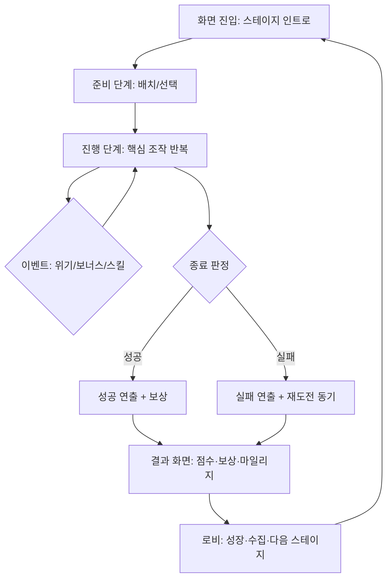
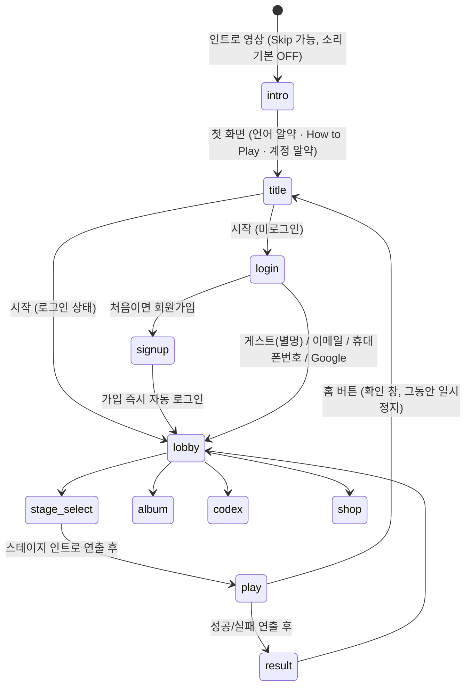

# 🎯 Universal Mini-Game Design Master Doc (v3.1)
*Universal Mini-Game Design Document — Form_2_1 Compliant*
***검증 참조 프로젝트: 『토이빌 디펜더스: 별빛축제 대작전』 (toyville-defenders) 최종 출시본 — Vite 8 + TypeScript 5.9 + Phaser 3.90 + DOM UI Layer + Firebase 13 + Vercel (실서비스 배포·검증 완료)***
*이전 버전: Design Master Doc v3.0 (Toyville 기획 단계 전용) → v3.1 (범용 템플릿 + 최종 결과물 교훈 반영)*

---

## 0. 문서 개요 및 사용 지침

### 0.1 이 문서의 위치 (문서 파이프라인)

```
01 Brainstorm  →  02/03 GDD(요약/상세)  →  04 AI Prompt Set  →  [05 Design Master Doc 3.1]  →  [06 Spec & Blueprint Form 2.1]  →  07/08 Agent 실행 프롬프트
```

* 본 문서는 **새로운 미니게임 아이디어가 브레인스토밍되고 기본 기획서(01~03)가 작성된 상태**를 전제로, 그 기획을 *실제로 출시 가능한 웹게임*으로 옮기기 위한 **최상위 게임 디자인 표준**이다.
* v3.0은 Toyville 한 작품의 기획 문서였다. v3.1은 **어떤 장르의 미니게임에도 그대로 쓰는 범용 템플릿**이며, Toyville 최종 결과물(코드·배포·실사용 피드백)에서 확인된 요소를 표준으로 끌어올렸다.
* 기술 구현 규격(폴더, 모듈, 코드 계약, DB, 배포, QA)은 **06 Form 2.1**이 담당한다. 본 문서는 *무엇을, 어떤 경험으로* 만들지를 정한다.

### 0.2 작성 규칙

| 표시 | 의미 |
| --- | --- |
| {중괄호} | 새 게임 기획 내용으로 채워 넣는 칸 |
| ✅ **검증됨** | Toyville 최종본에서 구현·배포·실기기 테스트로 확인된 방식 |
| 🟨 **표준 필수** | 신규 프로젝트에서 반드시 지켜야 하는 항목 |
| 🟦 **권장** | 장르에 따라 선택. 채택하지 않으면 이유를 기록 |
| ⚠️ **교훈** | Toyville 개발 중 실제로 발생한 문제와 그 해결책 |

### 0.3 절대 원칙 (Core Principles)

1. 🟨 **English-Only Code** : 소스 코드, 주석, 변수/파일명, 데이터 키, 이벤트 이름, 로그, DB 필드는 100% 영어. 화면 문구는 전부 i18n 키로만 출력한다.
2. 🟨 **3-Language UX (ko 기본 / en / ja)** : 사용자에게 보이는 모든 텍스트(버튼, 안내, 오류, 접근성 라벨, placeholder, 동영상 자막 대체 텍스트 포함)를 3개 언어로 제공하고, **재시작 없이 즉시 전환**되어야 한다. (§9)
3. 🟨 **3-Device Native Layout** : 데스크톱 / 모바일 가로 / 모바일 세로를 *각각 독립 설계*하고, 회전·리사이즈 시 **게임 진행 중에도 0.2초 이내** 자동 전환한다. 한 레이아웃을 늘리거나 줄여서 다른 기기에 쓰지 않는다. (§5)
4. 🟨 **Play-Area First** : 메인 게임 화면(플레이 영역)은 모든 기기에서 최대 크기로 보여야 한다. UI는 플레이 영역을 *둘러싸거나 위에 잠깐 겹칠 뿐* 잠식하지 않는다. (§6)
5. 🟨 **Zero-Occlusion & No-Overlap** : 메뉴·버튼·패널은 서로 겹치지 않고, 너무 작아지지 않는다(터치 44px, 글자 12px 이상). (§7)
6. 🟨 **Sound-Respectful** : 사운드는 기본 OFF, 사용자가 켜면 로그인 세션 동안 유지. BGM/효과음/UI음/영상 소리를 하나의 오디오 시스템이 관리한다. (§10)
7. 🟨 **Asset-Optional Playability** : 이미지·영상·오디오 파일이 하나도 없어도 플레이스홀더(이모지/도형/신스음)로 *게임 전체가 끝까지 플레이 가능*해야 한다. 에셋은 나중에 폴더에 넣기만 하면 자동 반영된다. (§11)
8. 🟨 **Stack Re-evaluation Mandate** : 아래 §1.3 참조. 엔진·앱 프레임워크·DB/백엔드·호스팅은 *기획서에 적힌 대로 고정하지 않고*, 코딩 에이전트가 개발 시작 시 반드시 재검토하여 선택하거나 변경할 수 있다.
9. 🟨 **Secret-Safe** : 비밀번호·관리자 자격 증명·비밀 키는 소스/문서/공개 저장소에 절대 쓰지 않는다. 관리자 UI는 관리자 ID로 로그인한 경우에만 보인다. (06 Form §12)
10. 🟦 **Tone Principle** : 장르 톤(예: Toyville의 *비폭력 힐링*)을 한 줄로 정의하고 연출·문구·사운드·실패 처리까지 일관되게 적용한다.

---

## 1. 프로젝트 메타 정보 (Master Overview)

### 1.1 기본 정보

| 항목 | 작성 칸 | Toyville 검증 사례 |
| --- | --- | --- |
| 게임명 (ko / en / ja) | { } | 토이빌 디펜더스: 별빛축제 대작전 / Toyville Defenders: Starlight Festival Rescue / トイビル・ディフェンダーズ |
| 영문 식별자 (ID) | {kebab-case} | toyville-defenders |
| 문서 버전 | Design Master Doc v3.1 | — |
| 장르 / 서브장르 | { } | 힐링 코믹 스토리 타워디펜스 |
| 한 줄 컨셉 (Elevator Pitch) | { } | 장난감 마을 주민들이 귀여운 사고뭉치 몬스터로부터 별빛 축제를 지킨다 |
| 톤 원칙 | { } | 비폭력 힐링 (사망·피·공포 금지, 실패도 코믹 해프닝) |
| 타깃 유저 | { } | 20~30대 캐주얼, 힐링·수집 선호 |
| 1판 플레이 시간 | { } | 3~5분 / 4 스테이지 |
| 지원 기기 | 데스크톱 · 모바일 가로 · 모바일 세로 (3종 모두 필수) | 동일 |
| 설치 형태 | 웹 + PWA 설치(모바일/데스크톱 아이콘) | 동일 |
| UX 언어 | ko(기본), en, ja | 동일 (키 500개) |
| 계정 | 게스트(별명) · 이메일 · 휴대폰번호 · Google | 동일 |
| 배포 | { } | GitHub(public) → Vercel 자동 배포, Firebase(Auth/Firestore/Storage) |

### 1.2 기본 추천 스택 (출발점 — 확정 아님)

| 영역 | 추천 기본값 | Toyville 최종 실사용 |
| --- | --- | --- |
| 빌드/앱 셸 | Vite + TypeScript (프레임워크 없는 DOM 화면 계층) | Vite 8 + TS 5.9 |
| 게임 렌더링 엔진 | Phaser 3 (2D 캔버스) | Phaser 3.90 (Three.js는 기획에 있었으나 **실제로 불필요하여 미사용**) |
| UI 계층 | HTML/CSS DOM 오버레이 (i18n·접근성·반응형에 유리) | 동일 |
| 백엔드/DB | Firebase Auth + Firestore + Storage | 동일 |
| 호스팅 | Vercel (GitHub 연동 자동 배포) | 동일 |
| 테스트 | Vitest + 헤드리스 Chrome(CDP) 화면 감사 | 동일 |

> ⚠️ **교훈** : v3.0 기획서는 "Phaser 3 + Three.js 하이브리드"를 명시했지만, 실제 구현에서는 **Phaser 캔버스(게임 필드) + DOM(모든 UI)** 구조가 더 단순하고 강력했다. 기획서의 기술 스택은 *가설*일 뿐이다.

### 1.3 🟨 기술 스택 재검토 의무 (Stack Re-evaluation Mandate)

개발 착수(Phase 0) 시, 코딩 에이전트는 다음 세 범주를 **반드시 재검토하고, 필요하면 선택 또는 변경**해야 한다. 기획서·본 문서·이전 프로젝트에 적힌 스택은 *기본 추천값*이며 강제 사항이 아니다.

| 범주 | 재검토 대상 예시 | 판단 기준 |
| --- | --- | --- |
| **① 엔진 프로그램 (게임 렌더링/물리)** | Phaser 3/4, PixiJS, Three.js, Babylon.js, PlayCanvas, Cocos Creator, Godot(Web Export), Unity(WebGL), Canvas 2D 직접 구현 | 2D/3D 여부, 오브젝트 수, 물리 필요성, 모바일 성능, 번들 크기, 텍스트/i18n 처리, 학습·유지보수 비용 |
| **② 사이트/앱 개발 프로그램 (앱 셸·UI 프레임워크)** | Vite + Vanilla TS, React/Preact, Vue, Svelte, Next.js, **Flutter(Web/모바일)**, Capacitor/Ionic(앱 패키징), Tauri/Electron(데스크톱) | 화면 수, 폼/계정 UI 복잡도, 앱스토어 배포 필요성, PWA 설치, SEO 필요성, 팀 숙련도 |
| **③ DB 프로그램 (백엔드·인증·저장)** | Firebase(Auth/Firestore/Storage), Supabase(Postgres/Auth/Storage), Appwrite, PocketBase, 자체 서버 + Postgres/MySQL | 인증 방식(게스트/이메일/휴대폰/소셜), 실시간성, 랭킹·통계 쿼리, TTL 자동 삭제, 보안 규칙, 무료 한도·비용, 지역 규제 |
| (부가) 호스팅/배포 | Vercel, Firebase Hosting, Netlify, Cloudflare Pages, 앱스토어 | 자동 배포, 환경 변수 관리, 도메인, 캐시 정책 |

* 🟨 재검토 결과는 06 Form §1의 **ADR(Architecture Decision Record)** 표에 *선택안 / 대안 / 선택 이유 / 변경 시 영향*으로 기록한다.
* 🟨 개발 도중이라도 치명적 제약(성능, 비용, 인증 요구사항 등)이 발견되면 에이전트는 변경을 제안·실행할 수 있다. 단, 변경 전 **사용자에게 이유와 영향 범위를 보고**한다.
* 🟨 스택이 바뀌어도 본 문서의 **경험 표준(3기기 레이아웃, 3개 언어, 사운드, 플레이 영역 최대화, 보안)** 은 그대로 유지된다.

---

## 2. 핵심 게임 디자인 (Core Design)

### 2.1 핵심 재미 정의

| 항목 | 작성 칸 | Toyville 사례 |
| --- | --- | --- |
| 핵심 재미 1문장 | { } | 주민을 보드에 끌어다 놓고, 사선을 고려해 배치를 바꾸며 웨이브를 막는 재미 |
| 핵심 조작 (Verb) | {예: 끌어다 놓기, 탭, 스와이프} | 드래그 배치 · 탭 정보 · 더블탭 실드 · 스킬 |
| 실패 조건 | { } | 생명 0 → 코믹 실패 컷씬 |
| 성공 조건 | { } | 마지막 웨이브/보스 방어 |
| 성장 루프 | { } | 행복 포인트·별조각 → 연구(영구 강화) · 무기 상점 |
| 수집 요소 | { } | 추억 앨범 · 도감 |

### 2.2 게임 루프 다이어그램 (작성 템플릿)



### 2.3 수치 설계 원칙

* 🟨 모든 밸런스 수치는 코드가 아니라 **데이터 파일(JSON)** 에 둔다 (economy.json, stages/\*.json, {entities}.json). ✅
* 🟨 핵심 전투/진행 로직은 렌더링과 분리된 **순수 모델(Model)** 로 작성해 단위 테스트가 가능해야 한다. ✅ (Toyville BattleModel + game.test.ts)
* 🟦 관리자 화면에서 난이도 배율을 실시간 조정할 수 있게 한다 (Admin Tuning). ✅
* 🟦 **마일리지(Lifetime Score)** : 소비되는 재화와 별개로, 누적 획득량을 영구 기록하는 지표를 둔다. 마이페이지에 표시하고 클라우드에 영구 저장한다. ✅

---

## 3. 세계관 · 캐릭터 · 스테이지 (작성 템플릿)

### 3.1 플레이어 측 캐릭터/유닛

| ID (영문) | 이름 (ko/en/ja) | 역할 | 행동/공격 | 고유 능력 | 대표 색상 | 에셋 상태 |
| --- | --- | --- | --- | --- | --- | --- |
| {id} | { } | { } | { } | { } | {#hex} | master.png / idle.mp4 |

### 3.2 적/장애물/보스

| ID | 이름 (ko/en/ja) | 이동/행동 패턴 | 기믹 | 처치·해소 연출 (톤 원칙 준수) |
| --- | --- | --- | --- | --- |
| {id} | { } | { } | { } | { } |

### 3.3 스테이지 매트릭스

| Stage | 이름 (ko/en) | 환경 | 핵심 기믹 | 목표물 | 보스 | BGM ID | 인트로/성공/실패 연출 |
| --- | --- | --- | --- | --- | --- | --- | --- |
| 1 | { } | { } | 튜토리얼 | { } | { } | stage01 | 영상 또는 그림책 컷씬 |

* 🟨 각 스테이지는 **인트로 / 성공 / 실패** 3개 연출을 가진다. 영상 파일이 있으면 영상, 없으면 대사 기반 그림책 컷씬으로 자동 대체한다. ✅
* 🟨 연출 대사는 모두 i18n 키로 작성한다 (cut.stage01.intro.1 등).

---

## 4. 화면 흐름 (Screen Flow)

### 4.1 표준 화면 상태도 (✅ Toyville 최종 흐름)



### 4.2 화면별 공통 요소 매트릭스 (🟨 작성 필수)

각 화면은 상단 시스템 바에 무엇을 보여줄지 **선언**한다 (06 Form §5 ScreenContext). 화면마다 즉흥적으로 버튼을 넣지 않는다.

| 화면 | 사운드 | 홈 | 언어 | 손잡이 | 메뉴(≡) | How to Play | 마이페이지·로그아웃 | 음악 |
| --- | --- | --- | --- | --- | --- | --- | --- | --- |
| Intro | ● | – | ● | – | – | – | – | 없음 |
| Title (첫 화면) | ● | – | 알약형 | – | ● | ● | ● (로그인 시) | title |
| Login / Signup | ● | 카드 내부 | ● | – | – | ● | – | title |
| Lobby | ● | ● | ● | – | ● | – | ● | lobby |
| Stage Select / Album / Codex | ● | ● | ● | – | ● | – | – | lobby |
| Play (Battle) | ● | ● (확인 창) | ● | ● | ● | (메뉴 내) | – | stage별 |
| Result | ● | ● | ● | – | ● | – | ● | 성공/실패 |
| My Page / Menu (모달) | – | 카드 내부 | – | – | – | – | 로그아웃 | 유지 |

* 🟨 **홈 버튼** : 첫 화면을 제외한 모든 화면·모달에서 첫 화면으로 돌아갈 수 있다. 처음 보일 때 "처음으로 돌아가기" 말풍선을 4~5초 보여준다. 게임 중에는 확인 창을 띄우고 **확인 창이 열린 동안 게임을 일시정지**한다. ✅
* 🟨 **계정 알약** : 로그인 후 첫 화면·로비·결과 화면 우상단에 [마이페이지][로그아웃]을 나란히 둔다. ✅

---

## 5. 🟨 기기별 화면 구성 표준 (3-Device Layout System)

### 5.1 레이아웃 프로필 정의와 판정 규칙

| 프로필 | 판정 규칙 (✅ Toyville) | 설계 기준 해상도 |
| --- | --- | --- |
| mobile-portrait | 화면 높이 > 너비 | 390×844 (iPhone 12~15) / 최소 360×640 |
| mobile-landscape | 가로 화면 + 터치 포인터(coarse) + 짧은 변 < 900px | 844×390 / 최소 640×360 |
| desktop | 그 외 (마우스·큰 화면) | 1280×720 / 1440×900 / 1920×1080 |

* 🟨 판정은 visualViewport 크기 기준, 리사이즈·회전 이벤트는 **150ms 디바운스**.
* 🟨 프로필이 바뀌면 html[data-layout] 속성 하나만 바뀌고, 모든 CSS·HUD 프리셋·게임 보드가 **같은 프레임에** 재배치된다.
* 🟨 회전 직후 **200ms 동안 입력 잠금** (회전 중 실수 터치 방지). ✅
* 🟨 게임 진행 중 회전해도 게임은 끊기지 않고 상태를 유지한 채 레이아웃만 전환된다 (Toyville 측정: 약 0.2초). ✅
* 🟦 관리자는 레이아웃을 강제 전환해 볼 수 있고, 실제 화면과 다르면 **기기 모양 프레임 안에 미리보기**로 보여준다. ✅

### 5.2 HUD 프로필 (기기별 UI 프리셋) — 어디서나 호출

기기별 수치를 CSS 여기저기에 흩지 않고 **하나의 프리셋 표**로 관리한다. 화면·게임 씬 어디서든 hudProfile()로 읽는다.

| 프리셋 항목 | desktop | mobile-landscape | mobile-portrait |
| --- | --- | --- | --- |
| 시스템 바 형태 | 1줄 | 1줄 | **2줄** (위: 원형 아이콘, 아래: 글자 알약) |
| 원형 시스템 버튼 크기 | 44px | 42px | 42px |
| 글자 알약 높이 / 글자 | 28 / 12px | 28 / 12px | 30 / 12.5px |
| 시스템 바 높이 (--sys-h) | 52px (실측) | 52px (실측) | 82px (알약 있을 때 실측) |
| 플레이 화면 하단 카드 바 | 96px | 70px | 128px (D-Pad·액션 포함) |
| 상세 정보 | 우측 고정 패널 300px | 우측 슬라이드 오버레이 | 하단 슬라이드 시트 |
| 방향 입력 | 키보드 | D-Pad + 액션 패드 (좌우 열) | D-Pad + 액션 패드 (하단 행) |

* 🟨 시스템 바 높이는 고정값을 가정하지 않고 **실측(ResizeObserver)하여 CSS 변수 --sys-h로 공개**한다. 모달·로비·플레이 화면은 이 변수로 바 아래에서 시작한다. ✅
* ⚠️ **교훈** : 바 높이를 "52px × 2" 같은 추정값으로 계산하면 알약 유무·언어에 따라 겹침이 생겼다. 실측 변수로 해결했다.

### 5.3 기기별 화면 배치 와이어프레임 (Play 화면)

**Desktop (16:9)**
```
+--------------------------------------------------------------------------+
| [🔇][🏠]          [HUD: 생명·재화·웨이브·배속]        [🫱R][Ko][≡]        |  ← --sys-h 행 (HUD와 시스템 바가 한 줄 공유)
+----------------------------------------------------------+---------------+
|                                                          |  상세 패널    |
|                 PLAY AREA (최대 크기)                    |  (300px 고정) |
|                                                          |               |
+----------------------------------------------------------+---------------+
| [카드 바: 유닛 슬롯 1~7]                                  | [스킬·확인]   |
+--------------------------------------------------------------------------+
```

**Mobile Landscape (오른손잡이 기본)**
```
+--------------------------------------------------------------------------+
| [🔇][🏠]       [HUD 46px]                               [🫱R][Ko][≡]      |
+---------+------------------------------------------------+---------------+
| 액션    |                                                |   D-Pad       |
| ✓ ✕    |              PLAY AREA                         |   ▲           |
| ⚡❄🎉  |                                                | ◀ ● ▶         |
| (122px) |                                                |   ▼ (122px)   |
+---------+------------------------------------------------+---------------+
| [카드 바 70px]                                                           |
+--------------------------------------------------------------------------+
```

**Mobile Portrait (오른손잡이 기본)**
```
+------------------------------+
| [🔇][🏠]        [🫱R][Ko][≡] |  ← 1줄: 원형 버튼
|   [How to Play][마이][로그아웃]|  ← 2줄: 글자 알약 (있을 때만)
+------------------------------+
| HUD (2줄 압축)               |
+------------------------------+
|                              |
|   PLAY AREA                  |
|   (보드를 세로로 전치)       |
|                              |
+------------------------------+
| [카드 바]                    |
+--------------+---------------+
| 액션 ✓✕⚡   |  D-Pad ▲◀●▶▼ |  ← 오른손잡이: 방향키가 오른쪽
+--------------+---------------+
```

### 5.4 🟨 손잡이(Handedness) 규칙

* **오른손잡이(기본값)** = 방향키(D-Pad)가 **오른쪽(오른손 엄지 쪽)**, 확인·스킬 버튼이 왼쪽. **왼손잡이** = 반대. ✅
* ⚠️ **교훈** : 초기 구현은 라벨과 실제 배치가 반대였다(오른손잡이인데 화살표가 왼쪽). 기획서에 *"오른손잡이 = 무엇이 오른쪽인가"* 를 반드시 명시한다.
* 🟨 로그인 사용자의 손잡이 선택은 **클라우드 저장**하여, 다른 기기에서 다시 로그인해도 유지된다. 신규 사용자는 오른손잡이로 시작한다. ✅

### 5.5 비게임 화면(타이틀·로그인·로비 등) 기기별 규칙

| 요소 | desktop | mobile-landscape | mobile-portrait |
| --- | --- | --- | --- |
| 타이틀 로고 | 한 줄 유지, 자동 축소 | 한 줄 유지, 자동 축소 | 한 줄 유지, 자동 축소 (최소 14px) |
| 시작 버튼 | 중간 크기, 한 줄 | 축소, 한 줄 | 약 50% 축소하되 **높이 ≥ 44px**, 한 줄 |
| 언어·도움말 알약 | 기본 | 기본 | 기본보다 17~23% 작게 |
| 로그인/가입 카드 | 중앙 카드 | 좌우 여백 줄인 카드, 세로 스크롤 허용 | 전체 폭 카드 |
| 로비 메뉴 버튼 | 하단 5열 | 하단 5열 | 하단 5열 (글자 2줄 허용) |

* ⚠️ **교훈** : "50% 축소" 같은 요구는 터치 최소 크기(44px)와 충돌할 수 있다. 축소 요구가 있어도 **터치 높이 44px 하한**을 지킨다.

---

## 6. 🟨 플레이 영역 최대화 프로토콜 (Play-Area Maximization)

메인 게임 화면을 사용자에게 *더 크고 선명하게* 보여주기 위한 표준이다.

### 6.1 구조 원칙

1. **캔버스는 전체 화면, 상호작용 보드는 남은 공간에 최대 맞춤** : 게임 캔버스는 화면 전체(배경·하늘·장식 포함)에 깔고, 실제 조작 보드는 DOM 레이아웃이 남겨 준 플레이 영역 사각형(playRect)에 **정수 타일 크기 최대값**으로 맞춘다. ✅
2. **플레이 영역 = 남는 칸 (minmax(0, 1fr))** : HUD·카드 바·패드는 고정 크기, 플레이 영역은 나머지 전부를 가진다. ✅
3. **세로 화면은 보드 전치(Transpose)** : 가로로 긴 보드를 세로 화면에서는 90° 전치해 그린다. 게임 로직 좌표는 그대로, 화면 좌표 변환만 바뀐다 (GridMapper). ✅
4. **상세 패널은 공간을 예약하지 않는다** : 모바일에서는 필요할 때만 슬라이드로 *겹쳐서* 나오고, 평소에는 플레이 영역을 넓게 쓴다. ✅
5. **HUD는 시스템 바와 행을 공유** : 데스크톱·가로 모드에서는 HUD를 시스템 바와 같은 줄에 두어 세로 공간을 아낀다. ✅
6. **배경은 플레이 영역 밖까지 연장** : 레터박스(검은 띠) 대신 같은 스테이지 배경이 화면 끝까지 이어진다.
7. **안전 영역(노치) 대응** : env(safe-area-inset-\*)를 모든 가장자리 UI에 적용한다. ✅

### 6.2 목표 수치 (v3.1 신규 기준)

| 지표 | desktop | mobile-landscape | mobile-portrait |
| --- | --- | --- | --- |
| 플레이 영역 / 전체 화면 면적 | ≥ 65% | ≥ 55% | ≥ 50% |
| 최소 타일(셀) 크기 | 56px | 40px | 40px |
| 핵심 오브젝트 최소 표시 크기 | 48px | 36px | 36px |
| 플레이 영역 위 상시 UI | 없음 | 없음 | 없음 (토스트·말풍선만 일시 표시) |

> Toyville 실측 기준선: 모바일 가로(844×390)에서 플레이 영역은 약 48%였다. 다음 프로젝트에서는 아래 기법으로 목표치를 달성한다.

### 6.3 확대 기법 체크리스트 (🟦 장르별 선택)

* [ ] **집중 모드(Focus Mode)** : 진행 단계에서는 카드 바·패드를 반투명 축소하고, 준비 단계에서만 크게 표시
* [ ] **패드 폭 축소 / 오버레이화** : 가로 모드 좌우 패드(122px)를 96px로 줄이거나 플레이 영역 가장자리에 반투명으로 겹침
* [ ] **전체 화면 버튼** : 모바일 브라우저에서 Fullscreen API 버튼 제공 (PWA 설치 시 기본 fullscreen)
* [ ] **핀치 줌 / 팬** : 보드가 큰 장르는 확대·이동 지원 (UI 버튼은 고정)
* [ ] **동적 HUD 압축** : 숫자만 남기고 라벨은 아이콘으로 대체 (세로 모드)
* [ ] **카메라 자동 프레이밍** : 액션 중심으로 살짝 줌인 (장르가 허용할 때)
* [ ] **해상도 대응** : devicePixelRatio 반영으로 고해상도 기기에서 선명하게 (성능과 균형)

---

## 7. 🟨 UI/UX 공통 규칙 (No-Overlap · Readability)

### 7.1 겹침 방지 · 최소 크기

| 규칙 | 기준 |
| --- | --- |
| 터치 대상 최소 크기 | 44×44px (모바일) |
| 최소 글자 크기 | 12px (관리자 전용 표시 11px 허용) |
| 메뉴·버튼 상호 겹침 | 0건 (3기기 자동 감사로 검증) |
| 모달 위치 | 시스템 바 아래(--sys-h)에서 시작, 내부 스크롤 |
| 세로 모드 상단 메뉴 | 2줄 배치 (원형 아이콘 / 글자 알약) |

### 7.2 Zero-Occlusion 메시지

* 🟨 게임 중 안내 문구는 플레이 영역 핵심부를 오래 가리지 않는다: **1.0초 유지 → 0.4초 축소 소멸**(v3.0 계승) 또는 하단 토스트.
* 🟨 튜토리얼 힌트는 플레이 영역 하단 가장자리에 말풍선으로, 핵심 오브젝트를 가리지 않는 위치에 둔다.

### 7.3 텍스트 품질

* 🟨 한국어 줄바꿈은 **단어 단위**(word-break: keep-all), 제목은 text-wrap: balance. ✅
* 🟨 로고·제목은 **한 줄 유지**, 넘치면 글자 크기를 자동 축소(언어 전환·회전·웹폰트 로딩 후 재계산). ✅
* 🟨 언어별 대표 폰트 지정 (ko: Jua / en: Nunito / ja: M PLUS Rounded 1c 등) — html[data-lang]으로 전환. ✅
* 🟦 큰 글씨 모드(접근성) 제공. ✅

### 7.4 디자인 일관성 점검

* 🟨 새 버튼·문구를 추가할 때 기존 디자인 토큰(색, 둥근 모서리, 그림자, 글꼴)을 사용한다.
* 🟨 개발 마무리 단계에서 **모든 화면 × 3기기 × 3언어 스크린샷**을 검토해 어색한 문구·잘림·겹침을 재디자인한다.

---

## 8. 계정 · 데이터 · 마이페이지 (Account & Data UX)

### 8.1 로그인 방식 (✅ Toyville 표준)

| 방식 | 사용자 입력 | 저장 정책 |
| --- | --- | --- |
| 게스트 | **별명 필수** (2~12자, 사용 중인 별명은 중복 불가) | 로그아웃하면 다시 찾을 수 없음, 별명은 즉시 재사용 가능, 서버 기록은 **100일 후 자동 삭제** |
| 이메일 | 이메일 + 비밀번호(+확인) | 영구 보관 |
| 휴대폰번호 | 국가번호 칸(기본 +82) + 번호 칸("10 1234 5678", -·공백 무관) + 비밀번호 | 영구 보관, **SMS 인증 사용 안 함** (휴대폰번호:비밀번호 방식) |
| Google | 팝업 로그인 | 영구 보관 |

* 🟨 로그인 화면: 게스트 시작 / Google / [이메일 | 휴대폰번호] 탭 / 로그인 / **"처음이면 회원가입"** 링크 / 카드 우상단 홈 버튼.
* 🟨 회원가입 화면: [이메일로 회원가입] [휴대폰번호로 회원가입] 두 버튼만 → 아이디·비밀번호·비밀번호 확인 → **가입 즉시 자동 로그인**.
* 🟨 용어: "전화번호"가 아니라 **"휴대폰번호"** 로 통일.

### 8.2 마이페이지

| 항목 | 표시 방식 |
| --- | --- |
| 계정 종류·별명 | 아바타 + 계정 종류 (게스트/이메일/휴대폰/Google) |
| 아이디 | 이메일 또는 +82 10 1234 5678 형식 |
| 비밀번호 | **●●●●●●●● 마스킹 + 변경 폼** (현재/새/확인). 비밀번호는 서버에 해시로만 저장되어 원문 표시가 불가능함을 안내 |
| 마일리지 | 누적 점수 카드 + 재화 칩 |
| 게스트 경고 | "로그아웃하면 이 별명과 마일리지를 다시 찾을 수 없어요 (100일 후 자동 삭제)" |

### 8.3 설정 저장 범위 분류 (🟨 기획 단계에서 결정)

| 범위 | 예시 | 저장 위치 |
| --- | --- | --- |
| 기기 설정 (로그아웃 후에도 유지) | 언어, 큰 글씨, 레이아웃 강제값 | 브라우저 localStorage |
| 로그인 세션 설정 | 사운드 ON/OFF (로그아웃 시 OFF로 복귀) | 세션 키 |
| 사용자 설정 (기기 간 동기화) | 손잡이, {게임별 선호} | 클라우드 사용자 문서 |
| 진행 데이터 | 스테이지 별점, 재화, 마일리지, 앨범 | 로컬 + 클라우드 병합 |

> ⚠️ **교훈** : 설정마다 "어디까지 기억해야 하는가"를 처음에 정하지 않으면, 나중에 "다시 로그인하면 유지되게 해 달라"는 수정이 반복된다.

---

## 9. 🟨 언어(i18n) 전체 처리 표준

### 9.1 범위 — 무엇을 번역하는가

| 대상 | 처리 |
| --- | --- |
| 버튼·제목·본문·안내 | i18n 키 |
| 오류 메시지 (인증 오류 코드 포함) | 오류 코드 → i18n 키 매핑 (auth.err.\*) |
| 입력 placeholder, aria-label, title 속성 | 속성 번역 (data-i18n-attr) |
| 동적 숫자·이름 | 매개변수 {name}, {count} |
| 컷씬 대사·화자 이름 | i18n 키 |
| How to Play(도움말) | i18n 키 (문단 단위) |
| PWA 매니페스트·메타 | 기본 언어(ko) + 영문 short_name |
| 게임 캔버스 안 텍스트 | 같은 t() 함수 사용, 언어 변경 이벤트에서 다시 그림 |
| 이미지 속 글자 | **금지** (이미지에는 글자를 넣지 않는다) |

### 9.2 동작 규칙

* 🟨 **기본 언어 결정** : 저장된 선택 → 브라우저 언어(ja/en) → ko. ✅
* 🟨 **즉시 전환** : 언어 버튼을 누르면 새로고침 없이 화면의 모든 data-i18n 요소, 캔버스 텍스트, 열린 모달까지 즉시 바뀐다. ✅
* 🟨 **기준 사전 = ko** : en/ja는 ko와 키 집합이 정확히 같아야 하며, 빌드 전 검사 스크립트(i18n:check)로 누락·잉여 키를 차단한다. ✅ (Toyville: 3개 언어 × 500키)
* 🟨 **누락 시 대체** : 현재 언어에 없으면 ko 문구 → 키 이름 순으로 대체 (화면이 비지 않게).
* 🟨 **언어 전환 위치** : 첫 화면은 3개 언어 알약 버튼, 그 외 화면은 시스템 바의 언어 버튼(Ko/En/Ja 순환).
* 🟨 **길이 대응** : 영어·일본어는 한국어보다 길거나 짧다. 버튼은 고정 폭 대신 최소 폭 + 줄바꿈 규칙, 로고는 자동 축소.
* 🟨 **키 네이밍** : {screen}.{element} (예: login.toSignup, mypage.pwChange, hud.wave).

### 9.3 번역 품질 체크

* [ ] 3개 언어로 모든 화면 스크린샷 검토 (잘림·겹침·어색한 줄바꿈)
* [ ] 존댓말/반말 톤 통일 (ko), 영어 대문자 규칙 통일, 일본어 장음·문장부호 통일
* [ ] 게임 고유 명사 표기표 (캐릭터·스테이지·재화) 작성

---

## 10. 🟨 사운드 전체 처리 표준

### 10.1 사운드 정책

| 정책 | 내용 |
| --- | --- |
| 기본 상태 | **OFF** (브라우저 자동재생 정책 + 사용자 배려) |
| 켜기 | 시스템 바 사운드 버튼. 켜면 **로그인 세션 동안 유지**(새로고침 포함), 로그아웃 시 OFF |
| 적용 범위 | BGM, 효과음, UI음, **동영상 소리**까지 한 버튼으로 |
| 일시정지 | 게임 일시정지·관리자 정지·탭 숨김 시 오디오도 정지/재개 |
| 대사 중 | BGM 덕킹(일시 음량 50%) |

### 10.2 오디오 구조

* 🟨 하나의 오디오 매니저가 Web Audio 그래프를 소유: **master → bgm / sfx / ui 버스** (기본 믹스 bgm 0.6 · sfx 0.8 · ui 0.7). ✅
* 🟨 **파일 우선, 신스 대체** : bgm\_{id}.mp3, sfx\_{id}.mp3 파일이 있으면 사용, 없으면 내장 절차적 신스로 재생. 게임은 소리 파일 없이도 완성된다. ✅
* 🟨 **화면이 음악을 선언** : 화면 컨텍스트의 music 값으로 화면 전환 시 자동 교체(페이드 0.6초). 보스 등장 시 보스 음악. ✅
* 🟨 **끊김 없는 루프** : 루프 길이 표(bgm_loops.json) + 디코더 앞쪽 무음 자동 건너뛰기. ✅
* 🟨 **연타 제한** : 같은 효과음은 45ms 이내 재발생 무시 (연사 캐릭터 소리 뭉침 방지). ✅
* 🟨 **동영상 등록** : 모든 &lt;video>는 오디오 매니저에 등록해 사운드 버튼·일시정지를 따르게 한다. ✅
* 🟦 **절차적 작곡 도구** : audio:compose로 BGM·효과음을 생성해 저작권 걱정 없는 기본 사운드를 확보. 이후 실제 음원으로 교체 가능. ✅

### 10.3 사운드 목록 템플릿

| 분류 | ID | 사용 시점 | 감성 | 길이 |
| --- | --- | --- | --- | --- |
| BGM | title, lobby, stage01..N, boss, ending | 화면/상황 | { } | 루프 30~90초 |
| UI | ui_tap, ui_confirm, ui_cancel | 버튼 | 짧고 가벼운 팝 | < 0.2초 |
| 게임 | {place}, {attack\_\*}, {hit}, {reward} | 핵심 조작 | { } | < 1초 |
| 이벤트 | stage_clear, stage_fail, boss_fanfare, combo | 결과/이벤트 | { } | 1~3초 |

(Toyville: BGM 8곡, 효과음 29종)

---

## 11. 비주얼 · 에셋 파이프라인 (Asset-Optional)

### 11.1 비주얼 원칙

* 🟨 **No Background** : 캐릭터·몬스터·소품은 크로마키(#00FF00) 원본 → 자동 투명화.
* 🟨 **No Text in Images** : 이미지에 글자 금지 (다국어 대응).
* 🟨 **No Baked Shadow** : 그림자는 게임에서 동적으로.
* 🟨 생성 도구 워터마크는 변환 시 자동 제거 (despeckle, delogo, 크롭).

### 11.2 에셋 투입 흐름 (✅ Toyville)

```
AI 생성 도구 결과물 → raw_assets/{정해진 폴더/파일명} 에 넣기
  → 개발 서버가 감지 → 크로마키 제거 · 스프라이트 시트 · 아이템 시트 분할 · WebP 변환
  → public/assets/ 생성 + 에셋 목록(manifest.json) 갱신
  → 화면에 "새 에셋이 준비됐어요" 알림 → 새로고침 시 반영
  (파일이 없으면 이모지/도형 플레이스홀더로 계속 플레이)
```

### 11.3 에셋 목록 템플릿

| 분류 | 파일명 규칙 | 규격 | 없을 때 대체 |
| --- | --- | --- | --- |
| 캐릭터 원본 | characters/{id}/master.png, idle.mp4 | 1:1 / 16:9 4초 | 이모지 |
| 스프라이트 시트 | 자동 생성 anim/{id}/idle.webp+json | 256px 프레임, 48프레임, 8열, 12fps | 정지 이미지 |
| 배경 | stages/{sid}/sky_far, ground_tile, props_sheet | 2:1 / 1:2 / 3:2 | 그라데이션 |
| 아이템 시트 | items/sheet\_\*.jpg (그리드 배치 정의 JSON) | 그리드 | 이모지 |
| 동영상 | videos/intro\_\*.mp4, stageNN_intro/success/fail.mp4 | 16:9 H.264 | 그림책 컷씬 |
| 오디오 | audio/bgm\_\*.mp3, sfx\_\*.mp3 | 44.1kHz | 신스 |
| 설치 아이콘 | icons/source/mobile-source, desktop-source | 1024² | (필수) |

### 11.4 동영상 연출 규칙

* 🟨 화면 비율이 영상과 달라도 검은 띠 대신 **같은 영상을 흐리게 깐 배경 + 중앙 원본**으로 보여준다. ✅
* 🟨 모든 영상에 Skip 버튼, 기본 음소거, playsinline.

### 11.5 설치 아이콘 (PWA)

| 종류 | 디자인 규칙 |
| --- | --- |
| 모바일 | 가장자리까지 채운 정사각형 그림(둥근 모서리 금지 — OS가 자름), 주인공 얼굴 중심 |
| 안드로이드 maskable | 핵심 피사체를 중앙 80% 안전 영역 안에 |
| 데스크톱 | 투명 배경 위 둥근 타일 + 은은한 그림자, 16~32px에서도 식별 가능한 실루엣 |

---

## 12. 관리자 기능 (Admin)

* 🟨 관리자 판정은 **환경 변수의 관리자 ID 목록**으로만 한다 (예: 이메일, 휴대폰 별칭). 소스에 ID·비밀번호를 하드코딩하지 않는다.
* 🟨 관리자 UI(Admin Page, Pause/Go, 레이아웃 강제 전환, FPS, 치트 콘솔 ~, 전체 스테이지 열기)는 **관리자 로그인 시에만** 표시.
* 🟨 Pause/Go는 게임·영상·사운드를 모두 정지.

---

## 13. 데이터 로그 · 분석 (선택)

```json
{
  "eventType": "STAGE_CLEAR",
  "uid": "{firebaseUid}",
  "stageId": "stage01",
  "playTimeSec": 240,
  "result": { "stars": 3, "happiness": 150, "bonus": 12 },
  "device": { "layout": "mobile-portrait", "lang": "ko" },
  "timestamp": "{serverTimestamp}"
}
```

* 🟦 레이아웃·언어 정보를 로그에 포함하면 기기별 이탈 분석이 가능하다.
* 🟦 Analytics는 운영(production) 빌드에서만 켠다. ✅

---

## 14. 출시 · 운영

| 항목 | 표준 |
| --- | --- |
| 저장소 | GitHub (공개 저장소라면 비밀 정보 절대 금지) |
| 배포 | Vercel 자동 배포 (main 푸시 → 운영) |
| 환경 변수 | 공개 가능한 클라이언트 설정만 Vercel에 등록, 개발용 비밀번호류는 등록 금지 |
| 소셜 로그인 | 배포 도메인을 인증 서비스의 승인 도메인에 추가 |
| 설치 | PWA (매니페스트 + 아이콘 + 서비스 워커) |
| 유지 | 서버리스(Vercel/Firebase)로 상시 운영 — 개발 PC 상태와 무관 |

---

## 15. 완료 정의 (Definition of Done) — 기획 관점

- [ ] 3기기 × 모든 화면에서 겹침 0건, 터치 44px·글자 12px 이상
- [ ] 게임 진행 중 회전 시 상태 유지 + 0.2초 내 레이아웃 전환
- [ ] 플레이 영역 목표 면적(§6.2) 달성 또는 미달 사유 기록
- [ ] 3개 언어 키 동일, 즉시 전환, 이미지 속 글자 없음
- [ ] 사운드 기본 OFF, 세션 유지, 영상 포함 일괄 제어
- [ ] 에셋 0개 상태에서도 처음부터 엔딩까지 플레이 가능
- [ ] 게스트/이메일/휴대폰/Google 로그인, 가입 즉시 로그인, 마이페이지, 로그아웃
- [ ] 홈 버튼 모든 화면, 게임 중 확인 창 + 일시정지
- [ ] 관리자 UI는 관리자 ID에서만 표시
- [ ] PWA 설치(모바일·데스크톱 아이콘) 동작
- [ ] 기술 스택 재검토 결과(ADR) 기록 완료

---

## 16. [복사해서 쓰는] AI 코딩 에이전트 디자인 지시문

```text
[AI Agent Design Directive — Design Master Doc v3.1]
당신은 '{게임명 영문}' ({genre}) 웹 미니게임의 수석 개발 에이전트입니다.
기획 문서 01~04와 본 Design Master Doc v3.1, 기술 규격 06 Form 2.1을 기준으로 개발합니다.

[Phase 0 — 반드시 먼저 수행]
1. 엔진 프로그램(Phaser/PixiJS/Three.js/Godot Web 등), 앱 개발 프로그램(Vite+TS/React/Flutter/Capacitor 등),
   DB 프로그램(Firebase/Supabase/Appwrite 등)과 호스팅을 이 게임 요구사항 기준으로 재검토하고,
   선택 또는 변경한 결과를 ADR 표로 보고한 뒤 개발을 시작하십시오. 기본 추천값은 강제가 아닙니다.

[경험 표준 — 스택과 무관하게 필수]
2. 3기기 레이아웃(desktop / mobile-landscape / mobile-portrait)을 각각 설계하고, 회전 시 게임 중에도 즉시 전환.
   기기별 수치는 HUD 프로필 하나로 관리하고, 시스템 바 높이는 실측 변수로 공개.
3. 플레이 영역 최대화: 캔버스 전체 화면 + 보드는 남은 영역에 최대 정수 타일로 맞춤, 세로 화면 보드 전치,
   상세 패널은 오버레이. 목표 면적 비율을 측정해 보고.
4. 겹침 0건, 터치 44px, 글자 12px 이상, 세로 모드 상단 메뉴 2줄.
5. 모든 문구 ko/en/ja i18n 키(속성·오류·컷씬 포함), 즉시 전환, 키 동일성 검사 스크립트.
6. 사운드 기본 OFF·세션 유지, bgm/sfx/ui 버스, 파일 우선·신스 대체, 화면별 음악 선언, 영상 소리 포함 일괄 제어.
7. 에셋 없이 끝까지 플레이 가능, raw_assets 투입 시 자동 변환·반영.
8. 계정: 게스트(별명, 100일 TTL), 이메일, 휴대폰번호(국가번호, SMS 없음), Google, 마이페이지, 홈 버튼.
9. 비밀 정보는 소스·문서·저장소에 절대 쓰지 말고, 관리자 UI는 관리자 ID에서만 표시.
10. 100% English Code. 완료 시 3기기 × 3언어 스크린샷 감사와 테스트 결과를 보고.
```
