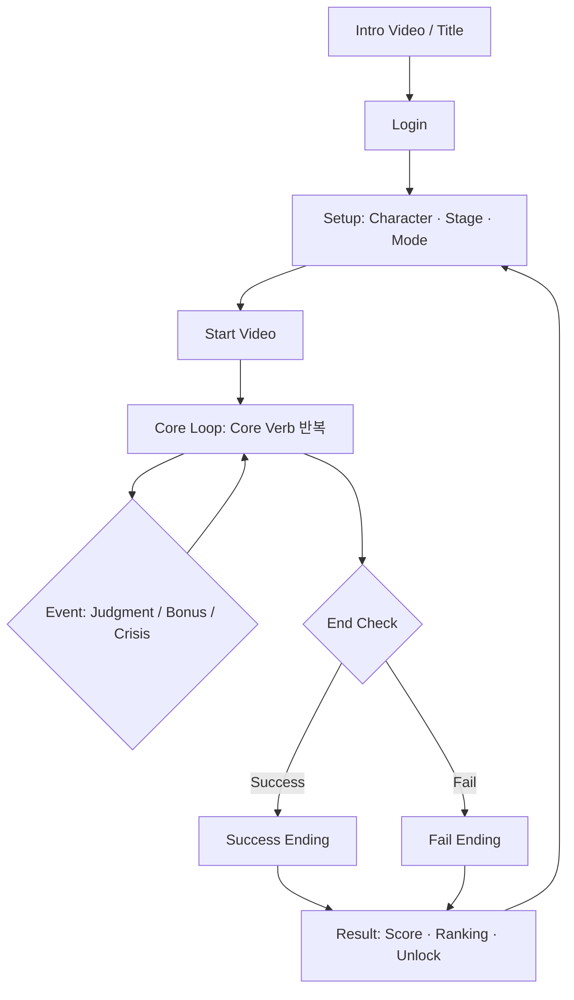
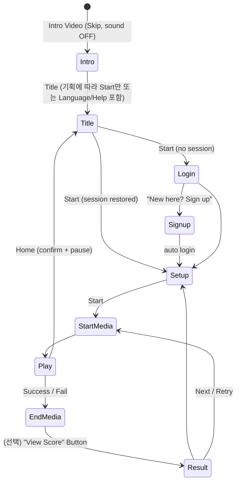

# 🎯 Universal Mini-Game Design Master Doc (v4.1)
*Universal Mini-Game Design Document — Form 4.1 Compliant*
***검증 참조 프로젝트 ✅: 『토이빌 디펜더스: 별빛축제 대작전』 (toyville-defenders) — Vite + TypeScript + Phaser 3 + DOM UI + Firebase + Vercel (출시·운영 검증 완료)***
***검증 참조 프로젝트 ✅: 『Real Court Tennis』 (real-court-tennis / realcourttennis) — Vite + TypeScript + Three.js + DOM UI + Firebase + Vercel + PWA (구현·점검 업그레이드 검증 완료, X44)***

**Header Verification (v4.1)**

* ✅ Toyville Defenders — Vite+TS+Phaser+DOM+Firebase+Vercel (W2D)
* ✅ Real Court Tennis — Vite+TS+Three.js+DOM+Firebase+Vercel+PWA (W3D) — implementation verified (NOT Unity/Supabase); Inspection Upgrade X44 applied

*이전 버전: v3.0 (Toyville 기획 전용) → v3.1 (Web 2D 범용 템플릿) → v4.0 (Web 2D + Native 3D 공통 범용 템플릿, RCT는 Unity 설계 가정) → **v4.1 (Web 2D + Web 3D 구현 검증 반영, RCT = W3D 실증)** → **v4.1 Inspection Upgrade (2026-11-16, X44)***

---

## 0. 문서 개요 및 사용 지침

### 0.1 이 문서의 위치 (Document Pipeline v4.1)

```
01 Brainstorm
  → 02 Project Concept
  → a01~a15 Detail Spec Set (GDD, System, Physics/Core Rule, Input, UI/UX, Character, AI, Art, Audio, TDD, Backend, Project Structure, Agent Guide, Data Table, Balance)
  → [05 Design Master Doc 4.1 (본 문서: 무엇을, 어떤 경험으로)]
  → [06 Spec & Production Blueprint Form 4.x (어떻게 만들고 검증하는가)]
  → 07 Cursor AI Agent Master Execution Prompt (프로젝트 전용 단일 실행 지시서)
  → Agent 산출물: docs/ADR.md · docs/DECISIONS.md (X## 결정 로그) · Phase Reports
  → (선택) Flow/AI 생성 Prompt 08·09 → raw_assets → build → public/assets
```

* 본 문서는 **새 미니게임의 Brainstorm·Concept·Detail Spec이 작성된 상태**를 전제로, 그 기획을 *출시 가능한 게임*으로 옮기기 위한 **최상위 Game Design 표준**이다.
* 기술 구현 규격(Folder, Module, Code Contract, DB, Deploy, QA)은 **06 Form 4.x**가 담당한다.
* 프로젝트별 최종 실행 지시서는 **07**로 작성한다. 07은 05·06을 해당 게임에 맞게 "결정된 값"으로 채운 문서다 (§17).
* 07 착수 이후의 결정은 07을 고치지 않고 **docs/DECISIONS.md (X## 번호)** 에 누적한다 (§0.5).

### 0.2 v4.0 → v4.1 주요 변경 (Changelog)

| 영역 | v4.0 | v4.1 |
| --- | --- | --- |
| W3D 검증 | RCT는 Unity N3D로 설계만 완료 (🧪) | **RCT가 Vite + TS + Three.js + Firebase + Vercel + PWA로 구현·검증 (✅ W3D)**. W3D Profile이 검증 Stack이 됨 (§1.2) |
| Stack 재검토 결과 | "재검토 의무"만 규정 | **Unity → Three.js, Supabase → Firebase** 실제 전환 사례를 ADR 사례로 수록 (§1.3). 전환 근거: Sports-lite 3D, AI Video Sprite, PWA 우선, 단일 Web 배포 |
| AI Motion Sprite 경로 | Humanoid Rig 중심 (Native) | **AI 생성 Motion Sprite(Video → Frame Sequence → Billboard)** 를 W3D의 정식 Character 경로로 추가 (§11.1, §11.5) |
| Asset Inbox | raw_assets 일반 규정 | **raw_assets → build → public/assets** 3단 흐름 + Flow Prompt 08/09 + Manifest + Placeholder 유지 (§11.2) |
| 문서 서식 | Markdown 전용 | **Plain Markdown 교훈**: Narrative에 inline backtick·LaTeX 사용 지양 (일부 Viewer 깨짐). Fenced block은 허용 (§0.4, X26) |
| 결정 기록 | 07 Conflict Log → DECISIONS.md 이관 | **post-07 결정은 docs/DECISIONS.md의 X## ID**로, Stack 변경은 ADR로 (§0.5) |
| Play Level / 자동화 | Skill Model 비율만 (Auto 70 / Stroke 20 / Timing 10) | **Play Level (Beginner / Middle / Master)** 로 자동화 보조량을 단계화하되 Skill Ceiling 유지 (§2.3, §2.6) |
| Camera Framing | 🧪 수식 설계 | **✅ Verified (W3D)**: Ball off-screen % 등 측정 Metric + Validator Test (§6.3) |
| Auth | Alias Email, Guest 100일 TTL 기술 | **Phone Alias Email, Guest Nickname Reclaim + 100d TTL, Admin Allowlist** 설계 수준 패턴 정리 (§8, §13) |
| HUD / System Bar | System Bar 실측 높이 | **One-Viewport HUD/Sysbar**: 3기기 모두 한 Viewport 안에서 Scroll 없이 HUD·System Bar가 완결 (§5.2, §7.1) |
| Inspection Upgrade (X44) | 점검 보고서의 P0~P2 요청과 구현 Gap | **체감·게임성 보강 검증**: Perfect Hit mid juice, Haptic, Audio silent-buffer Unlock, Desktop IJKL/Numpad, Character Passives, AI Corner+Comeback, Deuce/Match Point HUD, Rally Crowd, Firebase localStorage Pending Queue. Letterbox 금지·스태미나 UI 스킵 유지 (§2.5, §3.1~3.2, §7.3, §8.5, §10) |

### 0.3 작성 규칙 및 표시

| 표시 | 의미 |
| --- | --- |
| {중괄호} | 새 게임 기획 내용으로 채워 넣는 칸 |
| ✅ **Verified** | Toyville(W2D) 또는 Real Court Tennis(W3D)에서 구현·배포·Test로 확인된 방식 |
| 🧪 **Designed** | 아직 구현 검증이 없는 Native / N3D 경로 등 설계 수준으로만 예약된 방식 |
| 🟨 **표준 필수** | 신규 프로젝트에서 반드시 지켜야 하는 항목 |
| 🟦 **권장** | 장르에 따라 선택. 채택하지 않으면 이유를 기록 |
| ⚠️ **교훈** | 실제 개발·설계 중 발견된 문제와 그 해결책 |

* 표 안의 "✅ Toyville" 열은 W2D 검증 값, "✅ RCT" 열은 W3D 검증 값이다.
* 🧪는 v4.1에서 **Native/N3D 경로(Unity, Store Build, Apple Login, Account 삭제 등)에만** 남는다. RCT는 더 이상 🧪 대상이 아니다.

### 0.4 🟨 Document Language & Format Policy

| 대상 | 규칙 |
| --- | --- |
| 모든 기획·개발 문서 | **Markdown(.md) 전용**. 다른 형식(docx, pdf, txt)으로 원본을 만들지 않는다 |
| 문서 본문 | 한국어. **기술 용어는 영어로만 표기**한다 (예: "레이아웃" → Layout, "충돌 판정" → Hit Detection, "상태 머신" → State Machine) |
| Source Code · Comment · Identifier · Data Key · Log · DB Field · Commit Message | **100% English** |
| 사용자에게 보이는 UX / UI / HUD / Error / 접근성 Label / Video 대체 Text | **ko(기본) · en · ja**, Localization Key로만 출력 |
| Agent → 사용자 보고 | 사용자의 언어, 기술 용어는 영어 |
| 파일명 | {번호}\_{Title_Words}\_{project-id 또는 version}.md (예: 07_Cursor_AI_Agent_Master_Execution_Prompt_realcourttennis.md) |
| Markdown 서식 (Plain Markdown) | Narrative 문장에서 inline code backtick과 LaTeX 수식을 쓰지 않는다. 식별자·경로·수식은 일반 텍스트 또는 Fenced code block으로 쓴다 |

> ⚠️ **교훈 (RCT)**: a13 Agent Guide는 "물리 로직에 한글 주석 필수"를 요구했지만, 05/06의 English-Only Code 원칙과 충돌했다. → **Comment도 English**로 통일하고 Conflict Log에 기록했다.

> ⚠️ **교훈 (RCT, Plain Markdown, X26)**: 문서 본문에 inline backtick(예: 파일명, 함수명)과 LaTeX 수식을 섞었더니 일부 Markdown Viewer(Preview, Chat UI, 일부 Wiki)에서 기호가 깨지거나 수식이 그대로 노출됐다. → 본문은 **Plain text 우선**으로 쓴다. 예: D / (D + Delta) = 비율 처럼 일반 텍스트 수식으로 쓰고, 코드·명령·Tree는 **Fenced block**으로만 둔다. Fenced block은 모든 Viewer에서 안전하다.

### 0.5 🟨 Source of Truth Precedence & Conflict Resolution Protocol

문서가 여러 개로 나뉘면 **반드시 충돌이 생긴다**. 07 작성 시 아래 절차를 따른다.

**우선순위 (위가 이긴다)**

| 순위 | 문서 |
| --- | --- |
| 1 | 사용자의 최신 지시 |
| 2 | 프로젝트 07 (Conflict Resolution Log 포함) + docs/ADR.md + docs/DECISIONS.md (07 이후 결정) |
| 3 | 05 / 06 (경험 표준·구조·보안·QA) |
| 4 | a01~a15 (게임 세부 사양·수치) |
| 5 | 02 Project Concept |
| 6 | 01 Brainstorm (원초 의도 — 해석이 갈릴 때 근거) |

**절차**

1. 07 작성자는 모든 원천 문서를 정독하고 **충돌 목록**을 만든다 (Stack, 규칙, 수치, 화면 구성, 용어, 언어).
2. 각 충돌을 **Conflict Resolution Log** 표(# · 충돌 내용 · 결정 · 근거)로 07 앞부분에 기록한다.
3. 어떤 문서에도 없는 필수 규칙(예: RCT의 Serve 규칙)은 **Gap**으로 기록하고 기본안을 제시한다.
4. 사용자 판단이 필요한 항목은 **Open Decisions** 표(적용한 기본값 · 대안)로 남기고, 기본값으로 개발을 진행한다.
5. Agent는 이 Log를 docs/DECISIONS.md로 이관하고 이후 결정을 누적한다.

**07 이후 결정 기록 (v4.1 추가)**

| 상황 | 기록 위치 | ID 규칙 |
| --- | --- | --- |
| 07 작성 중 발견한 문서 간 충돌 | 07 Conflict Resolution Log | C01, C02 … |
| 07 작성 중 사용자 판단 대기 항목 | 07 Open Decisions | D01, D02 … |
| **07 이후** 구현 중 내린 모든 결정 (규칙, 수치, UX, 서식, 자산 경로, 인증 등) | **docs/DECISIONS.md** | **X01, X02 …** (번호는 중복·재사용 금지) |
| **Stack 변경** (Engine, App Framework, Backend, Hosting) | **docs/ADR.md** + DECISIONS.md에 X## 링크 | ADR-001, ADR-002 … |

* 🟨 DECISIONS.md의 각 X## 항목은 {날짜 · 결정 · 이유 · 영향 범위 · 되돌리는 방법}을 한 줄 이상 가진다.
* 🟨 07의 내용을 조용히 덮어쓰지 않는다. 07과 달라지는 결정은 반드시 X## 로 남기고 07을 참조한다.
* 🟨 Stack 변경은 사용자에게 먼저 보고한다 (Gate G0). 구현 후에도 Stack이 바뀌면 ADR을 새로 쓴다.

> 🧪→✅ **RCT 사례**: 07 단계에서 20건의 충돌(C01~C20)과 14건의 Open Decision(D01~D14)을 기록했다. 대표 사례 — "Racket 가장자리 25% = Out"(01)과 "9분할 3×3"(a03)을 **바깥 25% Fault Ring + 안쪽 3×3 Shot Zone**으로 통합. 이후 Unity → Three.js, Supabase → Firebase 전환과 Plain Markdown(X26) 같은 결정은 ADR과 DECISIONS.md의 X## 로 누적했다.

### 0.6 절대 원칙 (Core Principles)

1. 🟨 **English-Only Code** — 화면 문구는 전부 Localization Key로만 출력. ✅
2. 🟨 **3-Language UX (ko 기본 / en / ja)** — Restart 없이 즉시 전환, Key 집합 동일성 자동 검사. ✅
3. 🟨 **3-Device Native Layout** — desktop / mobile-landscape / mobile-portrait를 각각 독립 설계. Gameplay 중 회전해도 상태 유지 + 0.2초 이내 전환. ✅
4. 🟨 **Play-Area First** — 2D는 Board 최대화, 3D는 Camera Framing 조건 충족. UI는 핵심 Play 영역을 잠식하지 않는다. ✅
5. 🟨 **Zero-Occlusion & No-Overlap** — UI 상호 겹침 0건, Touch Target ≥ 44 px(dp), Text ≥ 12 px(dp). 한 Viewport 안에 HUD와 System Bar가 완결된다. ✅
6. 🟨 **Sound-Respectful** — 기본 OFF, 켜면 Login Session 동안 유지, BGM/SFX/UI/Video를 하나의 Audio System이 관리. ✅
7. 🟨 **Asset-Optional Playability** — 이미지·Model·Animation·영상·오디오가 없어도 Placeholder로 처음부터 끝까지 플레이 가능. ✅
8. 🟨 **Stack Re-evaluation Mandate** — Engine / App Framework / Backend / Hosting은 Phase 0에서 Agent가 재검토하고 ADR로 기록. ✅ (Toyville, RCT 모두 실제 변경 또는 확인 사례 보유)
9. 🟨 **Secret-Safe** — Secret Key·Password·Admin Credential을 Source·문서·Repository·Client Build에 절대 포함하지 않는다. Admin UI는 Admin 권한에서만 표시. ✅
10. 🟨 **Testable Deterministic Core** — Game Rule·판정·AI는 Rendering과 분리된 Pure Model + Fixed Tick + Seeded RNG + Unit Test. ✅
11. 🟨 **Data-Driven Balance** — 모든 Balance 수치는 Data File(CSV/JSON)에. ✅
12. 🟨 **Document Integrity** — Markdown 전용, Plain Markdown 서식, 충돌은 Log로 해결, Gap과 Open Decision을 명시, post-07 결정은 X## 로 기록. ✅
13. 🟨 **Measurable Acceptance** — "크게", "자연스럽게" 같은 요구는 **측정 가능한 수치 조건**으로 바꿔 쓴다 (예: Play-Area 면적 비율, Camera 투영 위치, Ball off-screen %, Timing Window ms). ✅
14. 🟦 **Tone Principle** — 장르 톤을 한 줄로 정의하고 연출·문구·사운드·실패 처리까지 일관 적용 (Toyville: 비폭력 힐링 / RCT: 밝고 청량한 여름 Sports + 사실적 몰입감).

---

## 1. 프로젝트 메타 정보 (Master Overview)

### 1.1 기본 정보

| 항목 | 작성 칸 | ✅ Toyville (W2D) | ✅ Real Court Tennis (W3D) |
| --- | --- | --- | --- |
| 게임명 (ko / en / ja) | { } | 토이빌 디펜더스 / Toyville Defenders / トイビル・ディフェンダーズ | 리얼 코트 테니스 / Real Court Tennis / リアルコートテニス |
| Project ID | {kebab-case} | toyville-defenders | real-court-tennis / realcourttennis (Firebase·Vercel Project 및 Repository 폴더명) |
| 장르 | { } | Healing Comic Story Tower Defense | 3D Eye-Level Sports Mini Game |
| Elevator Pitch | { } | 장난감 마을 주민이 별빛 축제를 지킨다 | Bird View가 아니다. 직접 코트에 서서 플레이하라 |
| Tone Principle | { } | 비폭력 힐링 | 밝고 청량한 여름 Sports + 사실적 몰입감 |
| 타깃 | { } | 20~30대 Casual | 일본·글로벌 10~40대 Casual |
| 1판 시간 | { } | 3~5분 / 4 Stage | 1.5~3분 / 10 Stage |
| Platform | { } | Web + PWA | Web + PWA (+ Capacitor 이후 선택) |
| 기본 Orientation | { } | 모두 | Mobile Landscape 우선(권장), 단 desktop / mobile-landscape / mobile-portrait 3 Layout 모두 지원 |
| UX 언어 | ko(기본) · en · ja | 동일 | 동일 |
| Account | { } | Guest · Email · Phone · Google | Guest · Email · Phone(Alias Email, SMS 없음) · Google |
| Backend | { } | Firebase | Firebase (Auth + Firestore) |
| Frontend Stack | { } | Vite + TypeScript + Phaser 3 + DOM UI | Vite + TypeScript + Three.js + DOM UI |
| Hosting | { } | Vercel | Vercel |

> ⚠️ **교훈 (RCT)**: v4.0의 RCT 열(Unity 6 / Supabase / Android·iOS)은 07 시점의 가정이었다. 실제 구현은 Web + PWA + Firebase로 확정·검증되었으므로 v4.1은 **구현된 값**을 기준으로 한다. 가정과 검증 값이 다를 때는 ADR과 DECISIONS.md에 이유를 남긴다.

### 1.2 🟨 Project Archetype → Default Stack Profile

먼저 게임을 Archetype으로 분류하고, 06 Form 4.x의 Default Stack Profile을 출발점으로 삼는다. **확정이 아니라 출발점**이다 (§1.3).

| Archetype | 특징 | Default Stack Profile (06 §1) | 참조 |
| --- | --- | --- | --- |
| **W2D** Web 2D Casual | Puzzle, Defense, Runner, Board | Profile **W2D**: Vite + TypeScript + Phaser + DOM UI + Firebase + Vercel + PWA | ✅ Toyville |
| **W3D** Web 3D Light | Sports-lite, 적은 Animation, AI Video Sprite, PWA 우선 | Profile **W3D**: Vite + TypeScript + Three.js + DOM UI + Firebase + Vercel + PWA (+ Capacitor 선택). Babylon.js는 대안 | ✅ RCT |
| **N3D** Native 3D Sports/Action | Humanoid Rig Animation, 복잡한 Shader, Store 출시 필수, 60 FPS 고정 | Profile **N3D**: Unity 6 LTS URP + UI Toolkit + Input System + Supabase/Firebase + WebGL(Desktop) | 🧪 (선택 Archetype, RCT 검증 아님) |
| **N2D** Native 2D | Store 우선 2D | Profile **N2D**: Unity 2D / Godot / Flutter + Flame | 🧪 |

* ✅ W3D Profile은 Real Court Tennis로 검증되었다: Three.js Scene + DOM HUD, Pure TypeScript Core(physics / ai / match), Firebase Auth·Firestore, Vercel 배포, PWA 설치.
* 🧪 N3D는 **선택 Archetype**으로 유지한다. Store 출시·Humanoid Rig·고급 Shader가 필수 조건일 때만 선택하며, RCT가 N3D를 검증했다고 주장하지 않는다.

### 1.3 🟨 Stack Re-evaluation Mandate

* Phase 0에서 Coding Agent는 ① Engine ② App Framework/UI ③ Backend/DB (+Hosting)를 **반드시 재검토**하고 06 §1의 ADR 표로 기록한다.
* 기본값을 바꾸면 사용자 승인 후 착수(Gate G0), 유지하면 보고 후 진행.
* Stack이 바뀌어도 본 문서의 **경험 표준**(3기기, 3개 언어, Sound, Play-Area, 보안, Asset-Optional)은 그대로 유지한다.

**실증 사례 (ADR)**

| 프로젝트 | 설계 시점 가정 | 재검토 결과 (구현 Stack) | 전환 근거 |
| --- | --- | --- | --- |
| Toyville | Phaser + Three.js Hybrid | Phaser 단일 (W2D) | 3D 요소가 불필요했다 |
| RCT | Unity 6 URP + Supabase (N3D) | **Three.js + Firebase (W3D)** | Sports-lite 규모, AI Video Sprite 기반 Character, PWA 우선(설치 없이 즉시 플레이), Toyville과 Backend·Hosting 재사용, Web 단일 Build로 3기기 Layout 검증 용이 |

> ⚠️ **교훈 (Toyville)**: 기획의 "Phaser + Three.js Hybrid"는 실제로 불필요했다 — 기획 Stack은 가설이다.
> ⚠️ **교훈 (RCT)**: 07의 Unity + Supabase는 설계 가설이었고, Phase 0 재검토에서 Three.js + Firebase로 바뀌어 구현·검증되었다. 05/06이 Engine-agnostic 계약 + Engine별 Binding으로 분리되어 있었기에 경험 표준(3기기, 3개 언어, Judgment, Camera Framing)은 Stack 전환 후에도 그대로 유지되었다.

### 1.4 🟨 When to choose W3D vs N3D (Archetype 선택 기준)

| 판단 질문 | W3D 쪽 | N3D 쪽 |
| --- | --- | --- |
| 게임 규모 | Sports-lite, 1.5~3분 1판, 적은 Character·Animation | 대규모 Animation Set, Blend Tree, IK 필요 |
| Character 제작 | **AI Video Sprite**(Motion Sprite)로 충분 | Humanoid Rig + Skinned Mesh 필수 |
| 배포 우선순위 | **PWA-first**, URL 공유 즉시 플레이 | Store 출시(Android/iOS)가 1순위 |
| 성능 | 30~60 FPS 가변 허용, Low-end Mobile 대응 | 고정 60 FPS, 복잡한 Shader/Post-processing |
| Backend 재사용 | 기존 Firebase / Vercel 파이프라인 재사용 | 새 Native Backend Binding 필요 |
| 팀 / Agent 환경 | Cursor + Vitest + 즉시 Hot Reload | Unity Editor 의존 |
| 정책 | Store 정책(Account 삭제, Sign in with Apple)이 당장 불필요 | Store 정책 충족이 출시 조건 |

**결정 규칙**

* 🟨 위 표에서 W3D 쪽이 과반이고 "Sports-lite + AI Video Sprite + PWA-first"가 모두 해당하면 → **W3D를 기본 선택**한다. (RCT가 이 경우)
* 🟨 N3D는 Store 출시가 필수이거나 Humanoid Rig가 필수일 때만 선택하고, 선택 이유를 ADR에 남긴다.
* 🟦 W3D로 시작한 뒤 Store가 필요해지면 Capacitor로 Wrapping을 먼저 시도하고, 한계가 확인되면 N3D 이관을 ADR로 결정한다.

---

## 2. 핵심 게임 디자인 (Core Design)

### 2.1 핵심 재미 정의

| 항목 | 작성 칸 | ✅ Toyville | ✅ RCT |
| --- | --- | --- | --- |
| 핵심 재미 1문장 | { } | 배치를 바꾸며 Wave를 막는 재미 | 코트에 선 시점에서 Stroke와 Timing을 골라 상대를 꺾는 재미 |
| 핵심 조작 (Verb) | { } | Drag 배치, Tap, Double-tap | Pad로 Intent 지정, Button Press → Slide → **Release로 Swing** |
| 성공 / 실패 조건 | { } | 마지막 Wave 방어 / 생명 0 | 3 Point 선승 / 상대 3 Point |
| 성장 루프 | { } | 연구·상점 | Stage 해금, Best Score, Ranking, Mileage |
| 수집 요소 | { } | 앨범·도감 | (v1 없음) |

### 2.2 Game Loop 다이어그램 (작성 템플릿)



### 2.3 🟨 Skill Model — Automation vs Player Skill 비율

Mobile의 작은 화면과 두 엄지 조작 한계를 고려해, **무엇을 자동화하고 무엇을 플레이어 실력으로 남길지**를 비율로 정의한다.

| 항목 | 작성 칸 | ✅ RCT 사례 |
| --- | --- | --- |
| 자동화 영역 | { } | 이동 경로·발 위치·몸 회전·Split Step (**Auto Positioning 70%**) |
| 플레이어 선택 | { } | 6개 Stroke 중 선택 (**20%**) |
| 플레이어 Timing | { } | Release 순간 (**10%**) |
| 플레이어 Intent | { } | Pad로 방향·깊이 의도 (자동화를 "조종"하는 입력) |
| 초보 보조 | { } | Stroke Hint(Stage 1~2), Landing Marker, Play Level Beginner |
| 숙련 차별화 | { } | Perfect Window ±30 ms, Zone별 구질(TopSpin/Flat/Slice), Play Level Master |

* 🟨 "직접 조작" 원안과 "자동화" 결정이 공존하면, 원안의 **제약 조건**(예: 이동 가능 영역)은 자동화 안에서도 유지한다.
* 🟦 Admin Tuning에 Manual Mode를 남겨 자동화 효과를 비교 Test할 수 있게 한다.

**Play Level 설계 (RCT 교훈, 상위 수준)**

| Play Level | 의도 | 자동화·보조 수준 | Skill Ceiling |
| --- | --- | --- | --- |
| Beginner | 처음 한 판을 이기게 하는 입문 | 이동·Positioning 자동화 최대, Hint·Marker ON, 넓은 Timing 허용 | 낮은 Tier까지만 보상 (Perfect 보너스 제한) |
| Middle | 규칙을 이해한 Casual | 자동화 중간, Hint는 선택, 표준 Window | 대부분의 Tier 달성 가능 |
| Master | 숙련자 | 보조 최소, Window 최표준, Zone·구질 정밀도가 승패 결정 | Perfect·Zone 정확도로 **상한 없이** 차별화 |

* 🟨 Play Level은 **자동화 보조량과 Hint를 바꾸는 장치**이지, Master 플레이어가 받을 수 있는 최고 보상·Score·Ranking 상한을 깎는 장치가 아니다. 낮은 Level의 보조가 높은 Level의 Skill Ceiling을 제거하면 안 된다.
* 🟨 Play Level별 차이는 모두 Data File에 둔다 (Window 배율, Hint ON/OFF, Auto Positioning 보정).
* 🟦 Ranking은 Play Level별로 분리하거나 Level 배율을 Score에 명시적으로 반영한다. 섞어서 비교하지 않는다.

### 2.4 수치 설계 원칙

* 🟨 모든 Balance 수치는 Data File에 둔다 (CSV/JSON). Code에 Magic Number 금지. ✅
* 🟨 핵심 Rule은 Rendering과 분리된 **Pure Model**로 작성한다. ✅
* 🟨 Simulation은 **Fixed Tick**(예: 120 Hz) + **Seeded RNG** → 같은 입력은 같은 결과. ✅
* 🟨 **Headless Balance Simulation**: Bot(실력 단계별)로 수천 판을 돌려 Stage별 승률·평균 시간 분포를 보고하고, 목표 범위 표를 기획 단계에서 정한다. ✅
* 🟦 Admin Tuning으로 난이도 배율을 실시간 조정. ✅
* 🟦 **Mileage(Lifetime Score)**: 누적 지표를 MyPage에 표시하고 Cloud에 영구 저장. ✅

### 2.5 🟨 Judgment Design Standard (판정 설계 표준)

Timing·정확도 판정이 있는 장르(Sports, Rhythm, Action)는 아래를 기획 단계에서 정한다.

| 항목 | 규칙 | ✅ RCT 사례 |
| --- | --- | --- |
| 판정 시각 | Frame Polling이 아니라 **Input Event Timestamp**를 Simulation Clock으로 변환해 사용 | Pointer Event timestamp → MatchClock |
| Tier | 이름·Window를 표로 정의 (ms 단위) | Perfect ≤30 / Great ≤70 / Good ≤120 / Early·Late ≤180 / Miss |
| 다축 판정 | 여러 축(Timing, 위치 Offset)이 있으면 **최종 Tier = 가장 낮은 축의 Tier** (min 규칙) | Timing Tier vs Racket Offset Tier |
| 축 변환 | 한 축의 오차를 다른 축의 결과로 변환하면 규칙이 단순해진다 | Timing 오차 → Racket 좌우 Offset → Left/Right Out |
| 기하 판정 vs 확률 판정 | 결과를 기하(위치)로 결정할지, 확률로 보정할지 명시. 확률을 쓰면 Seeded RNG + Data 값 | Zone 판정(기하) + Quality별 In Chance(확률, a15) |
| 경계 일관성 | Tier 경계와 결과 경계가 수학적으로 맞물리는지 검증 | Early/Late 구간 = abs(x) 0.5~0.75 = Out 구간 |
| Feedback | Tier별 시각·소리·Camera·Haptic 연출을 Data로 정의 | Perfect = Spark + Shake + Hit-stop (RCT mid: Hit-stop 0.10 s, Shake Amp 0.06) + vibrate Pattern. Great 이하도 짧은 Haptic 권장 (X44) |
| 상대 AI | 확률 판정을 쓰는 AI는 "도달 가능성(기하) → 확률 Roll" 순서로 | Reach 밖이면 Roll 없이 실패. 고난이도는 빈 코너·역크로스, 긴 Rally면 Comeback으로 Return 확률 소폭 하락 (X44) |

### 2.6 🟨 Release-to-Act와 Automation Assist (RCT 교훈)

| 주제 | 규칙 | 근거 |
| --- | --- | --- |
| Release-to-Act | 누르는 동안은 **선택·Charge**, 떼는 순간이 **실행과 판정 시각**이다. Release Timestamp가 Judgment의 유일한 시각 입력이다 | Press 시점 판정은 Stroke 선택과 Timing이 섞여 Skill이 모호해진다 |
| Cancel | Control 밖 Release 또는 Pointer Cancel = 실행하지 않음 | 오조작 방지 |
| Automation Assist | 이동·자세는 자동화하되, **Intent 입력(방향·깊이)과 Release Timing은 자동화하지 않는다** | 자동화가 판정 축을 대신하면 Skill Ceiling이 사라진다 |
| Assist 한도 | 자동화는 "도달 가능성"을 늘릴 뿐 "결과 Tier"를 올려주지 않는다 | Beginner도 Perfect는 Release Timing으로만 얻는다 |
| 투명성 | 어떤 보조가 켜져 있는지 Play Level 설명·HUD Hint로 보여준다 | 초보가 규칙을 학습할 수 있어야 한다 |
| 검증 | Headless Bot을 Play Level별로 돌려 승률 분포 목표를 확인한다 | 보조량 조정 시 Balance 붕괴 방지 |

* 🟨 새 자동화를 추가할 때마다 "이것이 Skill Ceiling을 낮추는가"를 점검하고 결론을 DECISIONS.md(X##)에 남긴다.

---

## 3. 세계관 · Character · Stage · AI (작성 템플릿)

### 3.1 Player Character / Unit

| ID | 이름 (ko/en/ja) | Type | Stat (예: Speed/Power/Reach/Control) | 고유 특징 | Color | Asset 상태 |
| --- | --- | --- | --- | --- | --- | --- |
| {id} | { } | { } | { } | { } | {#hex} | Model / Motion Sprite / Placeholder |

* 🟨 Stat은 반드시 **적용 공식**까지 정의한다 (예: moveSpeed = baseMoveSpeed x Speed / 85). 숫자만 있고 쓰임이 없는 Stat은 금지. ✅
* 🟨 **Character Passiveives (명시 배율)**: 연속 Stat 외에도 캐릭터별 고유 배율을 Data(characters.json passives)로 둔다. 예(RCT X44): David Perfect Window +10%, Susan Move Speed +15%, Wolfson Shot Speed +10%. Setup UI에 Passive 문구(ko/en/ja)를 표시한다. ✅

### 3.2 Opponent / Enemy / AI Difficulty

| Level | 핵심 확률·속도 | Reaction | Targeting Style | 특수 행동 | 설명 |
| --- | --- | --- | --- | --- | --- |
| {1..N} | { } | { } | { } | { } | { } |

* 🟨 AI 난이도는 **수치 + 행동 특성**을 함께 바꾼다 (속도만 바뀌는 AI는 지루하다). ✅
* 🟨 **고난이도 Targeting**: corners / corners_smash는 플레이어가 한쪽으로 쏠리면 빈 코너·역크로스(슬라이스 편향)를 우선한다. ✅ RCT X44
* 🟨 **Rally Comeback**: 긴 랠리(예: 5타 이상)에서 NPC Return Chance를 Data(rules.comeback)로 소폭 낮춰 모바일 미니게임의 빠른 쾌감을 유지한다. Floor Mul로 하한을 둔다. ✅ RCT X44

### 3.3 Stage Matrix

| Stage | 이름 Key | 환경/Theme | 난이도 Level | 속도 배율 | 핵심 Gimmick | BGM | 보조 기능 |
| --- | --- | --- | --- | --- | --- | --- | --- |
| 1 | { } | { } | { } | { } | Tutorial | { } | Hint ON |

* 🟨 각 Stage는 **Start / Success / Fail** 연출을 가진다. Video가 없으면 Fallback 연출로 자동 대체 (§12). ✅
* 🟦 "Stage Mode(고정 난이도)" + "Free Mode(난이도 직접 선택)"를 함께 두면 기획 의도 충돌을 흡수하기 쉽다. ✅

---

## 4. 화면 흐름 (Screen Flow)

### 4.1 표준 화면 상태도 (템플릿)



### 4.2 🟨 System Bar 매트릭스 (작성 필수)

각 화면은 System Bar 구성을 **선언**한다 (06 §4 ScreenContext). 즉흥적으로 Button을 넣지 않는다.

| Screen | Sound | Home | Language | Handedness | Menu | Help | MyPage | Logout | Music |
| --- | --- | --- | --- | --- | --- | --- | --- | --- | --- |
| {Screen} | ● / – | | | | | | | | {id} |

* 🟨 Sound Button은 **Intro를 포함한 모든 화면**에 고정 위치. ✅
* 🟨 Home Button: Title 외 모든 화면에서 첫 화면으로. 처음 보일 때 Tooltip 4~5초. Gameplay 중이면 확인 Modal + **Modal이 열린 동안 Pause**. ✅
* 🟨 Gameplay 중 노출 Button은 **최소화**한다 (오조작 이탈 방지). ✅ RCT: Gameplay 중 MyPage/Logout 숨김.
* 🟨 Handedness처럼 조작 체계를 바꾸는 설정은 **변경 위치를 한 곳으로 제한**할 수 있다 (RCT: MyPage 전용). ✅
* 🟨 System Bar는 **One-Viewport** 규칙을 따른다: 3기기 모두에서 Bar가 한 줄(또는 선언된 2줄) 안에 들어가고, Page Scroll 없이 HUD와 함께 한 Viewport에 완결된다 (§5.2).

---

## 5. 🟨 기기별 화면 구성 표준 (3-Device Layout System)

### 5.1 Layout Profile 판정

| Profile | 판정 규칙 | 설계 기준 해상도 |
| --- | --- | --- |
| mobile-portrait | 높이 > 너비 | 390×844 / 최소 360×640 |
| mobile-landscape | 가로 + Touch 주 입력 + 짧은 변 < 900 px(dp) | 844×390 / 21:9 2400×1080 / 최소 640×360 |
| desktop | 그 외 | 1280×720 / 1440×900 / 1920×1080 |

* 🟨 Resize·회전 150 ms Debounce, 전환 후 200 ms Input Lock, Gameplay 상태 무손실. ✅
* 🟨 Web은 CSS px 기준(Safe Area inset 포함), Native Engine은 px 대신 **dp(= px / (dpi/160))** 로 판정하고 dpi를 알 수 없으면 96을 가정한다. ✅ (Web) / 🧪 (Native)

### 5.2 HUD Profile (기기별 UI Preset 단일 출처)

| Preset 항목 | desktop | mobile-landscape | mobile-portrait |
| --- | --- | --- | --- |
| System Button 크기 | {44} | {42} | {42} |
| System Bar 형태 | 1줄 | 1줄 | 1줄 또는 2줄(Text Pill 있을 때) |
| Play-Area 형태 | {Board / 3D View} | { } | { } |
| Control 배치 | {Keyboard / Overlay} | {Corner Overlay / Side Column} | {Bottom Deck / Bottom Row} |
| Camera Profile (3D) | { } | { } | { } |

* 🟨 System Bar 높이는 **실측값**으로 공개하고 다른 UI가 그 아래에서 시작한다. ✅
* 🟨 **One-Viewport HUD/Sysbar**: HUD(점수·Stage·Timer)와 System Bar는 Viewport 높이(Safe Area 제외)를 넘지 않는다. 100vh 대신 실제 Visible Viewport(dynamic viewport 단위 또는 JS 실측)로 계산하고, Page Scroll이 생기면 결함으로 처리한다. ✅ RCT
* 🟨 HUD 요소 수가 늘면 Text Pill을 축약·숨김하는 **우선순위 표**를 둔다 (Profile별로 어떤 Pill을 먼저 숨길지 선언).

> ⚠️ **교훈 (Toyville)**: 추정 높이(52px × 2)로 계산하면 언어·Pill 유무에 따라 겹침이 생겼다.
> ⚠️ **교훈 (RCT)**: Mobile 브라우저의 주소창 높이 변화 때문에 100vh 기준 Layout이 Landscape에서 System Bar를 가렸다. → 실제 Visible Viewport 실측 + One-Viewport 규칙으로 해결했다.

### 5.3 Play 화면 Wireframe 작성 의무

* 🟨 Play 화면은 **3개 Profile 각각** Wireframe을 그린다 (Text 도식 가능). Handedness 반전 상태도 명시한다.
* 🟦 2D 장르: Board + Card Bar + Side Pad (Toyville 형식). 3D 장르: Full 3D View + Corner Overlay(landscape/desktop) + Bottom Deck(portrait) (RCT 형식).

### 5.4 🟨 Handedness 규칙 — "주력 손 = 정밀 Primary Action"

**원칙**: 오른손잡이는 **가장 정밀한 Timing·선택이 필요한 Primary Action**을 오른손 엄지에 둔다. 무엇이 Primary Action인지는 장르마다 다르므로 **기획서에 반드시 명시**한다.

| 장르 | Primary Action (주력 손) | Secondary (반대 손) | 오른손잡이 배치 |
| --- | --- | --- | --- |
| ✅ Tower Defense (Toyville) | 방향 이동(D-Pad, 정밀 Cursor 이동) | 확인·Skill | D-Pad **오른쪽**, Action 왼쪽 |
| ✅ Sports Timing (RCT) | Stroke 선택 + Release Timing | 이동 Intent Pad | Stroke Button **오른쪽**, Pad 왼쪽 |
| Runner / Rhythm | Jump·Tap Timing | Lane 이동 | Timing Button 오른쪽 |
| Shooter | Aim | Move | Aim 오른쪽 |

* 🟨 왼손잡이 전환 시 **좌우 배치 반전**뿐 아니라 **Control 내부 의미 배치**도 검토한다. ✅ RCT: 2열 Stroke Button의 열도 교환(왼손잡이의 Forehand는 몸 왼쪽).
* 🟨 3D Character가 있으면 Animation Mirror(Sprite는 Flip) 여부를 정한다. ✅
* 🟨 로그인 사용자의 Handedness는 Cloud 저장 → 다른 기기에서도 유지. 기본값 오른손잡이. ✅

> ⚠️ **교훈 (Toyville)**: 초기 구현은 Label과 실제 배치가 반대였다. "오른손잡이 = 무엇이 오른쪽인가"를 문장으로 명시한다.

### 5.5 비게임 화면 규칙

| 요소 | desktop | mobile-landscape | mobile-portrait |
| --- | --- | --- | --- |
| Logo | 한 줄 유지, 자동 축소 | 동일 | 동일 (최소 14 px) |
| 주요 Button | 중간 크기 | 축소 | 축소하되 **높이 ≥ 44** |
| Login/Signup Card | 중앙 Card | 여백 축소 + 세로 Scroll | 전체 폭 Card |

---

## 6. 🟨 Play-Area 최대화 Protocol

### 6.1 2D Board 장르 (✅ Toyville)

1. Canvas는 전체 화면, 조작 Board는 남은 영역(playRect)에 **최대 정수 Tile**로 맞춤.
2. Play-Area = 남는 칸 전부(minmax(0, 1fr)).
3. 세로 화면은 Board 전치(Transpose), Game Logic 좌표는 그대로.
4. 상세 Panel은 Overlay, 평소 공간 예약 금지.
5. 배경은 Play-Area 밖까지 연장(**Letterbox 금지** — Blur+Contain 또는 Full-bleed), Safe Area 대응. Inspection P0 Letterbox 요청은 본 표준과 충돌하므로 채택하지 않는다 (RCT X44 / Q3=A).

| 지표 | desktop | mobile-landscape | mobile-portrait |
| --- | --- | --- | --- |
| Play-Area / 전체 면적 | ≥ 65% | ≥ 55% | ≥ 50% |
| 최소 Tile | 56 | 40 | 40 |

### 6.2 3D View 장르 (✅ RCT, W3D)

1. 3D View는 landscape/desktop에서 **전체 화면**, Control은 **하단 Corner Overlay** (반투명, Touch 중 진하게).
2. Portrait는 3D View 상단 ≥ 60% + **하단 Control Deck**(겹침 없음).
3. Control은 **핵심 피사체(Player Character, Ball 궤적 중심부)의 Bounding Box와 겹치지 않는다**.
4. Overlay가 3D View를 덮는 비율 상한: desktop ≤ 12%, landscape ≤ 22%.
5. 작은 핵심 Object(Ball 등)는 **거리 기반 Visual Scale + Trail + Shadow**로 시인성을 보정한다.
6. WebGL Canvas의 Pixel Ratio는 min(DPR, 2)로 제한하고, Resize 시 Canvas·Camera Aspect·HUD를 한 번에 갱신한다.

### 6.3 ✅ 3D Camera Framing Acceptance (측정 가능한 구도 조건, W3D Verified)

기획의 구도 묘사("캐릭터가 화면 하단 절반", "상대가 1/3 크기")는 **투영 좌표 조건**으로 바꿔 쓰고, Validator Test로 자동 검증한다. RCT에서 Three.js Camera + Vitest로 검증 완료.

| 작성 항목 | 형식 | ✅ RCT 값 |
| --- | --- | --- |
| 주인공 화면 점유 | 머리 Top의 Viewport y 범위 | 0.50 ~ 0.67 |
| 기준 Object 관계 | Object A가 B의 어느 부위 사이에 보이는가 | Net Top이 Player 가슴~머리 사이 |
| 원근 크기 비율 | 원거리 Object 높이 / 근거리 Object 높이 | NPC / Player = 0.33 ± 0.06 |
| Profile별 FOV 정책 | Vertical 고정 또는 Horizontal 고정 | Landscape vFOV 13°, Portrait hFOV 22.8° |
| **핵심 Object 가시성** | 비행 중 Ball이 Viewport 밖에 있는 시간 비율 (off-screen %) | 예: Rally 전체 Sample 중 Ball off-screen ≤ 1% (RCT: 수정 전 Mobile 약 9.7% → 수정 후 약 0.8%. 목표값은 Data File) |
| Profile 간 일관성 | 3 Profile에서 위 Metric이 모두 목표 범위인가 | desktop / landscape / portrait 각각 측정 |

**Metric 측정 예시 (Validator 개념)**

```text
for each profile in [desktop, mobile-landscape, mobile-portrait]:
    build camera (profile) with fixed aspect
    replay N recorded rallies with deterministic seeds
    for each sim tick:
        project ball world position to normalized device coordinates
        mark off-screen if abs(x) > 1 or abs(y) > 1 (with margin)
    report ballOffscreenPercent, playerHeadTopY, npcToPlayerHeightRatio
    assert each metric inside the limits from the Data File
```

* 🟨 원근 비율 조건은 **Camera 거리를 수학적으로 결정**한다: D / (D + Delta) = 비율. RCT는 Delta = 23.77 m, 비율 1/3 → **D ≈ 12 m(망원)**. 이 계산 없이 "눈높이 = 가까운 Camera"로 구현하면 조건을 만족할 수 없다.
* 🟨 07에는 기본 Camera Parameter + 검증 투영 결과 표 + CameraFramingValidator Test 기준을 포함한다.
* 🟨 Ball off-screen % 같은 **동적 Metric**은 Headless Replay(결정적 Simulation)로 계산한다. 눈으로 보고 "괜찮다"로 끝내지 않는다.
* 🟦 Ball이 화면 밖으로 나갈 위험이 높으면 Camera 자동 Framing(Look-at Lerp, FOV Pull-back) 또는 Ball 위치 Edge Indicator를 추가한다.

> ⚠️ **교훈 (RCT)**: "눈높이 시점"을 직관적으로 Over-the-shoulder 근접 Camera로 해석하면 상대가 Player의 약 1/9 크기로 보여 기획(1/3)과 어긋난다. 망원 Camera로 정적 구도를 맞춘 뒤에도, Lob·Serve에서 Ball이 상단으로 벗어나는 문제가 있었다. **구도 요구는 정적 수식 + 동적 Metric(Ball off-screen %) 두 가지로 검증한다.**

### 6.4 확대 기법 Checklist (🟦 장르별)

* [ ] Focus Mode (진행 중 Control 반투명 축소) · [ ] Pad Overlay화 · [ ] Fullscreen Button / PWA fullscreen · [ ] Pinch Zoom · [ ] 동적 HUD 압축 · [ ] Camera 자동 Framing · [ ] 고해상도 대응(min(DPR, 2))

---

## 7. 🟨 UI/UX 공통 규칙

### 7.1 겹침 방지 · 최소 크기

| 규칙 | 기준 |
| --- | --- |
| Touch Target | ≥ 44×44 (Timing 조작 Button은 ≥ 60 권장) |
| Text | ≥ 12 (Admin 전용 11 허용) |
| UI 상호 겹침 | 0건 (3기기 자동 감사) |
| Modal | System Bar 실측 높이 아래에서 시작, 내부 Scroll |
| One-Viewport | HUD + System Bar가 Visible Viewport를 넘지 않음, Page 전체 Scroll 0 (Modal 내부 Scroll만 허용) |

### 7.2 Zero-Occlusion Message

* 🟨 Gameplay 중 안내·판정 문구는 **1.0 s 유지 → 0.4 s 축소 소멸**, 핵심 피사체를 가리지 않는 위치. ✅

### 7.3 🟨 입력 설계 표준

| 항목 | 규칙 |
| --- | --- |
| **Touch Block Policy** | Gameplay 화면에서 Touch를 받는 요소를 **열거**하고, 그 외 영역 Touch는 무시한다 (3D World Raycast 입력 금지 등). Browser 기본 제스처(Pull-to-refresh, Double-tap Zoom, Long-press Menu)는 Gameplay 영역에서 차단한다 ✅ |
| Multi-Touch | 양손 동시 입력 장르는 Control마다 Pointer ID를 고정하여 간섭을 막는다 ✅ |
| Release-to-Act | "누르고 → 밀어서 선택 → 떼면 실행" 입력은 **Release 시점의 Control = 최종 선택**, Control 밖 Release = Cancel ✅ (§2.6) |
| Timing 정밀도 | 판정은 Input Event Timestamp 기준 (§2.5) ✅ |
| Desktop Mapping | Touch 조작을 Keyboard/Mouse로 1:1 대응하는 표를 기획에 포함 (Hold = Charge, Key Release = Action 등). RCT: WASD 이동, ←→ / J L / Numpad 4·6 Side, ↑↓ / I K / Numpad 8·2 Height, HUD Key Hint 표시 ✅ X44 |
| Haptic Feedback | 모바일 Web은 Navigator.vibrate로 Press / Release / Perfect 등 짧은 Pattern을 제공한다 (미지원 기기 No-op) ✅ RCT X44 |
| Match Tension HUD | Match Point·Deuce(동점 임계) 시 Scoreboard Tension Class + 짧은 Callout으로 긴장감을 표출한다 ✅ RCT X44 |
| Spam 방지 | 실행 후 Recovery 시간 동안 재입력 불가 ✅ |

### 7.4 Text 품질

* 🟨 한국어 단어 단위 줄바꿈, Logo·제목 한 줄 유지 + 자동 축소, 언어별 Font 지정(CJK Fallback 포함). ✅
* 🟦 큰 글씨 Mode. ✅

### 7.5 Design 일관성

* 🟨 개발 마무리 단계에서 **모든 화면 × 3기기 × 3언어 Screenshot**을 검토해 잘림·겹침·어색한 문구를 재디자인한다. ✅

---

## 8. Account · Data · MyPage · Ranking

### 8.1 Login 방식

| 방식 | 사용자 입력 | 보관 정책 |
| --- | --- | --- |
| Guest | **Nickname 필수** (2~12자, 활성 Guest 간 중복 불가) | Logout 시 Session 복구 불가, **Nickname Reclaim**(아래), 서버 기록 **100일 TTL 후 자동 삭제** ✅ |
| Email | Email + Password(+확인) | 영구 ✅ |
| Phone (휴대폰번호) | 국가번호(기본 +82) + 번호 + Password, **SMS 인증 없음** (Alias Email 방식) | 영구 ✅ |
| Google | Popup(Web) / Native ID Token | 영구 ✅ |
| Apple | iOS Native(Nonce) / Web OAuth | 영구 🧪 — **iOS Store 빌드에서 소셜 Login을 제공하면 Sign in with Apple 필수** (Web/PWA 전용이면 선택) |

**Phone without SMS — Alias Email 패턴 (설계 수준)**

| 단계 | 규칙 |
| --- | --- |
| 입력 정규화 | 국가번호 + 번호에서 공백·하이픈 제거, 선행 0 규칙 적용 → 정규화된 숫자열 |
| Alias 생성 | 정규화된 숫자열로 가짜 Email 형식 ID를 만든다 (예: 숫자열@phone.{project-domain}). 실제 Mail은 발송하지 않는다 |
| 인증 | Backend의 Email/Password 인증을 그대로 사용 (SMS 비용·Provider 의존 없음) |
| 표시 | MyPage에는 원래 번호 형식(+82 10 1234 5678)으로 표시하고 Alias는 노출하지 않는다 |
| 한계 고지 | SMS 인증이 없으므로 번호 소유 증명이 없다. 비밀번호 분실 복구는 제공하지 않거나 별도 정책을 둔다 (Help 문구에 고지) |

**Guest Nickname Reclaim + 100d TTL (설계 수준)**

| 항목 | 규칙 |
| --- | --- |
| Nickname 점유 | 활성 Guest의 Nickname은 **Nickname Registry**(Key = 정규화 Nickname)에 점유 기록 |
| Logout 시 | Guest Session은 복구 불가. 그러나 같은 Nickname으로 **새 Guest를 시작하면(Reclaim)** 이전 점유가 소유자 없는 상태일 때 새 Guest가 이어받는다 |
| 중복 방지 | 점유 중(Session 활성 상태)인 Nickname은 다른 Guest가 가져갈 수 없다 |
| TTL | Guest 기록(Profile, Progress, Registry)은 마지막 접속 후 **100일**에 TTL로 자동 삭제 (Firestore TTL Policy 또는 Scheduled Function) |
| Ranking | Guest도 참여 시 Nickname 표시, TTL 삭제 시 Ranking에서도 제거 |

* 🟨 Login 화면: Guest / Google / (Apple) / [Email | Phone] Tab / Login / "처음이면 회원가입" / Card 우상단 Home.
* 🟨 회원가입: [Email로] [Phone으로] → ID·Password·확인 → **가입 즉시 자동 Login**.
* 🟨 용어: "전화번호"가 아니라 **"휴대폰번호"**.
* 🟨 Auth Error는 Error Code → Localization Key로 매핑하고 Backend 원문 노출 금지 (§9).

### 8.2 MyPage

| 항목 | 표시 |
| --- | --- |
| Account 종류·Nickname | Avatar + 종류 |
| ID | Email 또는 +82 10 1234 5678 형식 (Alias Email 숨김) |
| Password | ●●●●●●●● 마스킹 + 변경 Form (원문 표시 불가 안내) |
| 게임 설정 | 조작 체계 변경 설정(예: Handedness), Play Level |
| Mileage · 진행 · Best Score | Card |
| Guest 경고 | "로그아웃하면 이 별명으로 시작한 기록을 이어갈 수 없어요 (100일 후 자동 삭제)" — 실제 Reclaim 정책에 맞춰 문구를 작성 |
| **Account 삭제** | 🟨 Store 출시 게임 필수 (iOS/Android 정책) 🧪 / Web은 🟦 권장 |

### 8.3 Ranking (🟦 장르별, 채택 시 🟨 규칙)

* 🟨 점수는 Client가 Collection/Table에 직접 쓰지 않고 **Server 검증 함수(Cloud Function / RPC)** 로만 제출한다 (범위·상한·최소 Play 시간 검증 + Rate Limit). ✅
* 🟨 Leaderboard 조회는 **공개 Field만**(Nickname, Score, 진행도, 순위) 반환한다. ✅
* 🟨 Guest도 Ranking에 참여할지 기획에서 결정한다 (RCT: 참여, Nickname 표시).
* 🟦 Play Level별 Ranking 분리 여부를 기획에서 결정한다 (§2.3).

### 8.4 🟨 설정 저장 범위 분류

| 범위 | 예시 | 저장 위치 |
| --- | --- | --- |
| Device (Logout 후 유지) | Language, 큰 글씨, Layout 강제값 | localStorage / PlayerPrefs |
| Session (Logout 시 초기화) | Sound ON/OFF | Session Key |
| User (기기 간 동기화) | Handedness, 선택 Character, 선호 언어, Play Level | Cloud User Record |

### 8.5 🟨 Offline Result Queue (Firebase Primary)

| 규칙 | 내용 |
| --- | --- |
| 저장소 | **localStorage** Pending Queue (IndexedDB 필수는 아님). Light data + 단순 재전송에는 localStorage로 충분 ✅ RCT X44 / Q5=A |
| 항목 형식 | uid + queuedAt + attempts + MatchResult. 다른 계정 항목과 섞이지 않게 uid로 분리 |
| Flush | Session Restore · online Event · visibility visible 시 재전송. 실패 시 Exponential Backoff, 상한 초과 시 Drop |
| Backend | Firebase Auth + Firestore named DB. 네트워크 오류만 Queue에 넣고, Auth 오류는 Queue하지 않음 |
| 검증 | tools/firebase-smoke.ts로 Create / Read / Update / Delete 통과 후 배포 |
| Progress | Stage 진행, Best Score, Mileage | Local + Cloud 병합 (max) |

> ⚠️ **교훈 (Toyville)**: 범위를 먼저 정하지 않으면 "다시 Login해도 유지되게 해 달라"는 수정이 반복된다.

---

## 9. 🟨 Localization (i18n) 전체 처리 표준

### 9.1 범위

| 대상 | 처리 |
| --- | --- |
| Button·제목·본문·안내·HUD·판정 문구 | Localization Key |
| Error (Auth Error Code 포함) | Error Code → Key 매핑, Backend 원문 노출 금지 |
| Placeholder, 접근성 Label, Tooltip | 속성 번역 |
| 동적 값 | Parameter {n}, {name} |
| Video·컷씬 대사·Overlay Text | Key |
| How to Play | Key (문단 단위) |
| 3D/Canvas 안 Text | 같은 t() 사용, 언어 변경 Event에서 다시 그림 |
| 이미지 속 글자 | **금지** |

### 9.2 동작 규칙

* 🟨 **기본 언어**: 저장값 → (기획이 허용하면) Device 언어 → ko. RCT처럼 기획이 "기본 한국어"를 명시하면 자동 감지를 끈다(Config Flag). ✅
* 🟨 **즉시 전환**: 화면 Text, Canvas/3D Text, 열린 Modal까지 새로고침 없이. ✅
* 🟨 **기준 사전 = ko**. en/ja는 Key 집합 동일, 검사 Script/Test로 누락·잉여·빈 값·Parameter 불일치 차단. ✅
* 🟨 **ja 품질**: 한국어 혼용 금지, 자연스러운 일본어. ✅

> ⚠️ **교훈 (RCT)**: a14 LocalizationTable의 ja 값이 게임을 시작하다 (ゲーム開始)처럼 한국어와 섞여 있었다 → 07에서 전면 재작성. **번역 Table은 언어별 원어민 수준 검수 항목을 둔다.**

* 🟨 **Key Naming**: {screen}.{element} (예: login.toSignup, hud.stage, judge.perfect).
* 🟨 **Language Button 위치**: 기획에 따라 (Title 알약형 / System Bar 순환형 Ko → En → Ja).
* 🟨 Source Code 위치: src/i18n/strings (ko/en/ja). 사용자에게 보이는 문구는 Code에 직접 쓰지 않는다.

### 9.3 번역 품질 Check

* [ ] 3개 언어 모든 화면 Screenshot 검토 · [ ] 존댓말/반말 통일(ko) · [ ] 대문자 규칙(en) · [ ] 장음·문장부호(ja) · [ ] 고유명사 표기표(Character·Stage·Court)

---

## 10. 🟨 Sound 전체 처리 표준

| 정책 | 내용 |
| --- | --- |
| 기본 | **OFF** |
| 위치 | 모든 화면(Intro 포함) 고정 위치 (보통 좌상단 끝) |
| 유지 | 켜면 Login Session 동안 유지(새로고침·App 재시작 포함), Logout 시 OFF |
| 범위 | BGM · SFX · UI · **Video 소리**를 한 Button으로 |
| Pause | Game Pause·Admin 정지·Background 전환 시 정지/재개 |

* 🟨 Bus 구조: Master → BGM(0.6) / SFX(0.8) / UI(0.7). ✅
* 🟨 **File 우선, Procedural 대체** (Web Audio Synth). ✅ (Native: AudioClip.Create 🧪)
* 🟨 화면이 Music을 선언, 0.6 s Fade. ✅
* 🟨 같은 SFX 45 ms 이내 재발생 무시. ✅
* 🟨 판정 Tier별 Hit Sound를 분리 (손맛 = 몰입감). ✅
* 🟨 Browser Autoplay 정책: 첫 사용자 Gesture(pointerdown / keydown / touchend)에서 AudioContext를 생성·Resume하고, **무음 Buffer 1샘플 재생**으로 Unlock을 보장한다. ✅ RCT X44
* 🟨 긴 Rally·Ace 등 하이라이트에서 Crowd Cheer / Excite를 Data 임계값으로 발동한다. ✅ RCT X44

### 10.1 Sound 목록 Template

| 분류 | ID | 사용 시점 | 감성 | 길이 |
| --- | --- | --- | --- | --- |
| BGM | bgm_main_theme, bgm\_{stage/theme} | 화면·상황 | { } | Loop 30~90 s |
| Judgment | sfx_hit\_{tier} | 판정 | { } | < 1 s |
| Event | sfx_score_win, sfx_out_whistle … | 결과 | { } | 1~3 s |
| UI | ui_tap, ui_confirm, ui_cancel | Button | 가벼운 Pop | < 0.2 s |

---

## 11. Visual · Asset Pipeline (Asset-Optional)

### 11.1 Visual 원칙

* 🟨 No Text in Images, No Baked Shadow (Shadow는 Runtime).
* 🟨 2D: Chroma Key(#00FF00) 원본 → 자동 투명화, Sprite Sheet 자동 생성. ✅
* 🟨 **W3D Character 경로 선택**: (A) **AI Motion Sprite** — AI Video로 동작을 생성 → Frame 추출 → 배경 제거 → Atlas → Three.js Billboard/Plane로 재생. (B) Primitive Mannequin + Procedural Animation (Fallback). ✅ RCT
* 🟨 **N3D**(선택) Humanoid Rig 표준, Shader 방향(예: Cell Shading 2-Ramp + Outline + Rim)과 비율(예: 7.5등신, Realistic 70%)을 수치로 명시. 🧪
* 🟦 W3D에서 3D Court·Net·Environment는 Code 생성 Mesh 또는 가벼운 glTF, Character만 Motion Sprite로 두는 **Hybrid**가 Sports-lite에 효율적이다. ✅

### 11.2 Asset 투입 흐름 (Asset Inbox)

```
AI 생성 도구 결과물 (Flow 등)
  → raw_assets/{정해진 폴더/파일명}        ← Asset Inbox (원본, Build 입력)
  → build / convert script (npm run assets 등)
       - 규격 검증, 이름 규칙 확인
       - 배경 제거 / Frame 추출 / Atlas·압축 변환
       - manifest.json 생성·갱신
  → public/assets/...                      ← 서비스 대상 산출물
  → (Dev Server) 변경 감지 → Reload / 알림
  (파일이 없으면 Placeholder로 계속 플레이)
  (Native 선택) Unity AssetPostprocessor → AssetRegistry Key 등록 🧪
```

| 단계 | 위치 | 규칙 |
| --- | --- | --- |
| Inbox | raw_assets | 사람이 직접 놓는 원본 입력. 폴더·파일명 규칙을 문서화. Repository에는 용량 정책에 따라 포함 여부 결정 |
| Build | scripts / build step | 결정적 변환(같은 입력 → 같은 출력), 실패 시 Placeholder 유지 + 경고 Log |
| Output | public/assets | Build 산출물만. 손으로 직접 수정하지 않는다 |
| Manifest | manifest.json | 존재하는 Asset만 열거, Runtime은 Manifest에 없으면 Placeholder 사용 |

* 🟨 raw_assets 폴더에 파일을 놓기만 하면 Build가 알아서 public/assets와 Manifest를 갱신해야 한다 (사람이 Manifest를 편집하지 않는다).
* 🟨 **Flow Prompt 08 / 09**: AI 생성 도구(Flow)에 넣을 Prompt 문서를 프로젝트 문서 세트에 포함한다.
  * 08: Character Motion Prompt Set — 동작별(Idle, Run, Stroke 6종, Serve 등) Prompt, 고정 Camera/배경(Chroma Key), 길이·FPS·해상도, 파일명 규칙(raw_assets 대응).
  * 09: Environment / VFX / Video Sequence Prompt Set — Intro·Start·Ending Video, 배경·Court Texture, UI 장식, 파일명 규칙.
* 🟦 Motion Sprite는 W3D의 **정식 선택지**이며, Humanoid Rig가 없어도 Sports-lite 수준의 몰입을 줄 수 있다. 시점별 Frame 수가 늘면 용량이 커지므로 Frame 수·해상도·Atlas 크기를 예산 표로 관리한다.

### 11.3 Placeholder 표준

| Asset | 2D Placeholder | 3D Placeholder |
| --- | --- | --- |
| Character | Emoji / 도형 | Primitive Mannequin (Capsule·Sphere·Cylinder) + Procedural Animation (Motion Sprite 부재 시) |
| 배경·Court | Gradient | Code 생성 Mesh (정확한 규격 Line) + Gradient Skybox |
| Animation | 정지 이미지 | Procedural Rotation (관절 각도 = 판정 상태 반영) |
| Audio | Synth | Procedural Clip (Web Audio) |
| Video | 그림책 컷씬 | Camera 연출 (Fly-in, Orbit) / Fallback Card |

### 11.4 Asset 목록 Template

| 분류 | 경로·이름 규칙 | 규격 | 없을 때 대체 |
| --- | --- | --- | --- |
| { } | raw_assets/{ } → public/assets/{ } | { } | { } |

### 11.5 AI Motion Sprite 작성 Template (W3D)

| 항목 | 작성 칸 | ✅ RCT 방향 |
| --- | --- | --- |
| 동작 목록 | { } | Idle, Ready, Move, Stroke 종류별 Swing, Serve, Celebrate, Lose |
| Frame 규격 | { 해상도 · FPS · 총 Frame 수 } | Atlas 단위로 예산 관리 |
| 배경 | Chroma Key #00FF00 → 자동 투명화 | Build 단계에서 처리 |
| 방향 | { 좌우 Flip 가능 여부 } | Handedness 시 Flip 또는 별도 Set |
| 재생 | { Billboard 방식 } | 판정 상태(Release Tier)에 동기화된 Frame 선택 |
| 판정 연동 | Hit Frame 번호를 Data Table에 기록 | Release Timestamp ↔ Contact Frame 매핑 |
| Fallback | Mannequin Procedural Animation | Asset-Optional 보장 |

---

## 12. 🟨 Video Sequence Standard

| 구간 | 길이 | 작성 칸 | ✅ RCT |
| --- | --- | --- | --- |
| Intro | { } | { } | 6 s |
| Start (Match/Stage 시작) | { } | { } | 4 s |
| Success Ending | { } | { } | 4 s |
| Fail Ending | { } | { } | 4 s |
| Ending 후 Result 진입 방식 | 자동 / Button | { } | "스코어 보기" Button |

* 🟨 모든 Video: Skip Button, 기본 Muted(Sound OFF), playsinline(Web).
* 🟨 화면 비율이 다르면 Letterbox 대신 **같은 Video를 Blur한 배경 + 중앙 원본**. ✅
* 🟨 Video가 없으면 **같은 길이의 Fallback 연출**로 대체 (Flow 시간은 동일하게 유지). ✅
* 🟨 Video 원본은 raw_assets 에 두고 Build를 거쳐 public/assets 로 서비스한다 (§11.2). Prompt는 Flow 09 문서에 기록한다.

---

## 13. Admin 기능

* 🟨 Admin 판정은 **Server 측 권한**으로만 한다. Client에 ID·Password Hard-coding 금지. 방식은 아래 중 하나를 ADR에 기록한다.

| 방식 | 설명 | 참조 |
| --- | --- | --- |
| 환경 변수 Admin ID 목록 | Server(Serverless Function) 환경 변수에 Admin ID를 두고 Server가 판정 | ✅ Toyville |
| **Firestore Allowlist** | admins/{loginKey} Document의 존재 여부로 Admin 판정 (설계 노트 아래) | ✅ RCT |
| Backend Role Column / Custom Claim | User Record의 role 값 | 🧪 대안 |

**Firestore admins/{loginKey} Allowlist 설계 노트**

| 항목 | 규칙 |
| --- | --- |
| Collection | admins, Document ID = loginKey (정규화된 Login ID: Email 또는 Phone Alias 기준) |
| 읽기 | Security Rules에서 **본인 loginKey Document만** 읽기 가능 (존재 확인용). 목록 조회 금지 |
| 쓰기 | **Client 쓰기 전면 금지**. Admin 추가·삭제는 Console 또는 Admin SDK(Server)에서만 |
| 판정 | Client는 Login 직후 admins/{내 loginKey} 존재 여부를 조회해 Admin UI 노출 여부를 결정. **UI 노출은 편의일 뿐**이며, 민감한 Action(Score 수정, 전체 해금 저장 등)은 Server·Security Rules에서 다시 검증한다 |
| Secret | Allowlist에는 Password·Token을 저장하지 않는다 (Login ID만). Secret은 Repository·Client Build에 포함하지 않는다 |
| Guest | Guest는 Admin이 될 수 없다 (Rules에서 Provider 확인) |
| 감사 | Admin Action은 Log에 uid·시각 기록 (선택) |

* 🟨 Admin UI(Pause/Go, Admin Tuning, Layout 강제 전환 + Device Frame Preview, FPS, Cheat Console ~, 전체 Stage 해금, 판정 Debug Overlay, Camera Framing Metric Overlay, Manual Mode 토글)는 Admin Login 시에만 표시. ✅
* 🟨 Admin 전용 Overlay·Console 문구는 Admin UX이므로 en 단일 표기를 허용하되, Text ≥ 11 (§7.1)을 지킨다.

---

## 14. Data Log · Analytics (🟦)

```json
{
  "eventType": "MATCH_END",
  "uid": "{userId}",
  "stageId": 3,
  "result": { "won": true, "pointsFor": 3, "pointsAgainst": 1, "perfect": 4 },
  "device": { "layout": "mobile-landscape", "lang": "ja", "hand": "right", "playLevel": "middle" },
  "timestamp": "{serverTimestamp}"
}
```

* 🟦 Layout·언어·Handedness·Play Level을 Log에 포함하면 기기별·실력별 이탈 분석이 가능하다.
* 🟦 Analytics는 Production Build에서만. Platform 미지원이면 No-op Adapter.
* 🟦 Camera Framing의 Ball off-screen % 같은 품질 Metric을 Sampling해 Log로 남기면 Profile별 구도 문제를 운영 중에도 확인할 수 있다.

---

## 15. 출시 · 운영

| 항목 | Web (W2D / W3D) ✅ | Store + WebGL (N3D) 🧪 |
| --- | --- | --- |
| Repository | GitHub (Public이면 Secret 절대 금지) | 동일 + Git LFS |
| Deploy | Vercel 자동 배포 | Android AAB / iOS Xcode / WebGL → Vercel·Cloudflare (Brotli Header) |
| 설치 | PWA (Manifest + Service Worker + Icon) | Store 설치 + WebGL PWA Template |
| 필수 정책 | Firebase 승인 Domain 등록, Security Rules 배포 | Privacy Policy, Account Deletion, Sign in with Apple, Data Safety / Privacy Label, 연령 등급, 현지어 Store Listing |
| 운영 | Serverless 상시 운영 | 동일 + Crash Report |
| Native 확장 | Capacitor Wrapping(선택, Store가 필요해질 때) 🧪 | – |

* 🟨 W3D는 Asset 용량이 커지기 쉬우므로 초기 Load Budget(예: 첫 Play 가능까지 전송량)과 Lazy Load 정책을 Phase 0에서 정한다. ✅
* 🟨 PWA Service Worker의 Cache 갱신 정책(새 Version 감지 → 사용자에게 Reload 안내)을 정의한다. ✅

---

## 16. 🟨 Detail Spec Set (a01~a15) 작성 표준

05/06과 07 사이를 채우는 프로젝트별 상세 문서 세트. 각 문서의 **최소 필수 내용**은 아래와 같다. (RCT 과정에서 부족했던 항목을 ⚠️로 표시)

| # | 문서 | 필수 내용 | ⚠️ RCT에서 발견된 누락 → 보완 |
| --- | --- | --- | --- |
| a01 | GDD | 개요, USP, Core Loop, Character/AI 요약, 득실점 규칙, Roadmap | 승리 조건·Serve 등 **Rule의 시작과 끝**을 빠짐없이 |
| a02 | Game System Spec | App FSM, 핵심 System 알고리즘, Stage 구조, 설정 위치 | System Bar 매트릭스, Play Level |
| a03 | Core Rule / Physics Spec | 공식, 좌표계, 판정 Table, 경계 규칙, Code 계약 | 좌표계·단위·경계 우선순위, 판정 축 간 수학적 정합성 |
| a04 | Input & Control Spec | Device별 Layout, Control 정의, Desktop Mapping, Touch Block | Release·Cancel·Multi-Touch 규칙, Handedness 시 내부 배치 |
| a05 | UI/UX Bible | 원칙, 화면 Flow, 화면별 요소, 반응형 | 3 Profile Wireframe, 측정 가능한 크기 기준, One-Viewport |
| a06 | Character Bible | 비율, Profile, Stat, Animation 세트 | **Stat 적용 공식**, Motion Sprite 동작 목록 |
| a07 | AI Design | 난이도 표, 행동 특성, 판정 순서 | 도달 판정 기준 지점(착지점 vs 타격 지점) |
| a08 | Art Direction | Style 비율, Shader, Theme, VFX | Placeholder 정책, Motion Sprite 규격 |
| a09 | Audio Direction | 정책, SFX/BGM 표 | 누락 SFX(Bounce, Whiff 등) |
| a10 | TDD | Architecture, 성능 목표, Manager 계약 | Pure Model 분리, Clock·Timestamp |
| a11 | Backend Spec | Stack, Schema, API | Security Rules, 서버 검증 함수, TTL, Admin Allowlist, Account 삭제 |
| a12 | Project Structure | Folder, Assembly/Module | Test·Data·raw_assets 폴더, Build Script |
| a13 | Agent Guide | Coding Rule, Prompt Template | 05/06 원칙과의 일치(언어 규칙), Plain Markdown 규칙 |
| a14 | Data Table Spec | Table별 Column·값 | **ja 번역 품질**, 참조 무결성, 전체 Table 목록 |
| a15 | Balance Design | 철학, 난이도 곡선, Window | **Simulation 목표 승률 표**, Play Level별 목표 |

---

## 17. 🟨 07 Agent Master Execution Prompt 작성 표준

프로젝트마다 07을 하나 작성한다. 07은 다음 구조를 따른다 (RCT 07이 기준 예시).

| § | 섹션 | 내용 |
| --- | --- | --- |
| 0 | 문서 개요 | 역할, Pipeline, **Precedence**, **Language Policy**, **Conflict Resolution Log** |
| 1 | Agent Role & Mission | 영어 Role Block |
| 2 | 절대 원칙 | 05/06 원칙 + 프로젝트 고유 원칙 (번호 부여) |
| 3 | Project Meta | 확정 값 표 |
| 4 | Phase 0 Stack 재검토 | 기본 추천, 대안, Decision Trigger(Platform 제약 포함), ADR 양식, **Gate G0** |
| 5 | Repository 구조 | Folder Tree, Module 경계, Version Control |
| 6 | Runtime Architecture | Boot 순서, App FSM, EventBus, Pause, Clock, ScreenContext |
| 7 | 화면 사양 | System Bar 매트릭스, 화면별 표 |
| 8 | Gameplay Core | 좌표계, Rule, 공식, 판정, AI, Stat 공식, Score, Code 계약, Headless Simulation |
| 9~12 | Presentation · Character · Input · Layout | Camera Framing, Animation/Motion Sprite, Device별 Wireframe, HUD Profile |
| 13~16 | UI·i18n · Audio · Art/Asset · Video | Localization Master Table(3개 언어 실제 문구), raw_assets 흐름 포함 |
| 17~19 | Backend · Data Table · Save | Schema, 보안 Rule, 서버 검증 함수, Table 실제 값 |
| 20~22 | Admin · Security · Performance | Admin Allowlist, Secret 정책 |
| 23 | Testing & QA | 명령, 필수 Test 목록, 화면 감사, E2E, Camera Framing Validator |
| 24 | Build & Deploy | Target별 규격, Store Checklist(해당 시) |
| 25 | Phase Plan | Phase별 내용·산출물·**DoD**·Gate |
| 26 | 보고 형식 | Phase Report Template |
| 27 | Cursor Rules | .cursor/rules/\*.mdc 내용 |
| 28 | Open Decisions | 기본값 + 대안 |
| 29 | 최종 DoD | Checklist |
| 30 | Kickoff Prompt | 복사용 첫 메시지 + Phase 진행 Prompt |

* 🟨 07의 모든 수치는 **Data Table 초기값**으로 그대로 옮길 수 있어야 한다.
* 🟨 07은 Agent가 "질문 없이 Phase 0을 시작"할 수 있을 만큼 완결적이어야 한다. 불확실한 것은 Open Decision으로.
* 🟨 07 이후의 변경은 07 본문을 고쳐 쓰지 않고 docs/DECISIONS.md의 X## 로 누적한다 (§0.5).

---

## 18. 완료 정의 (Definition of Done) — 기획 관점

- [ ] 3기기 × 모든 화면 겹침 0건, Touch 44 · Text 12 이상, One-Viewport(Page Scroll 0)
- [ ] Gameplay 중 회전 시 상태 유지 + 0.2 s 내 Layout 전환
- [ ] Play-Area 목표(2D 면적 비율 / 3D Camera Framing 조건 + Ball off-screen %) 달성 또는 미달 사유 기록
- [ ] 3개 언어 Key 동일, 즉시 전환, ja 품질 검수, 이미지 속 글자 없음
- [ ] Sound 기본 OFF, 모든 화면 고정 위치, Session 유지, Video 포함 일괄 제어
- [ ] Asset 0개 상태에서 처음부터 Result까지 완주 (raw_assets 비어 있어도)
- [ ] raw_assets → build → public/assets 흐름 동작, Manifest 자동 갱신
- [ ] Account 방식 전체(Guest Nickname Reclaim + 100일 TTL, Email, Phone Alias, Google), 가입 즉시 Login, MyPage, Logout, (Store 출시 시) Account 삭제·Apple Login
- [ ] Home Button 모든 화면, Gameplay 중 확인 + Pause
- [ ] Handedness 규칙(주력 손 = Primary Action) 구현 + Cloud 저장
- [ ] Play Level(Beginner / Middle / Master)이 Data로 정의되고 Skill Ceiling이 유지됨
- [ ] 판정 Window·경계 규칙이 Test로 검증됨, Headless Simulation 목표 범위 충족
- [ ] Admin UI는 Admin 권한(Server 판정 / Allowlist)에서만, Client Hard-coding 없음
- [ ] PWA 또는 Store Build 동작
- [ ] ADR · DECISIONS(X##) · Phase Report 완비, 문서는 Plain Markdown 서식
- [ ] Character Passives·Hit Feedback·Comeback·Offline Queue·Haptic·Tension HUD가 Data/DECISIONS에 기록되고 체감 검증됨 (RCT X44)
- [ ] firebase-smoke (Auth + named Firestore CRUD + Storage) 통과, Vercel Production 배포 확인

---

## 19. [복사해서 쓰는] AI Coding Agent Design Directive

```text
[AI Agent Design Directive — Design Master Doc v4.1]
You are the lead development agent for '{Game Name EN}' ({genre}, archetype {W2D|W3D|N3D|N2D}).
Follow the project's 07 Master Execution Prompt first, then Design Master Doc 4.1 and Spec Form 4.x.
Precedence: user's latest instruction > 07 (incl. Conflict Resolution Log) + docs/ADR.md + docs/DECISIONS.md > 05/06 > a01-a15 > 02 > 01.
Verified references: Toyville Defenders (W2D: Vite + TS + Phaser + DOM + Firebase + Vercel) and
Real Court Tennis (W3D: Vite + TS + Three.js + DOM + Firebase + Vercel + PWA). RCT is NOT Unity/Supabase.
N3D (Unity) remains an optional, unverified archetype.

[Phase 0 — mandatory]
1. Read every spec document. Report contradictions not covered by 07's Conflict Resolution Log.
2. Re-evaluate Engine / App framework / Backend / Hosting and write docs/ADR.md.
   Defaults are not mandatory. If you change a default, wait for approval (Gate G0).
   Prefer W3D for sports-lite, AI video sprites, PWA-first; choose N3D only when store release or humanoid rig is required.
3. Record every post-07 decision in docs/DECISIONS.md as X## (never reuse ids). Stack changes also go to the ADR.

[Experience standards — independent of stack]
4. Three native layouts (desktop / mobile-landscape / mobile-portrait), rotation without state loss (<0.2 s),
   one HUD profile source, measured system bar height, one-viewport HUD/sysbar with no page scroll.
5. Play-area first: 2D board maximized, or 3D camera framing conditions met and measured
   (head-top y range, perspective ratio, ball off-screen percent) with validator tests.
6. Zero overlap, touch >= 44, text >= 12, explicit Touch Block Policy for gameplay.
7. Handedness: dominant hand = precision primary action (define it), left-handed mirrors layout and inner mapping.
8. Skill model: automate movement and positioning, keep intent and release timing as player skill.
   Play Level (Beginner / Middle / Master) changes assist amount only and must not remove the skill ceiling.
   Release-to-act judgment uses the input event timestamp.
9. All text via ko/en/ja keys (attributes, errors, video overlays), instant switch, key parity test, natural Japanese.
10. Sound OFF by default, session-persistent, bgm/sfx/ui buses, file-first with procedural fallback, video audio included.
    Unlock AudioContext on first gesture with a silent buffer poke (iOS Safari).
11. Asset-optional: full playthrough with placeholders. Asset inbox: raw_assets -> build -> public/assets with an
    auto-generated manifest. AI motion sprites are a first-class W3D character path. Flow prompts live in docs 08/09.
12. Deterministic, data-driven, pure-model core with unit tests and headless balance simulation.
    Character passives, hitFeedback, and AI comeback live in JSON data only.
13. Accounts per 05 section 8: guest nickname (reclaim + 100-day TTL), email, phone via alias email without SMS, Google;
    Apple and account deletion for iOS/store builds. Server-validated ranking.
    Offline match results: uid-scoped localStorage pending queue flushed on online/visibility (not IndexedDB by default).
14. Admin only by server-side authority (env admin list or Firestore admins/{loginKey} allowlist with no client writes).
    Secrets never in source, docs, or builds.
15. No letterboxing: full-bleed / blur+contain. Optional stamina UI is out unless a project explicitly opts in.
15. 100% English code and comments. Documents in plain Markdown: no inline backticks or LaTeX in narrative text,
    fenced blocks only for code. Report to the user in their language with English technical terms.
```
