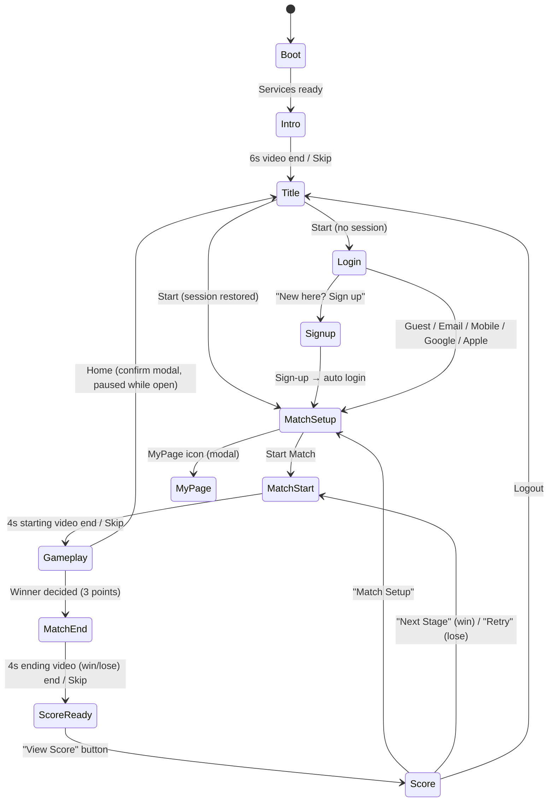

# 🎾 07. Cursor AI Agent Master Execution Prompt — Real Court Tennis
*Cursor AI Agent Master Execution Prompt — real-court-tennis v1.0*
***기준 문서: 05 Universal Mini-Game Design Master Doc v3.1 · 06 Universal Mini-Game Master Specification & Production Blueprint Form 2.1***
***상세 문서: 01 Brainstorm · 02 Project Concept v1.0 · a01 GDD ~ a15 Balance Design Document (총 15종)***
*본 문서의 결과를 일반화한 후속 표준: 05 Design Master Doc v4.0 · 06 Spec & Blueprint Form 4.0*

---

## 0. 문서 개요 및 사용 지침

### 0.1 이 문서의 역할

* 본 문서는 Coding Agent(Cursor)가 **『Real Court Tennis』를 처음부터 출시 가능한 상태까지 개발**하기 위해 따르는 **단일 실행 지시서(Single Source of Execution)** 이다.
* 01~02와 a01~a15에 흩어진 기획 의도와 세부 사양을, 05 v3.1과 06 Form 2.1의 구조·개발 방향에 맞춰 **하나의 모순 없는 사양**으로 통합했다.
* 문서 사이에 충돌이 있던 부분은 §0.5 **Conflict Resolution Log**에 결정 사항으로 기록했다. Agent는 이 결정을 따른다.

### 0.2 문서 Pipeline

```
01 Brainstorm → 02 Project Concept → a01~a15 Detail Spec Set
      → [05 Design Master Doc 3.1 + 06 Spec & Blueprint Form 2.1 (Base Structure)]
      → [07 Cursor AI Agent Master Execution Prompt (본 문서)]
      → Phase Reports / docs/ADR.md / docs/DECISIONS.md (Agent 산출물)
```

### 0.3 문서 우선순위 (Source of Truth Precedence)

충돌이 생기면 위에 있는 항목이 이긴다.

| 순위 | 문서 | 적용 범위 |
| --- | --- | --- |
| 1 | 사용자의 최신 지시 (Chat) | 전체 |
| 2 | **본 문서 07** (특히 §0.5 Conflict Resolution Log) | 전체 |
| 3 | 05 v3.1 / 06 Form 2.1 | 경험 표준(Experience Standard), 구조, 보안, QA |
| 4 | a01~a15 | 게임 세부 사양, 수치, 아트·오디오 방향 |
| 5 | 02 Project Concept | 의도와 USP |
| 6 | 01 Brainstorm | 원초 의도 (해석이 필요할 때 근거로 참조) |

### 0.4 Document Language Policy

| 대상 | 규칙 |
| --- | --- |
| 기획·개발 문서 | **Markdown(.md) 전용**. 본문은 한국어, **기술 용어는 영어로만 표기**한다 (예: "레이아웃" ❌ → "Layout" ✅, "충돌 판정" → "Hit Detection") |
| Source Code, Comment, Identifier, Data Key, Log, DB Field, Commit Message | **100% English** |
| 사용자에게 보이는 UX / UI / HUD / Video 대체 텍스트 / Error Message | **ko(기본) · en · ja 3개 언어**, 모두 Localization Key로만 출력 |
| Agent → 사용자 보고 | 사용자의 언어(한국어), 기술 용어는 영어 |

### 0.5 Conflict Resolution Log (문서 간 충돌 결정 사항)

| # | 충돌 내용 | 결정 | 근거 |
| --- | --- | --- | --- |
| C01 | 05/06은 Web Stack(Vite+Phaser+Firebase+Vercel)을 기본 추천, a01/a10/a12는 Unity 6 URP + Supabase를 명시 | **기본 추천 = Unity 6 LTS (URP) + C# + Supabase**. 단, 05/06의 **Stack Re-evaluation Mandate**에 따라 Phase 0에서 재검토 후 ADR로 확정 | 3D Realistic Cell-Shaded Character, 18개 Animation Clip, Mobile Native 출시 요구 |
| C02 | 05/06의 경험 표준은 DOM/CSS 기준으로 작성됨 | 경험 표준은 **Engine-agnostic 계약**으로 해석하고 Unity Binding으로 구현 (html[data-layout] → UI Toolkit root class, --sys-h → 실측 SystemBarHeight 등) | 05 §1.3 "스택이 바뀌어도 경험 표준은 유지" |
| C03 | Brainstorm은 "엣지 25%면 Out/Net", a03은 "9분할 3×3" | **Racket Face = 바깥 25% Fault Ring + 안쪽 3×3 Shot Zone** (§8.7) | 두 규칙을 모두 만족하는 유일한 통합 모델 |
| C04 | Brainstorm은 Δt 하나로 판정, a03은 Timing + Distance Offset 두 축 | **Quality = min(Timing Tier, Offset Tier)**, Timing 오차는 Racket Face의 x offset으로 변환 | a03 표 + a15 Window 수치 동시 충족 |
| C05 | Brainstorm 원안은 직접 이동, 이후 결정은 Semi-Auto Positioning | **Auto Positioning 기본**, Pad는 "Intent(의도)" 입력. 이동 가능 영역은 원안(네트 ~ 바깥 20%) 유지 | 02 §7, a02 §2 |
| C06 | 이동 가능 영역 "코트 길이의 20%"의 적용 방향 불명확 | 후방·좌우 모두 **courtLength × 0.20 = 4.754 m** (Data로 조정 가능) | 01 원문 문자 그대로 |
| C07 | Gameplay 중 터치 가능 요소: 01은 Sound/Language/Home만, a04는 MyPage/Logout 포함 | **Gameplay 중: Pad · 6 Stroke Button · Sound · Home · Language만**. MyPage/Logout은 Gameplay 중 숨김 | 경기 중 오조작으로 인한 이탈 방지, 01 원안 우선 |
| C08 | 01은 "첫 화면은 Start Button만", 05는 Title에 Language/How to Play 배치 | **Title = Start Button + Sound(좌상단)만**. Language는 Login 화면부터 표시. How to Play는 Match Setup 화면에 배치 | 01 원안 우선, 일본인 Tester를 위해 Login부터 Language 제공 |
| C09 | 05는 Device 언어 자동 감지, 01은 기본 한국어 | 최초 실행 = 저장값 → 없으면 **ko**. 자동 감지는 Config flag(autoDetectLanguage=false) | 01 명시 |
| C10 | 01은 "NPC 난이도 1~5를 Setting으로 선택", a02/a15는 Stage별 고정 | **Stage Mode(기본, Stage→Level 고정)** + **Free Match Mode(Level 1~5 직접 선택, Stage Ranking 미반영)** | 두 의도 모두 수용 |
| C11 | a05는 "세트 스코어" 표기, a02는 "3점 선승제" | **1 Match = 3 Point 선승 (Deuce 없음)**, Scoreboard는 Point만 표시. pointsToWin, winByTwo는 Data | a02 우선 |
| C12 | a04 Desktop 조작 "WASD / Arrow + Shift + Space" vs 01 "Arrow 상하좌우" | Movement = WASD 또는 Mouse Drag, Stroke = Arrow 조합(§11.4), Space = Serve 대체 키, **Shift는 v1 미사용** | 01 원안 + a04 일부 수용 |
| C13 | a13은 "물리 로직에 한글 주석 필수", 05/06은 "100% English Code" | **Comment도 English** | 05/06 절대 원칙, 사용자 최신 지시 |
| C14 | a14 LocalizationTable의 ja 값이 한국어 혼용 (게임을 시작하다 (ゲーム開始)) | **ja는 순수 일본어로 재작성** (§13.4) | 품질 오류 수정 |
| C15 | a11 handedness 'Right', preferred_language 'Ko' 대문자 값 | DB 값은 **소문자 enum** (right/left, ko/en/ja) + CHECK constraint | 일관성·검증 |
| C16 | 05 Handedness 규칙(오른손잡이 = 방향키 오른쪽)은 Toyville 장르 기준 | 본 게임: **오른손잡이 = Movement Pad 왼쪽(왼손 엄지), Stroke Button 오른쪽(오른손 엄지)** | 01 원문. "주력 손 = 정밀 Action" 원칙 |
| C17 | 01은 Login 수단 미지정, a02/a11은 Guest/Google/Apple, 05는 Guest/Email/Phone/Google | **Guest(Nickname) · Email · Mobile Number(SMS 없음) · Google · Apple** | 05 표준 + iOS App Store Guideline(소셜 Login 제공 시 Sign in with Apple) |
| C18 | Serve 규칙이 어느 문서에도 없음 | **Simplified Serve** 도입 (§8.2.3), Data flag로 끌 수 있음 | 실제 테니스 감각 |
| C19 | Brainstorm의 Stamina System | **v1 Backlog** (Auto Positioning과 중복 효과) | 범위 관리 |
| C20 | Camera가 "플레이어가 화면 하단 1/2~2/3" + "NPC는 플레이어의 1/3 크기" + "Net은 머리~가슴 사이"를 동시에 만족해야 함 | **망원(Telephoto) Eye-Level Camera Rig** (§9.1). 수학적으로 검증된 기본값 제공 | 세 조건을 동시에 만족하는 유일한 구성 |

---

## 1. Agent Role & Mission

```text
[ROLE]
You are the Lead Game Developer Agent for "Real Court Tennis" (id: real-court-tennis),
a 3D eye-level (over-the-shoulder) mobile tennis mini game.
You own architecture, implementation, tests, build, and deployment.

[MISSION]
Ship a production-ready game that:
1) delivers the "standing on a real court" eye-level tennis experience,
2) is easy on mobile (Auto Positioning + 6 Stroke Buttons + release-to-swing timing),
3) rewards skill through stroke choice and timing (Perfect / Great / Good),
4) satisfies every Experience Standard of Design Master Doc 3.1 and Form 2.1,
5) is fully playable with zero art/audio/video assets (placeholders), and
6) runs at 60 FPS on mid-range mobile devices.
```

---

## 2. 절대 원칙 (Absolute Rules)

| # | 원칙 | 구체 규칙 |
| --- | --- | --- |
| R01 | **English-Only Code** | Code, Comment, Identifier, Data Key, Log, DB Field, Commit Message 100% English. 화면 문구는 Localization Key로만 출력 |
| R02 | **3-Language UX** | ko(기본) / en / ja. Restart 없이 즉시 전환. 3개 언어 Key 집합 동일성 자동 검사 |
| R03 | **3-Device Native Layout** | desktop / mobile-landscape(주력) / mobile-portrait를 각각 독립 설계. Match 진행 중 회전해도 상태 유지 + 0.2초 이내 전환 |
| R04 | **Play-Area First** | 3D View는 최대 크기. Control은 3D View 가장자리(코너)에만 배치하고 Player Character·Ball 궤적의 핵심 영역을 가리지 않음 |
| R05 | **No-Overlap UX** | UI 요소 상호 겹침 0건, Touch Target ≥ 44dp, Text ≥ 12dp |
| R06 | **Sound-Respectful** | Sound 기본 OFF. 켜면 Login Session 동안 유지, Logout 시 OFF. BGM/SFX/UI/Video 소리를 하나의 AudioManager가 관리 |
| R07 | **Asset-Optional Playability** | Model/Texture/Animation/Audio/Video 파일이 하나도 없어도 Intro부터 Score 화면까지 완주 가능 |
| R08 | **Stack Re-evaluation Mandate** | Phase 0에서 Engine / App Framework / Backend / Hosting을 재검토하고 docs/ADR.md에 기록 |
| R09 | **Secret-Safe** | Secret Key, Service Role Key, Password, Admin Credential은 Source·문서·Repository·Client Build에 절대 포함 금지 |
| R10 | **Testable Core** | Physics·Hit Judgment·NPC AI·Match Rule·Score는 MonoBehaviour와 분리된 Pure C# Model + EditMode Test |
| R11 | **Data-Driven Balance** | 모든 Balance 수치는 Code가 아니라 Data Table(CSV/JSON)에 둠 |
| R12 | **Deterministic Simulation** | Gameplay Model은 Fixed Tick(120 Hz) + Seeded RNG(IRandom). 동일 입력 = 동일 결과 |
| R13 | **Zero GC in Gameplay Loop** | Update/Tick 경로에서 new, LINQ, Boxing, String 연결 금지. Object Pooling 사용 |
| R14 | **Touch Block Policy** | 허용된 Control 외 화면 영역의 Touch/Click은 무시 (§11.6) |
| R15 | **No Hand-Edited Unity YAML** | .unity, .prefab, .asset YAML을 직접 편집하지 않음. Scene/Prefab은 **Editor Script(Builder)** 로 생성·갱신 |
| R16 | **Report-Then-Change** | Stack·Scope·핵심 규칙 변경 시 이유와 영향 범위를 먼저 보고 |

---

## 3. 프로젝트 메타 정보

| 항목 | 값 |
| --- | --- |
| 게임명 (ko / en / ja) | 리얼 코트 테니스 / Real Court Tennis / リアルコートテニス |
| Project ID | real-court-tennis (Code Namespace: RCT) |
| 장르 | 3D Mobile Sports Mini Game (Eye-Level Over-The-Shoulder Tennis) |
| Elevator Pitch | "Bird View가 아니다. 직접 코트에 서서 플레이하라." |
| Tone Principle | **밝고 청량한 여름 스포츠 + 사실적 몰입감** (Realistic 70% : Anime 30%) |
| 타깃 | 일본 및 글로벌 10~40대 Casual Gamer, Sports Mini Game 선호 유저 |
| 1 Match 시간 | 약 1.5~3분 (3 Point 선승) |
| Stage | 10 Stage (NPC Level 1~5) + Free Match |
| Platform | Android · iOS (Native, 주력) + Desktop Web (WebGL) |
| Layout Profile | mobile-landscape(기본·최적) · mobile-portrait · desktop |
| UX 언어 | ko(기본) · en · ja |
| Player Character | David · Susan · Wolfson |
| Account | Guest(Nickname) · Email · Mobile Number(SMS 없음) · Google · Apple |
| 기본 추천 Stack | Unity 6 LTS (URP) · C# · UI Toolkit · Input System · Cinemachine · Supabase · Firebase Analytics/Crashlytics(Native) · GitHub |

---

## 4. Phase 0 — Stack Re-evaluation & ADR (Gate G0)

### 4.1 의무 사항

1. 아래 세 범주(+Hosting)를 이 게임의 요구사항 기준으로 재검토한다. 기본 추천값은 **강제가 아니다**.
2. 결과를 docs/ADR.md에 기록하고 사용자에게 보고한다. **기본 추천값을 바꾸는 경우 사용자 승인 전까지 Phase 1에 착수하지 않는다.** 기본값을 유지하는 경우 보고 후 진행한다.
3. 개발 도중 치명적 제약을 발견하면 변경을 제안할 수 있다. 실행 전에 이유, 영향 범위, Migration Plan을 보고한다.
4. Stack이 바뀌어도 §2 절대 원칙과 §7~§23의 경험·게임 사양은 동일하게 충족한다.

### 4.2 기본 추천 Stack과 후보

| 범주 | 기본 추천 | 검토할 대안 | 판단 기준 |
| --- | --- | --- | --- |
| ① Engine | **Unity 6 LTS + URP** | Godot 4, Three.js / Babylon.js + Capacitor, PlayCanvas | 3D Cell-Shading, Humanoid Animation(18 Clip + Mirror), Mobile 60 FPS, Store 출시, Cursor와의 C# 궁합 |
| ② App Framework / UI | **Unity UI Toolkit** (Screen·HUD) + Input System (Gameplay Touch) | uGUI(Canvas), Flutter + Unity as a Library | 3-Device Layout, Multi-Touch, i18n 즉시 전환, CJK Font |
| ③ Backend / DB | **Supabase** (Auth · Postgres · RLS · RPC · pg_cron) | Firebase(Auth/Firestore), PlayFab, Nakama | Ranking SQL Query, Guest TTL, Apple/Google ID Token Login |
| Analytics | **Firebase Analytics + Crashlytics** (Native만) | Unity Analytics, PostHog | Production Build 한정 |
| Hosting (WebGL) | **Vercel** 또는 Cloudflare Pages | Netlify, Firebase Hosting | Brotli/Gzip Header, 대용량 .data 캐시 |
| Test | **Unity Test Framework** (EditMode/PlayMode) + Device Simulator | GameCI (GitHub Actions) | Batchmode 실행 가능 |

### 4.3 반드시 확인할 Decision Trigger

- [ ] **Unity WebGL + Supabase**: 공식 supabase-csharp는 HttpClient 기반이라 WebGL에서 동작하지 않을 수 있다 → **UnityWebRequest 기반 Thin REST Gateway**(§17.6)를 기본안으로 채택할지 확인
- [ ] **Firebase Unity SDK는 WebGL 미지원** → WebGL Build에서는 Analytics를 No-op 처리
- [ ] **Mobile Web Browser**에서 Unity WebGL 성능은 보장 대상이 아님 → Desktop Web만 공식 지원, Mobile은 Native 권장 (Mobile Web 접속 시 Store 안내 Banner)
- [ ] **Google/Apple Native Login** Plugin 선정 (ID Token → Supabase grant_type=id_token)
- [ ] **CJK Font**: ko/ja 동시 표시용 Font Asset (Noto Sans KR + Noto Sans JP, Dynamic Atlas + Fallback)
- [ ] Unity License(Personal/Pro), Store 계정, Supabase Project, Firebase Project 준비 상태
- [ ] Unity 6 LTS 정확한 Patch Version 고정 (ProjectSettings/ProjectVersion.txt)

### 4.4 ADR 작성 양식 (docs/ADR.md)

| 범주 | 선택안 | 검토한 대안 | 선택 이유 | 변경 시 영향 | 상태 |
| --- | --- | --- | --- | --- | --- |
| Engine | | | | | Proposed / Accepted / Superseded |
| UI Framework | | | | | |
| Input | | | | | |
| Backend / DB | | | | | |
| Auth Providers | | | | | |
| Analytics | | | | | |
| Hosting (WebGL) | | | | | |
| Test / CI | | | | | |

### 4.5 Phase 0 산출물

- docs/ADR.md, docs/DECISIONS.md(§0.5를 이관하고 이후 결정을 누적), docs/OPEN_QUESTIONS.md
- Unity Project 생성, Package 설치, .gitignore, .gitattributes(Git LFS), .cursor/rules/\*.mdc(§27)
- Config/backend.example.json(Key 이름만), Local Secret 파일 경로 정의
- Supabase Project 생성(또는 생성 절차 보고), Firebase Project 생성 절차 보고

---

## 5. Repository & Unity Project 구조

### 5.1 Repository Root

```
📁 real-court-tennis/
├── Assets/
│   └── _RealCourtTennis/                 # 모든 Game Asset (a12 구조 확장)
├── Packages/manifest.json
├── ProjectSettings/
├── docs/
│   ├── ADR.md · DECISIONS.md · OPEN_QUESTIONS.md
│   ├── reports/phase-0.md … phase-8.md    # Phase별 보고서
│   └── specs/                             # 01, 02, a01~a15, 05, 06, 07 사본 (Markdown)
├── supabase/
│   ├── migrations/*.sql                   # Schema, RLS, RPC, Cron
│   └── seed.sql
├── raw_assets/                            # AI 생성 원본 투입 폴더 (README에 Naming Rule)
├── tools/                                 # Batch Script (test, build, i18n check, data validate)
├── web/                                   # WebGL Template (PWA), vercel.json
├── .cursor/rules/*.mdc
├── .gitignore · .gitattributes · README.md
```

### 5.2 Assets/\_RealCourtTennis/ (a12 확장)

```
Assets/_RealCourtTennis/
├── 01.Scenes/
│   ├── Scene_Boot.unity                  # Service 초기화 후 Scene_Intro 로드
│   ├── Scene_Intro.unity                 # Intro Video
│   ├── Scene_MainLobby.unity             # Title · Login · Signup · Match Setup · Score · MyPage (UI Toolkit Router)
│   └── Scene_GamePlay.unity              # Court · Characters · Camera · HUD (Additive)
├── 02.Scripts/
│   ├── Core/          # GameManager(FSM), EventBus, ServiceRegistry, PauseController, SettingsStore, SessionPrefs, Clock
│   ├── Gameplay/      # MatchModel, PointFlow, ServeRule, ScoreCalculator, StageCatalog   (Pure C#)
│   ├── Physics/       # CourtSpec, BallFlight, BallPredictor, HitJudge, ShotPlanner, ZoneRules (Pure C#)
│   ├── AI/            # NpcBrain (Pure C#), NPCAIController (Adapter)
│   ├── Input/         # GameplayInputRouter, TouchPadController, StrokeButtonCluster, KeyboardMouseInput
│   ├── Player/        # AutoPositioning, PlayerMotor, PlayerAnimationDriver
│   ├── Presentation/  # BallView, LandingMarker, CourtBuilder, ReplayRecorder, HitFx, CameraRigController
│   ├── Layout/        # LayoutManager, HudProfile, SafeAreaApplier
│   ├── UI/            # UIManager, ScreenRouter, Screens/*, SystemBar, Modal, Toast, HudView
│   ├── Localization/  # LocalizationService, FontRegistry
│   ├── Audio/         # AudioManager, ProceduralSfx, MusicCatalog
│   ├── Video/         # VideoSequencer, VideoFallbackCard
│   ├── Data/          # CsvReader, Table Records, DataRegistry, AdminTuning
│   ├── Save/          # SaveSystem, CloudSync
│   ├── Network/       # IBackendGateway, SupabaseRestGateway, MockBackendGateway, AuthService, RankingService
│   ├── Analytics/     # IAnalytics, FirebaseAnalyticsAdapter, NullAnalytics
│   ├── Assets/        # AssetRegistry, PlaceholderFactory
│   ├── Admin/         # AdminPanel, CheatConsole, FpsOverlay
│   └── Editor/        # SceneBuilder, PrefabBuilder, AssetPostprocessors, BuildScripts, AuditRunner, DataValidator
├── 03.Prefabs/
│   ├── Characters/    # David, Susan, Wolfson (+ Placeholder_Mannequin)
│   ├── Environment/   # Courts_01_to_04
│   └── UI/            # (UI Toolkit 사용 시 UXML/USS 참조용)
├── 04.Art/
│   ├── Animations/    # 18 Reach Swing Clips + Locomotion + Serve + Reaction
│   ├── Materials/     # CellShade_Materials
│   ├── Shaders/       # URP_CellShader.shadergraph, Outline
│   ├── Models/ · Textures/ · Courts/ · VFX/
│   └── Fonts/         # NotoSansKR, NotoSansJP, (en) Inter/Nunito
├── 05.Audio/
│   ├── SFX/ · BGM/
├── 06.Data/
│   ├── Tables/*.csv   # CharacterTable, AIDifficultyTable, StageTable, HitQualityTable, ShotZoneTable, ScoreTable, CourtThemeTable, AudioTable, VideoTable
│   ├── Config/*.json  # PhysicsConfig, CameraProfiles, InputConfig, MatchRules, AppConfig
│   └── Localization/ko.json · en.json · ja.json
├── 07.UI/
│   ├── UXML/ · USS/ · Icons/
├── 08.Videos/         # intro_6s.mp4, match_start_4s.mp4, ending_win_4s.mp4, ending_lose_4s.mp4
└── 09.Tests/
    ├── EditMode/      # RCT.Tests.EditMode.asmdef
    └── PlayMode/      # RCT.Tests.PlayMode.asmdef
```

### 5.3 Assembly Definitions (a12 확장)

| Assembly | 참조 | 규칙 |
| --- | --- | --- |
| RCT.Core | – | EventBus, Clock, IRandom, Pause, Settings |
| RCT.Data | Core | Table Record, CSV Parser, Config |
| RCT.Physics | Core, Data | **Pure C#** (UnityEngine Math Type만 허용, MonoBehaviour 금지) |
| RCT.Gameplay | Core, Data, Physics | **Pure C#** Match Rule |
| RCT.AI | Core, Data, Physics | **Pure C#** NpcBrain + Adapter 분리 |
| RCT.Input | Core | Input System 의존 |
| RCT.Presentation | Core, Data, Physics, Gameplay, AI, Input | MonoBehaviour Adapter, Camera, View |
| RCT.UI | Core, Data, Localization, Layout | UI Toolkit |
| RCT.Network | Core, Data | Backend Gateway |
| RCT.Editor | 전체 | Editor 전용 |
| RCT.Tests.EditMode / RCT.Tests.PlayMode | 대상 Assembly | Unity Test Framework |

* 🟨 Engine 의존 코드는 Presentation, UI, Input, Network(UnityWebRequest)에만 둔다. Physics/Gameplay/AI는 Engine 교체 시에도 재사용 가능해야 한다.

### 5.4 Version Control

* .gitignore: Unity 표준(Library/, Temp/, Obj/, Build/, Logs/, UserSettings/) + Config/backend.local.json + \*.keystore + GoogleService-Info.plist / google-services.json(Private Repository가 아니면).
* .gitattributes: Git LFS 대상 = \*.fbx \*.png \*.psd \*.tga \*.wav \*.mp3 \*.mp4 \*.ttf \*.otf. Unity YAML은 merge=unityyamlmerge.
* .meta File은 반드시 Commit하고, Agent가 임의로 삭제하지 않는다.

---

## 6. Runtime Architecture

### 6.1 구조 개요 (a10 확장)

```
[Scene_Boot] → ServiceRegistry.Init()
   ├── SettingsStore / SessionPrefs / PauseController / Clock
   ├── LayoutManager (+ HudProfile, SafeArea)
   ├── LocalizationService (+ FontRegistry)
   ├── AudioManager
   ├── DataRegistry (CSV/JSON Load + Validate)
   ├── AssetRegistry (+ PlaceholderFactory)
   ├── AuthService → IBackendGateway (Supabase | Mock)
   ├── AnalyticsService (Firebase | Null)
   └── GameManager (App FSM) → Scene_Intro
```

### 6.2 App FSM (GameManager, a02 확장)



* 🟨 화면 순서는 01 원안을 따른다: **Intro Video(6s) → Title(Start만) → Login → Setting(=Match Setup) → Starting Video(4s) → Gameplay → Ending Video(4s) → "View Score" Button → Score 화면**.
* 🟨 Score 화면 하단 Button: **[Match Setup] [Next Stage 또는 Retry] [Logout]**.

### 6.3 Typed EventBus (계약)

```csharp
namespace RCT.Core
{
    public enum LayoutProfile { Desktop, MobileLandscape, MobilePortrait }
    public enum Handedness { Right, Left }
    public enum Lang { Ko, En, Ja }

    public readonly struct LayoutChanged { public readonly LayoutProfile Profile; public LayoutChanged(LayoutProfile p) => Profile = p; }
    public readonly struct LanguageChanged { public readonly Lang Lang; public LanguageChanged(Lang l) => Lang = l; }
    public readonly struct SoundChanged { public readonly bool Enabled; public SoundChanged(bool e) => Enabled = e; }
    public readonly struct PauseChanged { public readonly bool Paused; public readonly bool AdminFrozen; public PauseChanged(bool p, bool a) { Paused = p; AdminFrozen = a; } }
    public readonly struct HandednessChanged { public readonly Handedness Hand; public HandednessChanged(Handedness h) => Hand = h; }
    public readonly struct SaveChanged { }
    public readonly struct AssetsUpdated { public readonly string Key; public AssetsUpdated(string k) => Key = k; }

    // Allocation-free publish/subscribe with struct events.
    public interface IEventBus
    {
        void Publish<T>(in T evt) where T : struct;
        void Subscribe<T>(System.Action<T> handler) where T : struct;
        void Unsubscribe<T>(System.Action<T> handler) where T : struct;
    }
}
```

### 6.4 PauseController (사유별)

```csharp
public enum PauseReason { Admin, Menu, Hidden, Rotation }
// Paused if any reason is active. Reasons never overwrite each other.
pause.Set(PauseReason.Menu, true);    // Home confirm modal
pause.Set(PauseReason.Hidden, true);  // OnApplicationPause / OnApplicationFocus(false)
```

* 🟨 Hidden에서 복귀하면 Gameplay는 **3-2-1 Countdown** 후 재개한다.
* 🟨 Pause 중에는 MatchModel Tick, Ball, Animation, Video, Audio가 모두 정지한다.

### 6.5 Clock (시간 기준)

| Clock | 용도 |
| --- | --- |
| MatchClock (double, 초) | Gameplay Simulation 시간. Fixed Tick 120 Hz, Pause 시 정지, Slow Motion 시 배속 적용 |
| RealClock | UI 애니메이션, Video, Countdown |

* 🟨 Input Timestamp(Touch.time, InputEvent.time)는 MatchClock으로 변환한다:
  tMatch = matchNow − (realtimeNow − inputTime) × currentTimeScale. Frame 단위 Polling 오차로 Timing 판정이 흔들리지 않게 한다.

### 6.6 ScreenContext (System Bar 선언형 제어)

```csharp
public sealed class ScreenContext
{
    public bool ShowSound = true;      // always (incl. Intro)
    public bool ShowHome;              // all screens except Title & Intro
    public bool ShowLanguage;          // from Login onward
    public bool ShowMyPage;            // after login, not in Gameplay
    public bool ShowLogout;            // after login, not in Gameplay
    public string MusicId;             // null = stop, "" = keep
}
```

---

## 7. 화면 흐름 및 화면별 사양 (Screen Spec)

### 7.1 System Bar 매트릭스

| Screen | Sound (좌상단 끝) | Home (Sound 오른쪽) | Language | MyPage | Logout | Music |
| --- | --- | --- | --- | --- | --- | --- |
| Intro | ● | – | – | – | – | Video Audio |
| Title | ● | – | – | – | – | bgm_main_theme |
| Login / Signup | ● | ● | ● | – | – | bgm_main_theme |
| Match Setup | ● | ● | ● | ● | ● | bgm_main_theme |
| Match Start (Video) | ● | – | – | – | – | Video Audio |
| Gameplay | ● | ● (확인 Modal + Pause) | ● | – | – | Court BGM |
| Match End (Video) | ● | – | – | – | – | Video Audio |
| Score Ready / Score | ● | ● | ● | ● | ● | bgm_main_theme |
| MyPage (Modal) | ● | 카드 내부 닫기 | ● | – | ● (카드 내부) | 유지 |

* 🟨 우상단 순서 (01 원안): **[Language] [MyPage] [Logout]** — Logout이 가장 오른쪽 끝, 그 왼쪽에 MyPage, 그 왼쪽에 Language. 모두 작은 Icon Button.
* 🟨 Language Button은 Tap할 때마다 Ko → En → Ja → Ko 순환. 표시 Label = 현재 언어 코드(KO/EN/JA). 기본값 KO.
* 🟨 Sound Button은 **Intro Video 화면을 포함한 모든 화면**의 좌상단 끝에 항상 고정. 기본값 OFF.
* 🟨 Home Button은 처음 보일 때 "처음 화면으로 돌아가기" Tooltip을 4초 표시한다.

### 7.2 화면별 상세

| Screen | 구성 요소 | 규칙 |
| --- | --- | --- |
| **Intro** | 6초 Intro Video, Skip Button(우하단) | Video 없으면 VideoFallbackCard(Logo + 코트 실루엣 애니메이션 6초). 기본 Muted, Sound ON이면 Video 소리 재생 |
| **Title** | Game Logo, **Start Button 하나** | Logo 한 줄 유지 + 자동 축소. Start Tap → Session 있으면 Match Setup, 없으면 Login |
| **Login** | Guest 시작(Nickname 입력 View) · Google · Apple(iOS 및 Web) · [Email \| Mobile Number] Tab · Password · Login · "처음이면 회원가입" Link · 카드 우상단 Home | Error는 Error Code → Localization Key 매핑 |
| **Signup** | [Email로 회원가입] [Mobile Number로 회원가입] → ID · Password · Password 확인 | **가입 즉시 자동 Login** → Match Setup |
| **Match Setup** (=설정 화면) | Mode Tab [Stage \| Free Match], Character 선택(3명 카드 + Stat Bar), Stage 선택(잠금 표시) 또는 Level 1~5 선택(Free), Court Theme(Free만 선택 가능), How to Play Button, **Start Match** Button | Handedness는 여기서 바꿀 수 없음 (MyPage 전용) |
| **Match Start** | 4초 Starting Video (Stage/Character 이름 Overlay는 Localization Text) | Video 없으면 Camera Fly-in 연출(4초)로 대체 |
| **Gameplay** | 3D View, Scoreboard(상단 중앙), Movement Pad, 6 Stroke Button, Judgment Popup, Landing Marker | §8~§12 |
| **Match End** | 4초 Ending Video (ending_win / ending_lose) | Video 없으면 Character Victory/Defeat Pose + Camera Orbit 4초 |
| **Score Ready** | "스코어 보기" Button 하나 | 01 원안: 엔딩 후 Button을 눌러야 Score 화면으로 이동 |
| **Score** | 승패, Point(예: 3-1), Total Score, Best Score, Quality 통계(Perfect/Great/Good/Miss), Max Rally, Ranking 순위, 하단 Button [Match Setup][Next Stage/Retry][Logout] | Guest도 Ranking 등록(Nickname 표시) |
| **MyPage** (Modal) | Account 종류·Nickname, ID 표시, Password 마스킹 + 변경 Form, **Handedness 설정(오른손잡이/왼손잡이)**, Mileage, Stage 진행, Best Score, 계정 삭제, Guest 경고 | Handedness는 Cloud 저장 → 다른 기기에서도 유지 |

### 7.3 How to Play (Match Setup에서 Modal)

3개 Page, 각 Page는 Localization Key 문단 + Placeholder 도해(Icon):
1. 왼손 엄지: Pad를 밀어 "가고 싶은 방향"을 알려 주면 Character가 자동으로 최적 위치로 이동.
2. 오른손 엄지: 6개 Stroke Button 중 하나를 누르고(밀어서 바꿀 수 있음) **손가락을 떼는 순간** Swing.
3. 판정: Perfect / Great / Good, Racket 가장자리 25%에 맞으면 Out 또는 Net.

---

## 8. Gameplay Core 사양 (Pure C# Model)

### 8.1 Court & Coordinate System

| 항목 | 값 |
| --- | --- |
| 단위 | 1 Unity unit = 1 m |
| 원점 | Net 중앙 바닥 |
| 축 | +Z = Player → NPC 방향, +X = Player 시점 오른쪽, +Y = 위 |
| Player 진영 | z < 0, NPC 진영 z > 0 |
| Singles Court | x ∈ [−4.115, +4.115], z ∈ [−11.885, +11.885] (길이 23.77 m, 폭 8.23 m) |
| Service Line | \|z\| = 6.40 |
| Net Height | 중앙 0.914 m, Singles Stick(x = ±4.57) 1.07 m, 그 사이 선형 보간 |
| Player Movement Area (C06) | z ∈ [−11.885 − 4.754, −0.50] = [−16.639, −0.50], x ∈ [−4.115 − 4.754, +4.115 + 4.754] = [−8.869, +8.869] |
| NPC Movement Area | Player 영역의 z 대칭 |

### 8.2 Match Rules

#### 8.2.1 Point·Match·Stage

| 규칙 | 기본값 (MatchRules.json) |
| --- | --- |
| Match 승리 | pointsToWin = 3, winByTwo = false |
| Server | firstServer = "player", 매 Point 교대 (serveAlternation = "every_point") |
| Stage 해금 | Stage N 승리 시 N+1 해금. Stage 1은 항상 해금 |
| Free Match | Level 1~5와 Court Theme 선택 가능. Stage 진행과 Stage Ranking에 반영하지 않음 (별도 free_best) |

#### 8.2.2 Point 종료 조건

| 상황 | 결과 |
| --- | --- |
| Player 타구가 In → NPC Reach(팔 길이 + Racket 길이) 밖으로 통과하고 NPC Court 안에 착지 | **Player 득점** (Winner, Serve면 Ace) |
| Player 타구가 In → NPC Reach 안 → Return Roll 실패 | **Player 득점** (NPC Error 연출: Net 40% · Long 30% · Wide 30%) |
| Player 타구가 In → NPC Reach 안 → Return Roll 성공 | NPC Return → Rally 계속 |
| Player 타구가 LongOut / Net / LeftOut / RightOut | **NPC 득점** |
| Player Swing이 Miss(헛스윙) 또는 Swing 없음, Ball이 Player Court 안에 착지 후 두 번째 Bounce 또는 Movement Area 이탈 | **NPC 득점** |
| NPC Return이 Player Reach 밖으로 통과하고 Player Court 안에 착지 | **NPC 득점** |

* 🟨 NPC의 성공 Return은 항상 Player Court 안에 착지한다 (Court 경계에서 0.3 m 안쪽으로 Clamp).

#### 8.2.3 Simplified Serve (C18)

| 항목 | 규칙 |
| --- | --- |
| Player Serve | 아무 **High** Stroke Button을 누르면 Toss 시작(누른 시점 + 0.60 s에 Contact Height 2.55 m 도달), **떼는 순간** Serve. 판정은 Timing만 사용 (Δt = Release − Toss Contact Time) |
| Serve 목표 | 대각선 Service Box (Player가 x ≥ 0에 서면 NPC 쪽 왼쪽 Box). x offset = Timing Signed Δt 기반 |
| Fault | Quality가 Early/Late/Miss이면 Fault. **2회 시도** (serveAttempts = 2), 두 번째도 Fault면 Double Fault → NPC 득점 |
| NPC Serve | 항상 In. 속도 = Stage BallSpeedMul × npcServeSpeed(20 m/s) |
| Desktop | Space Key = High Stroke 대체 (누름 = Toss, 뗌 = Serve) |
| 끄기 | serveRule = "feed"이면 Serve 없이 NPC가 중간 속도 Feed Ball로 Rally 시작 |

### 8.3 Ball Physics (a03, Custom Projectile Ballistics)

Rigidbody를 사용하지 않는다. 해석적 공식으로 Frame 독립성을 보장한다.

P(t) = P0 + V0 × t + ½ × k_spin × g × t², g = (0, −18.0, 0) m/s²

| Spin | Gravity 배율 k_spin | Bounce Restitution e (수직) | Bounce Friction μ (수평 유지율) | 특징 |
| --- | --- | --- | --- | --- |
| TopSpin | 1.3 | 0.75 | 0.88 | 급격히 떨어지고 앞으로 튐 |
| Flat | 1.0 | 0.72 | 0.80 | 직선적 고속 |
| Slice | 0.7 | 0.60 | 0.70 | 낮게 깔림 |

| Parameter (PhysicsConfig.json) | 기본값 |
| --- | --- |
| ballRadiusM | 0.033 |
| simTickHz | 120 |
| airDrag | 0.0 (v1 미사용, Hook만 존재) |
| Bounce 후 k_spin | 1.0으로 복귀 |
| Net 충돌 | Ball이 z = 0을 통과할 때 y < netHeight(x) + r → Net (Ball 낙하 연출 후 Dead) |
| Movement Area 이탈 | Dead Ball 처리 |

### 8.4 Ball Predictor

* 🟨 Ball이 Launch될 때마다 **한 번** 전체 궤적을 해석적으로 계산하여 Pre-allocated Buffer(BallPathSample[512], 1/120 s 간격)에 기록한다. Gameplay Loop에서 재할당 금지.
* 산출: netCrossing(x, y, t), firstBounce(p, t), secondBounce(p, t), exitArea(t).
* **Contact Candidate**: 첫 Bounce 이후 ~ 두 번째 Bounce 이전 구간에서 Ball 높이 ∈ [0.20, 2.30] m인 Sample. Volley를 허용할 때는 Bounce 이전 구간도 포함 (Player z > −6.40 이고 Forward Intent일 때).

### 8.5 Auto Positioning & Movement (a02 §2, 02 §8)

#### 8.5.1 Movement Pad Intent

Pad는 Character를 직접 조종하지 않고 **Intent Vector** (ix, iy) ∈ [−1, 1]²를 전달한다 (Pad 중심 기준, Dead Zone 0.15).

| Intent | 효과 |
| --- | --- |
| iy (Forward / Backward) | 선호 Contact Depth: iy = −1 → z = −16.0, iy = 0 → z = −12.9(기본: Baseline 1 m 뒤), iy = +1 → z = −1.5(Net Play). 구간별 선형 보간 |
| ix (Left / Right) | Ball이 오는 중: |ix| ≥ 0.5이면 **Side Override**(밀어 준 방향으로 Character가 움직여 반대쪽 Side로 치게 함, 예: Run-around Forehand). Ball이 없을 때: Recovery 위치 x = ix × 3.0 |
| 입력 없음 | 자동: 가까운 Side(동률이면 Forehand) 선택, Depth 기본값 |

#### 8.5.2 Target 계산 (Ball Incoming 시)

1. Predictor의 Contact Candidate 중 선호 Depth에 가장 가까운 Sample을 찾는다 (높이가 Mid Band 중심 1.0 m에 가까울수록 가중치).
2. side = Forehand | Backhand 결정 (Intent Override 우선).
3. targetX = contactX − sideDir × preferredReachM (preferredReachM = 0.55, Shoulder 기준 Ball이 Reach 범위 중앙에 오도록), targetZ = contactZ − 0.30 (Contact Plane이 몸 앞 0.30 m).
4. Target을 Movement Area로 Clamp → Contact Candidate를 한 번 더 재계산(최대 2회 반복).
5. 이동: 가속 18 m/s², 감속 24 m/s², 최고 속도 moveSpeed = 6.5 × (Speed / 85) m/s.

#### 8.5.3 Player State (01 Brainstorm B)

```
RUN → (Target 도착 또는 Contact 0.15 s 전) READY → (Release) SWING → (0.35 s) RECOVERY → RUN/READY
NPC가 Ball을 치는 순간: SplitStep(0.12 s) 후 RUN
```

* 🟨 Swing 직후 0.35 s RECOVERY 동안 새 Swing 불가 (Spam 방지).

### 8.6 Stroke Input & Timing

| 항목 | 규칙 |
| --- | --- |
| 6 Stroke | ForehandHigh, ForehandMiddle, ForehandLow, BackhandHigh, BackhandMiddle, BackhandLow (a03 Enum 유지) |
| 입력 단계 | Touch Down(Button 위) → Hold(Charge) → 엄지를 밀어 다른 Button으로 이동 가능 → **Release 시점의 Button이 최종 Stroke**, Release 시각 = t_release |
| Button 밖에서 Release | Cancel (Swing 없음) |
| Charge | chargeSec = t_release − t_press(최종 Button 진입 시각), chargeMul = lerp(0.90, 1.10, clamp01(chargeSec / 0.60)) |
| Impact 시각 | t_impact = t_release + impactLeadSec (기본 0.0, Animation Impact Frame과 동기화할 때 조정) |
| 판정 대상 Release | Contact Time t_ball 기준 [t_ball − 0.18, t_ball + 0.18] Window 안의 **첫 번째** Release. Window 이전 Release는 헛스윙 Animation + Recovery만 발생 |

### 8.7 Hit Judgment (Racket Face Model — C03, C04)

#### 8.7.1 Racket Face 규격

* Racket Face 크기 0.28 m × 0.38 m (01 Brainstorm 값), Local 좌표 (x, y) ∈ [−1, 1]²로 정규화.
* **바깥 25% = Fault Ring**, **안쪽 50% × 50% = 3×3 Shot Zone (A1~C3)**.

```
              x: −1 ──── −0.5 ─────────────── +0.5 ──── +1
 y +1 ~ +0.5 : [                LONG OUT (Fault)                 ]
 y +0.5      : [ LEFT  ][  A1  │  A2  │  A3  ][ RIGHT ]   A = TopSpin, Deep
 y   0       : [  OUT  ][  B1  │  B2  │  B3  ][  OUT  ]   B = Flat
 y −0.5      : [       ][  C1  │  C2  │  C3  ][       ]   C = Slice, Short
 y −0.5 ~ −1 : [                   NET (Fault)                   ]
 Precedence: y check first (LongOut / Net), then x (LeftOut / RightOut).
 Inner grid: u = x / 0.5, v = y / 0.5; columns at u = ±1/3, rows at v = ±1/3.
```

#### 8.7.2 Offset 산출

| 축 | 공식 | 의미 |
| --- | --- | --- |
| **y (높이)** | y = (h_ball − bandCenter) / bandFullHeight | Stroke Height Band 안이면 \|y\| ≤ 0.5. Band를 벗어나면 Fault, 크게 벗어나면 Miss |
| **x (좌우)** | x = s_timing × (Δt_signed / 0.24) + lateralResidual / 0.14 | Timing 오차가 Racket 좌우 Offset이 된다. Reach 범위를 벗어난 Ball도 x를 키운다 |

* Δt_signed = t_impact − t_ball (음수 = Early, 양수 = Late).
* s_timing: 오른손잡이 Forehand = +1, 오른손잡이 Backhand = −1, 왼손잡이는 부호 반전. (Early = Cross 방향으로 당겨짐)
* Height Band (PhysicsConfig.heightBands): **High [1.30, 2.30] m**, **Middle [0.75, 1.30] m**, **Low [0.15, 0.75] m**.
* Reach: Shoulder 기준 Ball 수평 거리 d ∈ [0.00, reachMaxM]이면 lateralResidual = 0. 범위를 넘으면 초과량(부호 = 화면 좌우), Stroke Side 반대편 Ball은 −(d + 0.2)로 처리 → 사실상 Miss. reachMaxM = 1.00 × (Reach / 85).

#### 8.7.3 판정 순서

```csharp
public static HitJudgment Evaluate(in SwingSample swing, in ContactSample contact, in PlayerFrame player,
                                   PhysicsConfig cfg, HitQualityTable table, IRandom rng)
{
    double signedDt = swing.ImpactTime - contact.Time;          // < 0 early, > 0 late
    double absDt = System.Math.Abs(signedDt);
    if (absDt > cfg.MissWindowSec) return HitJudgment.Whiff(signedDt);           // 0.18 s

    HeightBand band = cfg.HeightBands[(int)swing.Stroke.Height()];
    float y = (contact.BallHeight - band.Center) / band.FullHeight;
    if (System.Math.Abs(y) > 1f) return HitJudgment.Whiff(signedDt);

    float timingSign = TimingSign(swing.Stroke.Side(), player.Hand);
    float residual = LateralResidual(contact, swing.Stroke.Side(), player, cfg);
    float x = timingSign * (float)(signedDt / cfg.TimingFullScaleSec) + residual / cfg.FaceHalfWidthM;
    if (System.Math.Abs(x) > 1f) return HitJudgment.Whiff(signedDt);

    HitQuality timingTier = table.TierFromTiming(absDt, signedDt);              // Perfect/Great/Good/Early/Late
    HitQuality offsetTier = table.TierFromOffset(System.MathF.Sqrt(x * x + y * y));
    HitQuality quality = HitQualityRank.Min(timingTier, offsetTier, signedDt);

    ShotResult result = ZoneRules.Classify(x, y);                               // 25% fault ring
    if (result == ShotResult.In && rng.NextFloat() >= table.InChance(quality))
        result = ZoneRules.NearestFault(x, y);                                  // a15 in-rate
    return new HitJudgment(quality, signedDt, x, y, ZoneRules.Zone(x, y), result);
}
```

#### 8.7.4 Hit Quality Table (a03 + a15 통합)

| Quality | Timing \|Δt\| | Offset d = √(x²+y²) | In Chance (Zone이 In일 때) | Speed 배율 | NPC Return 배율 | Feedback |
| --- | --- | --- | --- | --- | --- | --- |
| **Perfect** | ≤ 0.03 s | < 0.15 | 1.00 | 1.15 | 0.50 (Ace 확률 증가) | Spark FX, Camera Shake, Hit-stop Slow Motion(0.08 s × 0.3), sfx_hit_perfect |
| **Great** | ≤ 0.07 s | < 0.35 | 0.90 | 1.05 | 0.85 | sfx_hit_great |
| **Good** | ≤ 0.12 s | < 0.60 | 0.70 | 1.00 | 1.00 | sfx_hit_good |
| **Early / Late** | ≤ 0.18 s | < 1.00 | 0.00 (Zone상 대부분 Fault) | 0.90 | 1.00 | sfx_hit_weak |
| **Miss** | > 0.18 s 또는 \|x\|·\|y\| > 1 | – | – | – | – | 헛스윙, sfx_swing_whiff |

* Quality = Timing Tier와 Offset Tier 중 **낮은 쪽**. Early/Late 구분은 Δt 부호로 한다.
* 수학적 일관성: Early/Late 구간(0.12~0.18 s)은 |x| = 0.5~0.75가 되어 Left/Right Out이 된다 → a15 "Late/Early → Out 확률 급증"과 일치.

### 8.8 Shot Planner (Target-Solved Ballistics)

Zone과 Offset으로 **착지 목표점**을 먼저 정하고, 그 목표에 도달하는 초기 속도를 역산한다.

| 단계 | 규칙 |
| --- | --- |
| 1. Spin | Row A = TopSpin, Row B = Flat, Row C = Slice |
| 2. Lateral Target (In) | u = x / 0.5 → targetX = u × (4.115 − 0.40) |
| 3. Depth Target (In) | v = y / 0.5 → targetZ = lerp(7.40, 11.385, (v + 1) / 2) (위쪽 = 깊게, 아래쪽 = 짧게) |
| 4. Fault Target | LongOut: targetZ = 11.885 + 0.5 + 2.0 × (|y| − 0.5) / 0.5; Left/RightOut: targetX = ±(4.115 + 0.3 + 1.7 × (|x| − 0.5) / 0.5); Net: Net Tape 아래(netHeight − 0.15)를 통과하도록 Launch |
| 5. Speed | v_h = baseSpeed(spin) × qualitySpeedMul × chargeMul × √(Power / 85) — baseSpeed: Flat 20, TopSpin 18, Slice 16 m/s |
| 6. 역산 | τ = horizontalDistance / v_h, V0 = (T − P0 − ½ k_spin g τ²) / τ |
| 7. Net Clearance | In Shot이 netHeight + 0.10 m를 넘지 못하면 τ를 5%씩 늘려 재계산(최대 10회) |
| 8. Scatter | Perfect 0 / Great 0.15 / Good 0.30 m의 결정론적 Scatter(Seeded RNG), In Shot은 Court 안쪽 0.20 m로 Clamp |

### 8.9 NPC AI (a07 + a14)

#### 8.9.1 Difficulty Table

| Level | ReturnChance | Speed (m/s) | HitAccuracy | ReactionDelay (s) | TargetStyle | Smash | 특성 (a07) |
| --- | --- | --- | --- | --- | --- | --- | --- |
| LV_1 | 0.20 | 4.0 | 0.50 | 0.45 | center | – | 초보자용, 반응이 늦고 Error가 많음 |
| LV_2 | 0.30 | 5.0 | 0.65 | 0.38 | safe_deep | – | 수비형, 기본 Return 위주 |
| LV_3 | 0.40 | 6.0 | 0.75 | 0.30 | cross | – | 균형형, 좌우 Cross Return |
| LV_4 | 0.50 | 7.0 | 0.85 | 0.22 | corners | – | 공격형, 빠른 구질·구석 공격 |
| LV_5 | 0.60 | 8.0 | 0.95 | 0.15 | corners_smash | ● | 프로급, High Ball Smash 반응 |

#### 8.9.2 NPC 처리 순서

1. Player 타구가 In으로 Launch되면 Predictor가 NPC 측 Contact Candidate를 계산한다.
2. ReactionDelay 후 Level Speed로 최적 Candidate를 향해 이동 (가속 포함).
3. Contact 시점에 NPC 몸과 Ball의 수평 거리 d를 계산한다. d > reach(Character ReachM, 기본 = 팔 길이 + Racket 길이)이면 **도달 불가** → Ball은 계속 진행 → Player 득점.
4. 도달 가능하면 Roll: r < ReturnChance(level) × NpcReturnMul(playerQuality) → 성공 시 Return, 실패 시 Error 연출.
5. Return Target: TargetStyle 기준점 + Scatter 반경 (1 − HitAccuracy) × 3.0 m. Spin은 Level별 가중치. LV_5는 Ball 높이 > 2.0 m면 Smash(Flat, 속도 × 1.35).
6. NPC Animation은 Player와 같은 18 Clip 세트를 사용 (Side·Height·Reach 자동 선택).

* 🟨 NPC Character는 Player가 고르지 않은 두 Character 중 Stage 번호에 따라 교대로 등장한다 (StageTable.NpcCharacterId).
* 🟨 NPC Return의 속도 = npcBaseShotSpeed(18 m/s) × Stage BallSpeedMul.

### 8.10 Character Stat 적용 (a06, a14)

| Stat | 적용 공식 (기본값, Data 조정 가능) |
| --- | --- |
| Speed | moveSpeed = 6.5 × Speed / 85 m/s |
| Power | Shot Speed × √(Power / 85) |
| Reach | reachMaxM = 1.00 × Reach / 85 (Shoulder 기준), NPC 판정용 ReachM 열 사용 |
| Control | Timing Window 배율 1 + (Control − 85) × 0.005, Scatter 배율 1 − (Control − 85) × 0.01 |

### 8.11 Score Calculation (ScoreTable.csv)

| 항목 | 점수 |
| --- | --- |
| Point 획득 | +1000 / Point |
| Perfect / Great / Good 타구 | +300 / +150 / +50 |
| Winner / Ace | +200 / +500 |
| Max Rally | +20 × Rally 수 |
| Match 승리 | +3000 + Stage × 500 |
| 무실점 승리 | +1500 |
| Free Match | Level 배율 0.6 / 0.8 / 1.0 / 1.2 / 1.4, Stage Ranking 미반영 |

* 🟨 Mileage(누적 점수, 05 표준) = 모든 Match Score의 합. MyPage에 표시하고 Cloud에 영구 저장.

### 8.12 Core 계약 (C#)

```csharp
namespace RCT.Physics
{
    public enum StrokeType { ForehandHigh, ForehandMiddle, ForehandLow, BackhandHigh, BackhandMiddle, BackhandLow }
    public enum StrokeSide { Forehand, Backhand }
    public enum StrokeHeight { High, Middle, Low }
    public enum HitQuality { Miss = 0, Early = 1, Late = 2, Good = 3, Great = 4, Perfect = 5 }
    public enum ShotResult { In, LongOut, Net, LeftOut, RightOut }
    public enum ShotZone { A1, A2, A3, B1, B2, B3, C1, C2, C3, None }
    public enum SpinType { TopSpin, Flat, Slice }
    public enum ReachStage { FullyBent, SlightlyBent, FullyExtended }

    public readonly struct HitJudgment
    {
        public readonly HitQuality Quality;
        public readonly double TimingDeltaSec;   // signed
        public readonly float XOffset, YOffset;  // normalized racket face [-1, 1]
        public readonly ShotZone Zone;
        public readonly ShotResult Result;
        // ctor + static Whiff(double signedDt)
    }

    public interface IRandom { float NextFloat(); int NextInt(int minInclusive, int maxExclusive); }
}

namespace RCT.Gameplay
{
    public enum PointWinner { None, Player, Npc }
    public enum PointEndReason { Winner, Ace, NpcError, PlayerFault, PlayerMiss, NpcWinner, DoubleFault }

    public interface IMatchModel
    {
        MatchSnapshot Snapshot { get; }                     // read-only state for views
        void Tick(double dt);                               // fixed 1/120 s
        void SubmitIntent(float ix, float iy);
        void SubmitStrokePress(StrokeType stroke, double tMatch);
        void SubmitStrokeRelease(StrokeType stroke, double tMatch);
        event System.Action<HitJudgment> PlayerHit;
        event System.Action<PointWinner, PointEndReason> PointEnded;
        event System.Action<PointWinner> MatchEnded;
    }
}
```

### 8.13 Headless Balance Simulation (필수 Tool)

* tools/sim 또는 EditMode Test로 **Bot Player vs NPC**를 1,000 Match씩 Simulation한다. Bot의 Timing 오차는 정규분포 σ ∈ {40, 70, 100} ms, Stroke 선택 정확도 ∈ {0.95, 0.85, 0.70}.
* 출력: Stage별 승률, 평균 Rally, Quality 분포, Fault 종류 분포 → docs/reports/balance.md.
* 목표 범위 (조정 기준, 고정 아님):

| Bot (σ / 정확도) | Stage 1 승률 | Stage 5 승률 | Stage 10 승률 |
| --- | --- | --- | --- |
| 숙련 (40 ms / 0.95) | ≥ 95% | ≥ 80% | 55~70% |
| 보통 (70 ms / 0.85) | ≥ 85% | 55~70% | 30~45% |
| 초보 (100 ms / 0.70) | ≥ 65% | 35~50% | ≤ 25% |

---

## 9. Camera & Presentation

### 9.1 Eye-Level Telephoto Camera Rig (C20)

01의 세 가지 화면 조건을 동시에 만족해야 한다.

1. Player Character가 화면 **하단 1/2 ~ 2/3**를 차지 (뒷모습).
2. Net Top이 Player의 **머리와 가슴 사이**에 보임.
3. NPC가 Player 신장의 **1/3** 크기로 보임.

조건 3은 원근상 D / (D + 23.77) = 1/3 → Camera–Player 거리 **D ≈ 12 m**가 필요하다. 이 거리에서 조건 1을 만족하려면 **망원(좁은 FOV)** 이 필요하고, 조건 2를 만족하려면 Camera 높이가 **1.79 m < h < 2.59 m**여야 한다.

| Parameter (CameraProfiles.json) | mobile-landscape / desktop | mobile-portrait |
| --- | --- | --- |
| Distance behind Player | 12.0 m | 12.0 m |
| Height | 2.10 m | 2.10 m |
| Pitch | −3.4° (Player 발이 3D View 하단에 오도록 자동 보정) | 자동 보정 |
| FOV 기준 | **Vertical FOV 13°** 고정 | **Horizontal FOV 22.8°** 고정 (가로 화면과 같은 좌우 시야) |
| Lateral Follow | Player x 추적, Damping 0.15 s, Yaw ≤ 8° | 동일 |

검증된 투영 결과 (16:9, 화면 하단 = 0, 상단 = 1):

| 대상 | 화면 높이 위치 |
| --- | --- |
| Player 발 / 가슴(1.35 m) / 머리(1.75 m) | 0.00 / 0.49 / 0.64 |
| Net Top (0.914 m) | 0.55 → 가슴과 머리 사이 ✅ |
| NPC 발 / 머리 | 0.51 / 0.72 → 높이 0.21 = Player(0.64)의 0.34배 ✅ |

* 🟨 CameraFramingValidator(PlayMode Test + Editor Overlay)는 위 세 조건을 Layout Profile별로 측정한다. 허용 범위: Player 머리 0.50~0.67(landscape/desktop), Net Top이 가슴~머리 사이, NPC/Player 높이 비율 0.33 ± 0.06. Portrait는 Player 머리 0.45~0.67을 허용.
* 🟨 Ball 시인성 보정: 실제 크기의 Ball은 먼 거리에서 3 px 수준으로 작아진다 → **ballVisualScale = 거리 기준 1.0(근거리) ~ 2.5(원거리)**, Trail Renderer(0.12 s), Contact Shadow(Ball 바로 아래 원형 그림자, 항상 표시).
* 🟨 **Landing Marker**: Predictor의 첫 Bounce 지점에 반투명 원형 Indicator (a05, a08). 기본 항상 표시.

### 9.2 Replay & FX

| 기능 | 규격 |
| --- | --- |
| Point Replay | replayMode = "player_winners"(기본): Player Winner/Ace 시 마지막 2.0 s를 0.4배속, 측면 Camera로 재생. Ring Buffer(Transform Snapshot, 120 Hz × 2.5 s) Pre-allocation. 자동 종료(Touch Skip 없음 — Touch Block Policy) |
| Perfect FX | Spark Particle(Pool), Camera Shake(0.15 s, 진폭 0.05), Hit-stop 0.08 s × timeScale 0.3 |
| Judgment Popup | Perfect/Great/Good/Early/Late/Miss, Out/Net/Ace/Winner 문구 — Localization Key, 1.0 s 유지 → 0.4 s 축소 소멸, Player Character 머리 위쪽 |
| Stroke Hint | StrokeHint = true인 Stage(1~2)에서 예상 최적 Button에 은은한 Glow |

---

## 10. Character & Animation (a06, a08)

### 10.1 Character Data

| ID | Name | 성별 / 나이 | Type | Speed | Power | Reach | Control | HeightM | ReachM | Color |
| --- | --- | --- | --- | --- | --- | --- | --- | --- | --- | --- |
| CHAR_01 | David | 남 / 20대 중반 | Balanced All-Rounder | 85 | 80 | 82 | 88 | 1.82 | 1.33 | #2E7DD7 |
| CHAR_02 | Susan | 여 / 20대 초반 | Agile Technician | 92 | 74 | 86 | 90 | 1.68 | 1.38 | #E04F8A |
| CHAR_03 | Wolfson | 남 / 20대 후반 | Power All-Rounder | 80 | 92 | 84 | 78 | 1.88 | 1.35 | #F29B2E |

### 10.2 Animation 세트 (11/10 updated)

> 11/10 (Web 구현, ADR-001): Animation은 AI Motion Video를 분해한 Sprite Atlas로 구현한다(08 §6). 132개 Clip을 기획서와 대조 검토한 결과와 대체 규칙은 다음과 같다.
> * Clip별 실제 Backswing / Contact 보정
> * reach_bh(char_01 back) → bh_mid 대체
> * Back run_right → run_left 좌우 반전
> * 달리기는 Pingpong / Crossfade Loop로 재생하고 발 위치 고정
>
> 상세는 08 §6.3·§6.8, 09 §E.0, docs/reports/motion_review.md를 참고한다.

| 분류 | Clip | 수량 |
| --- | --- | --- |
| **Reach Swing** | Stroke\_{FH\|BH}\_{High\|Mid\|Low}\_{Bent\|Slight\|Extended} | **18** (6 Stroke × 3 Reach) |
| Locomotion | Idle, Ready, Run(8방향 Blend), SplitStep, Recovery | 5+ |
| Serve | Serve_Toss, Serve_Hit | 2 |
| Reaction | Win_Point, Lose_Point, Victory, Defeat | 4 |

* 🟨 Reach Blend 기준 (a06): Shoulder–Ball 거리 **0.0~0.3 m = Fully Bent**, **0.3~0.6 m = Slightly Bent**, **0.6~1.0 m = Fully Extended**. Animator Blend Tree Parameter ReachDistance로 연속 Blend한다.
* 🟦 Animation Rigging Two-Bone IK로 손목을 Ball Contact 지점에 미세 보정 (Phase 6 Polish).
* 🟨 **왼손잡이**: Humanoid Animation Mirror + Racket을 왼손 Socket으로 이동. Stroke Side 의미(Forehand = 주력 손 쪽)는 유지.
* 🟨 Racket 길이 0.685 m, 팔 길이는 Character Height × 0.36.

### 10.3 Asset-Optional Placeholder

* Placeholder Mannequin: Primitive(Capsule 몸통, Sphere 머리, Cylinder 팔·Racket)를 Code로 조립. Swing은 Procedural Rotation(Shoulder Yaw + Elbow Bend = Reach Stage)으로 표현.
* Character 색상 = Color 열. NPC는 같은 Mannequin을 Scale 그대로 사용 (Camera 원근으로 1/3 크기).

---

## 11. Input & Controls (a04)

### 11.1 Mobile Landscape Layout (기본, 오른손잡이)

```
+--------------------------------------------------------------------------------+
| [🔇][🏠]                     [ YOU 2 : 1 OPPONENT · Stage 3 ]       [KO][👤][⎋] |
|                                                                                |
|                          (3D View: Net · NPC · Court)                          |
|                                                                                |
|                             [Player Character 뒷모습]                          |
|    ┌───────────┐                                              [BH-H] [FH-H]    |
|   /  Forward   \                                              [BH-M] [FH-M]    |
|  / Left   Right \                                             [BH-L] [FH-L]    |
| /    Backward    \                                                             |
+--------------------------------------------------------------------------------+
  ↑ Gameplay 중에는 우상단 [👤 MyPage][⎋ Logout] 숨김 (C07)
```

### 11.2 Movement Pad (Trapezoid)

| 항목 | 규격 |
| --- | --- |
| 형태 | 위가 좁은 사다리꼴(코트 원근과 같은 모양), 반투명 |
| 크기 (landscape) | 하단 폭 = 화면 폭 18% (최소 180 dp), 높이 = 화면 높이 34% (최소 120 dp) |
| 입력 | 해당 Touch의 pointerId를 Pad에 고정. Drag 위치 → Pad 중심 기준 Intent Vector, Dead Zone 0.15 |
| 시각 Feedback | Thumb Knob + 방향 강조 |

### 11.3 Stroke Button Cluster (2열 × 3행)

| 위치 (오른손잡이) | Stroke |
| --- | --- |
| 왼쪽 열 상 / 중 / 하 | Backhand High / Backhand Middle / Backhand Low |
| 오른쪽 열 상 / 중 / 하 | Forehand High / Forehand Middle / Forehand Low |

* 크기: Button 하나 ≥ 64 dp(landscape), 간격 8 dp. 전체 Cluster는 오른쪽 하단 코너.
* Touch가 Cluster 안에서 움직이면 Hover Button이 바뀐다(밀면서 선택). Release 시점의 Button = 최종 Stroke.
* 🟨 **왼손잡이**: Cluster가 왼쪽 하단, Pad가 오른쪽 하단으로 이동하고, **열도 교환**(왼쪽 열 = Forehand, 오른쪽 열 = Backhand). 왼손잡이의 Forehand는 몸 왼쪽이기 때문이다.

### 11.4 Desktop 입력 (C12)

| 기능 | 입력 |
| --- | --- |
| Movement Intent | **W/A/S/D** 또는 Pad를 Mouse Drag |
| Stroke 열 선택 | **←** = 화면 왼쪽 열, **→** = 화면 오른쪽 열 (오른손잡이: ← Backhand, → Forehand) |
| Stroke 높이 | **↑** 동시 누름 = High, **↓** 동시 누름 = Low, 없음 = Middle (Release 순간의 상태로 결정) |
| Swing | **←/→ Key를 떼는 순간** Swing (Hold 시간 = Charge) |
| Serve | Space 누름 = Toss, 뗌 = Serve (High Stroke 대체) |
| On-screen Button | Mouse로도 6 Button Press/Release 가능 |
| Home | Esc (확인 Modal) |
| 기타 Button | Mouse Click |

### 11.5 Input 구현 규칙

* 🟨 Gameplay Control은 **Input System EnhancedTouch** 로 Raw Touch를 읽고, UI Toolkit Element의 worldBound Rect에 대해 직접 Hit-test한다 → Pad와 Button의 **동시 Multi-Touch**가 서로 간섭하지 않는다.
* 🟨 Touch Timestamp를 MatchClock으로 변환(§6.5)하여 SubmitStrokeRelease에 전달한다.
* 🟨 회전 직후 200 ms Input Lock (05 표준).

### 11.6 Touch Block Policy (a04 §4, 01)

| 화면 | Touch/Click 허용 요소 |
| --- | --- |
| Gameplay | Movement Pad, 6 Stroke Button, Sound, Home, Language **만** |
| 그 외 화면 | 해당 화면에 표시된 Button·Input Field만 |

* 🟨 3D View와 배경 VisualElement는 PickingMode.Ignore. 3D World에는 Physics Raycast 입력을 사용하지 않는다.
* 🟨 허용 영역 밖 Touch는 어떤 동작도 일으키지 않는다(Replay Skip 포함).

---

## 12. 3-Device Layout & HUD (05 §5~§6, 06 §5~§6 Unity Binding)

### 12.1 Layout Profile 판정

```csharp
public static LayoutProfile Detect(int widthPx, int heightPx, float dpi, bool touchPrimary)
{
    float density = (dpi > 0f ? dpi : 96f) / 160f;              // dp conversion
    float shortSideDp = System.Math.Min(widthPx, heightPx) / density;
    if (heightPx > widthPx) return LayoutProfile.MobilePortrait;
    if (touchPrimary && shortSideDp < 900f) return LayoutProfile.MobileLandscape;
    return LayoutProfile.Desktop;
}
```

| 기능 | 규격 |
| --- | --- |
| 감지 | Screen 크기·방향 변화 Polling(Frame당 1회 비교) → 150 ms Debounce |
| 적용 | UI Toolkit Root에 class layout-desktop / layout-mobile-landscape / layout-mobile-portrait, hand-right / hand-left 적용 |
| 순서 | **HudProfile 먼저 적용 → LayoutChanged Publish** → Camera Profile·HUD가 같은 Frame에 재배치 |
| Input Lock | 전환 후 200 ms |
| Match 상태 | 회전해도 MatchModel 무손실 (View만 재배치) |
| Admin 강제 전환 | layoutOverride (Admin만) + Device Frame Preview |

### 12.2 HudProfile (ScriptableObject, 단일 출처)

| 항목 | desktop | mobile-landscape | mobile-portrait |
| --- | --- | --- | --- |
| System Button 크기 | 44 dp | 42 dp | 42 dp |
| System Bar 형태 | 1줄 | 1줄 | 1줄 (Gameplay) / 2줄 (Score·Setup에서 Text Pill이 있을 때) |
| 3D View 영역 | 전체 화면 | 전체 화면 | 상단 62% |
| Control 배치 | 3D View 위 하단 코너 Overlay (작게) + Keyboard Hint | 3D View 위 하단 코너 Overlay | **하단 Control Deck 38%** (Pad 왼쪽, Cluster 오른쪽, 겹침 없음) |
| Stroke Button 크기 | 52 dp | 64 dp | 60 dp |
| Pad 크기 | 폭 220 dp | 폭 18% (≥180 dp) | Deck 폭 45% |
| Scoreboard | 상단 중앙 | 상단 중앙 | 상단 중앙 (System Bar 아래) |
| Camera Profile | landscape | landscape | portrait |

* 🟨 System Bar 높이는 실측값(resolvedStyle.height)을 SystemBarHeight로 공개하고 Modal·Scoreboard가 그 아래에서 시작한다 (05 교훈: 추정값 금지).
* 🟨 Screen.safeArea를 모든 가장자리 UI에 적용한다 (Notch, Home Indicator).

### 12.3 Mobile Portrait Layout

```
+------------------------------+
| [🔇][🏠]          [KO]        |
|  [ YOU 1 : 0 OPPONENT ]      |
|                              |
|     3D VIEW (상단 62%)        |
|   NPC · Net · Court          |
|   [Player 뒷모습]             |
+--------------+---------------+
|   ┌──────┐   | [BH-H][FH-H]  |
|  / Pad    \  | [BH-M][FH-M]  |
| /          \ | [BH-L][FH-L]  |
+--------------+---------------+   ← Control Deck 38% (왼손잡이는 좌우 교환)
```

### 12.4 Desktop Layout

```
+--------------------------------------------------------------------------+
| [🔇][🏠]              [ YOU 2 : 2 OPPONENT · Stage 7 ]          [KO]     |
|                                                                          |
|                      3D VIEW (전체 화면, 16:9 기준)                       |
|                                                                          |
|  [Pad 220dp]   WASD: Move  ← →: Side  ↑ ↓: Height  Release: Swing   [6 Buttons] |
+--------------------------------------------------------------------------+
```

### 12.5 Play-Area 목표

| 지표 | desktop | mobile-landscape | mobile-portrait |
| --- | --- | --- | --- |
| 3D View / 전체 화면 | 100% (Overlay) | 100% (Overlay) | ≥ 60% |
| Control이 Player Character Bounding Box와 겹침 | 0% | 0% | 0% |
| Control이 3D View를 덮는 비율 | ≤ 12% | ≤ 22% | 0% (분리 Deck) |

* 🟨 Pad·Cluster의 투명도: 평상시 Alpha 0.55, Touch 중 0.85.
* 🟨 Aspect Ratio 16:9 ~ 21:9 (a05) 모두에서 Cut-off 없이 정렬된다.

---

## 13. UI/UX & Localization

### 13.1 UI 원칙 (a05)

1. 눈높이 시점 몰입감 보존: HUD는 상단 Edge와 하단 Corner에만.
2. One-Touch 반응성: 모든 Touch에 즉시 시각(Scale 0.94 + Glow) / 소리(ui_tap) Feedback.
3. Icon 중심 + 최소 Text, 모든 Text는 Localization Key.

### 13.2 Localization 규칙

| 규칙 | 내용 |
| --- | --- |
| 파일 | 06.Data/Localization/ko.json(기준), en.json, ja.json — Flat Key-Value |
| Key Naming | {screen}.{element} (예: login.toSignup, hud.stage, judge.perfect). a14의 UI_START 형식은 title.start 등으로 이관 |
| API | Loc.T(key, params), Loc.SetLanguage(lang), [LocKey] Binding으로 UI Toolkit Label 자동 갱신 |
| 즉시 전환 | LanguageChanged 구독 → 모든 Label, 열린 Modal, Judgment Popup 즉시 갱신 |
| Fallback | 현재 언어 → ko → Key 이름 |
| 검사 | EditMode Test LocalizationParityTests: ko/en/ja Key 집합 동일, 빈 값 0, Parameter({n}) 일치 |
| Font | ko: Noto Sans KR, ja: Noto Sans JP, en: Inter(또는 Nunito). Font Fallback Chain으로 혼용 문자 대응 |
| 줄바꿈 | 버튼은 최소 폭 + 자동 축소, Logo는 한 줄 유지 |
| 이미지 속 글자 | **금지** |

### 13.3 저장 위치

| 범위 | 항목 | 저장소 |
| --- | --- | --- |
| Device | Language, Layout Override(Admin), FPS 표시 | PlayerPrefs (rct.settings.\*) |
| Session | Sound ON/OFF (Logout 시 OFF) | SessionPrefs (rct.session.{uid}.soundOn) |
| User (Cloud 동기화) | Handedness, 선택 Character, Preferred Language | Supabase profiles |
| Progress | Stage 진행, Best Score, Mileage | Local + Cloud 병합 (max 규칙) |

### 13.4 Localization Master Table (a14 수정본)

| Key | ko | en | ja |
| --- | --- | --- | --- |
| title.start | 시작 | Start | スタート |
| common.ok | 확인 | OK | OK |
| common.cancel | 취소 | Cancel | キャンセル |
| common.close | 닫기 | Close | 閉じる |
| common.skip | 건너뛰기 | Skip | スキップ |
| sys.soundOn | 사운드 켜짐 | Sound On | サウンドON |
| sys.soundOff | 사운드 꺼짐 | Sound Off | サウンドOFF |
| sys.home | 처음 화면으로 | Home | ホーム |
| sys.homeTip | 처음 화면으로 돌아가기 | Back to the title screen | タイトル画面に戻る |
| sys.language | 언어 | Language | 言語 |
| sys.myPage | 마이페이지 | My Page | マイページ |
| sys.logout | 로그아웃 | Log Out | ログアウト |
| login.title | 로그인 | Log In | ログイン |
| login.guest | 게스트로 시작 | Play as Guest | ゲストで始める |
| login.nickname | 별명 (2~12자) | Nickname (2–12 chars) | ニックネーム(2〜12文字) |
| login.google | Google로 계속하기 | Continue with Google | Googleで続ける |
| login.apple | Apple로 계속하기 | Continue with Apple | Appleで続ける |
| login.tabEmail | 이메일 | Email | メール |
| login.tabPhone | 휴대폰번호 | Mobile Number | 携帯電話番号 |
| login.password | 비밀번호 | Password | パスワード |
| login.submit | 로그인 | Log In | ログイン |
| login.toSignup | 처음이면 회원가입 | New here? Sign up | はじめての方は新規登録 |
| signup.title | 회원가입 | Sign Up | 新規登録 |
| signup.byEmail | 이메일로 회원가입 | Sign up with Email | メールで登録 |
| signup.byPhone | 휴대폰번호로 회원가입 | Sign up with Mobile Number | 携帯電話番号で登録 |
| signup.passwordConfirm | 비밀번호 확인 | Confirm Password | パスワード(確認) |
| setup.title | 경기 설정 | Match Setup | 試合設定 |
| setup.modeStage | 스테이지 | Stage | ステージ |
| setup.modeFree | 자유 경기 | Free Match | フリーマッチ |
| setup.character | 캐릭터 선택 | Choose Player | キャラクター選択 |
| setup.difficulty | 난이도 | Difficulty | 難易度 |
| setup.court | 코트 | Court | コート |
| setup.howToPlay | 플레이 방법 | How to Play | 遊び方 |
| setup.startMatch | 경기 시작 | Start Match | 試合開始 |
| setup.locked | 잠김 | Locked | ロック中 |
| char.david.type | 균형형 올라운더 | Balanced All-Rounder | バランス型オールラウンダー |
| char.susan.type | 민첩형 테크니션 | Agile Technician | 俊敏型テクニシャン |
| char.wolfson.type | 파워 올라운더 | Power All-Rounder | パワー型オールラウンダー |
| stat.speed | 이동 속도 | Speed | スピード |
| stat.power | 파워 | Power | パワー |
| stat.reach | 리치 | Reach | リーチ |
| stat.control | 컨트롤 | Control | コントロール |
| court.day | 주간 스포츠 센터 | Day Sports Center | デイ・スポーツセンター |
| court.sunset | 석양 코트 | Sunset Court | サンセットコート |
| court.night | 야간 프로 경기장 | Night Pro Stadium | ナイト・プロスタジアム |
| court.indoor | 실내 코트 | Indoor Court | インドアコート |
| hud.you | 나 | YOU | あなた |
| hud.opponent | 상대 | OPPONENT | 相手 |
| hud.stage | 스테이지 {n} | Stage {n} | ステージ{n} |
| hud.serve | 서브 | Serve | サーブ |
| judge.perfect | 퍼펙트! | PERFECT! | パーフェクト! |
| judge.great | 그레이트! | GREAT! | グレート! |
| judge.good | 굿 | GOOD | グッド |
| judge.early | 빨라요 | EARLY | 早い |
| judge.late | 늦어요 | LATE | 遅い |
| judge.miss | 미스 | MISS | ミス |
| call.out | 아웃 | OUT | アウト |
| call.net | 네트 | NET | ネット |
| call.ace | 에이스! | ACE! | エース! |
| call.winner | 위너! | WINNER! | ウィナー! |
| call.fault | 폴트 | FAULT | フォルト |
| call.doubleFault | 더블 폴트 | DOUBLE FAULT | ダブルフォルト |
| result.win | 승리! | You Win! | 勝利! |
| result.lose | 패배 | You Lose | 敗北 |
| result.viewScore | 스코어 보기 | View Score | スコアを見る |
| score.title | 경기 결과 | Match Result | 試合結果 |
| score.total | 총점 | Total Score | 合計スコア |
| score.best | 최고 점수 | Best Score | ベストスコア |
| score.rank | 순위 | Rank | 順位 |
| score.maxRally | 최장 랠리 | Longest Rally | 最長ラリー |
| score.toSetup | 경기 설정으로 | Match Setup | 試合設定へ |
| score.nextStage | 다음 스테이지 | Next Stage | 次のステージ |
| score.retry | 다시 도전 | Retry | リトライ |
| mypage.handedness | 손잡이 | Handedness | 利き手 |
| mypage.rightHanded | 오른손잡이 | Right-handed | 右利き |
| mypage.leftHanded | 왼손잡이 | Left-handed | 左利き |
| mypage.mileage | 누적 점수 | Mileage | 累計スコア |
| mypage.changePassword | 비밀번호 변경 | Change Password | パスワード変更 |
| mypage.deleteAccount | 계정 삭제 | Delete Account | アカウント削除 |
| mypage.guestWarning | 로그아웃하면 이 별명과 기록을 다시 찾을 수 없어요. (100일 후 자동 삭제) | If you log out, this nickname and your records cannot be recovered. (Auto-deleted after 100 days) | ログアウトすると、このニックネームと記録は復元できません。(100日後に自動削除) |
| confirm.home | 경기를 멈추고 처음 화면으로 갈까요? | Quit the match and return to the title screen? | 試合をやめてタイトル画面に戻りますか? |
| confirm.logout | 로그아웃할까요? | Log out? | ログアウトしますか? |
| help.p1 | 왼손 엄지로 패드를 밀면 캐릭터가 그 방향의 최적 위치로 자동 이동해요. | Push the pad with your left thumb, and your player moves to the best spot in that direction automatically. | 左手の親指でパッドを押すと、キャラクターがその方向の最適な位置へ自動で移動します。 |
| help.p2 | 오른손 엄지로 6개 스트로크 버튼 중 하나를 누르고, 손가락을 떼는 순간 스윙해요. | Press one of the six stroke buttons with your right thumb and release to swing. | 右手の親指で6つのストロークボタンのどれかを押し、指を離した瞬間にスイングします。 |
| help.p3 | 공이 라켓 중앙에 맞을수록 좋아요. 가장자리 25%에 맞으면 아웃이나 네트가 돼요. | Hit the ball near the racket center. The outer 25% sends it out or into the net. | ラケットの中心で打つほど良い打球に。外側25%に当たるとアウトやネットになります。 |

* 🟨 위 표는 최소 Key 세트다. 구현 중 추가되는 모든 Text도 같은 규칙으로 3개 언어를 동시에 추가한다.
* 🟨 Auth Error Code 매핑: auth.err.invalidCredentials, auth.err.emailInUse, auth.err.weakPassword, auth.err.invalidId, auth.err.nicknameTaken, auth.err.nicknameInvalid, auth.err.network, auth.err.unsupported, auth.err.recentLogin (3개 언어 필수). Backend 원본 Error 문자열은 화면에 노출하지 않는다.

---

## 14. Audio (a09 + 05 §10)

### 14.1 정책

| 정책 | 내용 |
| --- | --- |
| 기본 | **OFF** |
| Toggle 위치 | 모든 화면 좌상단 끝 (Intro 포함) |
| 유지 | 켜면 Login Session 동안 유지 (App 재시작 포함), Logout 시 OFF |
| 범위 | BGM · SFX · UI · Video Audio를 한 Button으로 |
| Pause | Pause 시 Audio도 정지/재개 |

### 14.2 구조

* 🟨 AudioManager: AudioMixer Master → BGM(0.6) / SFX(0.8) / UI(0.7) Group.
* 🟨 **File 우선, Procedural 대체**: Clip이 없으면 ProceduralSfx가 AudioClip.Create로 짧은 합성음을 생성한다 (Asset-Optional).
* 🟨 같은 SFX ID는 45 ms 이내 재발생 무시.
* 🟨 Music 교체는 0.6 s Crossfade, 화면은 ScreenContext.MusicId로 선언.
* 🟨 Video는 VideoPlayer.audioOutputMode = AudioSource로 SFX Group에 연결하여 Sound Toggle을 따른다.

### 14.3 Audio 목록

| 구분 | ID / File | 설명 |
| --- | --- | --- |
| Perfect Hit | sfx_hit_perfect.wav | 묵직하고 강렬한 "팍!" + 잔향 |
| Great Hit | sfx_hit_great.wav | 경쾌하고 청량한 "퍽!" |
| Good Hit | sfx_hit_good.wav | 일반적인 "탁!" |
| Weak Hit | sfx_hit_weak.wav | Early/Late 빗맞음 |
| Whiff | sfx_swing_whiff.wav | 헛스윙 바람 소리 |
| Bounce | sfx_ball_bounce.wav | Court Bounce (Surface별 Pitch) |
| Net Hit | sfx_net_bounce.wav | 네트에 퉁 튕김 |
| Out | sfx_out_whistle.wav | Line 밖 착지음 + 호루라기 |
| Score Win | sfx_score_win.wav | 득점 환호 + Jingle |
| Score Lose | sfx_score_lose.wav | 실점 아쉬움 |
| Serve Toss | sfx_serve_toss.wav | Toss |
| Crowd | sfx_crowd_cheer.wav | 관중 환호 (Night Stadium 강조) |
| UI | ui_tap, ui_confirm, ui_cancel | < 0.2 s |
| BGM | bgm_main_theme.mp3 | Title·Setup·Score, Sporty Pop |
| BGM | bgm_court_day.mp3 | 주간·석양·실내, 새소리 + 활기찬 BGM |
| BGM | bgm_court_night.mp3 | 야간 경기장, 관중 함성 + 긴장감 Beat |
| Jingle | bgm_victory.mp3, bgm_defeat.mp3 | Match End |

---

## 15. Art & Asset Pipeline (a08 + 05 §11)

### 15.1 Visual 원칙

| 항목 | 규격 |
| --- | --- |
| Style | Realistic Cell-Shaded 3D (Realistic 70% : Anime 30%), 7.5등신 |
| Tone | 밝고 청량한 여름 Sports, 세련된 Outline + 수채화풍 Texture |
| Shader (URP Shader Graph) | 2-Ramp Cell Shading, Camera 거리 가변 Outline(Inverted Hull), Rim Light |
| Costume / Props | Polo Shirt, Tennis Shorts / Skirt, Carbon Racket, 형광 노랑 Ball, Wristband, Sun Cap |
| 이미지 규칙 | No Text in Images, No Baked Shadow |

### 15.2 Court Theme 4종

| ThemeId | 이름 Key | 조명 / 분위기 | Surface | BGM | Stage |
| --- | --- | --- | --- | --- | --- |
| day | court.day | 푸른 하늘, 흰 관중석 | Green Hard | bgm_court_day | 1~3 |
| sunset | court.sunset | 주황빛 노을, 반사광 | Hard | bgm_court_day | 4~5 |
| indoor | court.indoor | 깔끔한 실내 조명 | Wood / Urethane | bgm_court_day | 6~7 |
| night | court.night | Spotlight, 열기 띤 관중 | Hard | bgm_court_night | 8~10 |

* 🟨 Placeholder Court: CourtBuilder가 Code로 Plane + Line Mesh(정확한 규격) + Net Mesh + 단색 관중석 Block + Gradient Skybox를 생성한다.

### 15.3 Asset Naming & 투입

| 분류 | 경로 / 이름 | 없을 때 대체 |
| --- | --- | --- |
| Character Model | 04.Art/Models/Characters/{CharacterId}/{CharacterId}.fbx (Humanoid Rig) | Mannequin |
| Animation | 04.Art/Animations/{Clip}.anim 또는 FBX 내 Clip (Naming §10.2) | Procedural Swing |
| Court | 04.Art/Courts/{ThemeId}/Court\_{ThemeId}.prefab | CourtBuilder |
| VFX | 04.Art/VFX/fx\_{id}.prefab | 단순 Particle |
| Audio | 05.Audio/SFX/{id}.wav, 05.Audio/BGM/{id}.mp3 | Procedural Audio |
| Video | 08.Videos/{id}.mp4 (H.264, 16:9) | Fallback Card / Camera 연출 |
| App Icon | 07.UI/Icons/app_icon_1024.png | 기본 Icon (Build 전 필수 교체) |

* 🟨 AssetRegistry는 Key → Asset을 조회하고, 없으면 PlaceholderFactory가 대체물을 반환한다.
* 🟨 AssetPostprocessor가 Import 설정을 자동 적용한다 (Humanoid Rig, Texture Compression ASTC, Audio Compression Vorbis, Video Transcode).
* 🟦 raw_assets/에 AI 생성 원본을 넣으면 Editor Menu RCT/Assets/Import Raw Assets가 규칙에 맞게 이동·변환한다.

---

## 16. Video

| ID | 길이 | 사용 시점 | 대체 연출 (Video 없음) |
| --- | --- | --- | --- |
| intro_6s | 6 s | App 시작 | Logo + 코트 실루엣 애니메이션 6 s |
| match_start_4s | 4 s | Match 시작 | Camera Fly-in (관중석 → Player 후방) 4 s |
| ending_win_4s | 4 s | 승리 | Victory Pose + Camera Orbit |
| ending_lose_4s | 4 s | 패배 | Defeat Pose + Camera Pull-back |

* 🟨 모든 Video에 Skip Button, 기본 Muted(Sound OFF), Sound ON이면 소리 재생.
* 🟨 화면 비율이 다르면 검은 띠 대신 **같은 Video를 Blur 처리한 배경 + 중앙 원본** (RenderTexture 2장 합성).
* 🟨 WebGL에서는 Video를 StreamingAssets URL로 재생한다 (VideoClip 직접 참조 불가).

---

## 17. Backend — Supabase (a11 확장)

### 17.1 Auth 방식

| 방식 | 구현 | 보관 정책 |
| --- | --- | --- |
| Guest | Supabase Anonymous Sign-in + Nickname(2~12자, [\p{L}\p{N}\_], 활성 Guest 간 중복 불가) | Logout 시 삭제(복구 불가), 미사용 **100일 후 자동 삭제** |
| Email | Email + Password (+ 확인) | 영구 |
| Mobile Number | 국가번호(기본 +82, 일본 +81 선택 가능) + 번호 → Alias Email {digits}@phone.{aliasDomain} + Password. **SMS 인증 없음** | 영구 |
| Google | Native: Google Sign-In → ID Token → grant_type=id_token / WebGL: OAuth PKCE Redirect | 영구 |
| Apple | iOS: Sign in with Apple(Nonce) → ID Token / WebGL: OAuth | 영구 |

* 🟨 가입 즉시 자동 Login: Supabase Auth의 Email Confirmation을 끈다 (Alias Email 방식 때문에 필수).
* 🟨 Account Deletion을 MyPage에 제공한다 (App Store 요구사항).

### 17.2 Schema (supabase/migrations/0001_init.sql)

```sql
create table public.profiles (
  id uuid primary key references auth.users(id) on delete cascade,
  username text not null check (char_length(username) between 2 and 12),
  account_type text not null check (account_type in ('guest','email','phone','google','apple')),
  handedness text not null default 'right' check (handedness in ('right','left')),
  preferred_language text not null default 'ko' check (preferred_language in ('ko','en','ja')),
  selected_character text not null default 'CHAR_01',
  mileage bigint not null default 0,
  free_best int not null default 0,
  role text not null default 'player' check (role in ('player','admin')),
  expire_at timestamptz,                         -- guests only
  created_at timestamptz not null default now(),
  updated_at timestamptz not null default now()
);
create unique index profiles_guest_username_uq
  on public.profiles (lower(username)) where account_type = 'guest';

create table public.stage_progress (
  user_id uuid not null references public.profiles(id) on delete cascade,
  stage_id int not null check (stage_id between 1 and 10),
  cleared boolean not null default false,
  best_score int not null default 0,
  clear_count int not null default 0,
  updated_at timestamptz not null default now(),
  primary key (user_id, stage_id)
);

create table public.match_results (
  id bigint generated always as identity primary key,
  user_id uuid not null references public.profiles(id) on delete cascade,
  mode text not null check (mode in ('stage','free')),
  stage_id int check (stage_id between 1 and 10),
  npc_level int not null check (npc_level between 1 and 5),
  character_id text not null,
  won boolean not null,
  points_for int not null check (points_for between 0 and 3),
  points_against int not null check (points_against between 0 and 3),
  perfect_count int not null default 0,
  great_count int not null default 0,
  good_count int not null default 0,
  miss_count int not null default 0,
  max_rally int not null default 0,
  duration_sec int not null default 0,
  score int not null,
  client_version text, layout text, lang text,
  created_at timestamptz not null default now()
);

create table public.rankings (
  user_id uuid primary key references public.profiles(id) on delete cascade,
  stage_cleared int not null default 0,
  high_score int not null default 0,
  updated_at timestamptz not null default now()
);
```

### 17.3 RLS & 권한

```sql
alter table public.profiles enable row level security;
alter table public.stage_progress enable row level security;
alter table public.match_results enable row level security;
alter table public.rankings enable row level security;

create policy "own profile read"  on public.profiles for select using (auth.uid() = id);
create policy "own profile write" on public.profiles for update using (auth.uid() = id);
create policy "own progress read" on public.stage_progress for select using (auth.uid() = user_id);
create policy "own results read"  on public.match_results for select using (auth.uid() = user_id);
create policy "own ranking read"  on public.rankings for select using (auth.uid() = user_id);

-- Column-level guard: clients may only update preference columns.
revoke update on public.profiles from authenticated;
grant update (username, handedness, preferred_language, selected_character) on public.profiles to authenticated;
-- stage_progress / match_results / rankings: no direct insert/update from clients (RPC only).
```

### 17.4 RPC (Security Definer)

| RPC | 역할 |
| --- | --- |
| create_profile(username, account_type) | Login 직후 Profile 생성. Guest면 expire_at = now() + 100 days |
| submit_match_result(payload jsonb) | 검증(Point 범위, Score 상한 = 이론적 최대치, duration_sec ≥ 20) → match_results Insert → stage_progress Upsert(best_score = greatest) → rankings Upsert → mileage += score → Guest expire_at 갱신 → 순위 반환 |
| get_leaderboard(limit int) | username, high_score, stage_cleared, rank만 반환 (다른 Column 비공개) |
| discard_guest() | 호출자가 Guest일 때 자신의 auth.users Row 삭제 |
| delete_my_account() | 호출자 계정 삭제 (Cascade) |

### 17.5 Guest TTL (pg_cron)

```sql
select cron.schedule('purge-expired-guests', '15 3 * * *', $$
  delete from auth.users u using public.profiles p
  where p.id = u.id and p.account_type = 'guest' and p.expire_at < now();
$$);
```

### 17.6 Client Gateway (Unity)

```csharp
namespace RCT.Network
{
    public enum IdTokenProvider { Google, Apple }

    public interface IBackendGateway
    {
        Task<AppUser> RestoreSessionAsync(CancellationToken ct);
        Task<AppUser> SignInGuestAsync(string nickname, CancellationToken ct);
        Task<AppUser> SignInWithPasswordAsync(string loginEmail, string password, CancellationToken ct);
        Task<AppUser> SignUpWithPasswordAsync(string loginEmail, string password, CancellationToken ct);
        Task<AppUser> SignInWithIdTokenAsync(IdTokenProvider provider, string idToken, string nonce, CancellationToken ct);
        Task ChangePasswordAsync(string loginEmail, string currentPassword, string newPassword, CancellationToken ct);
        Task SignOutAsync(CancellationToken ct);
        Task DiscardGuestAsync(CancellationToken ct);
        Task DeleteAccountAsync(CancellationToken ct);
        Task<ProfileDto> GetProfileAsync(CancellationToken ct);
        Task UpdateProfileAsync(ProfilePatch patch, CancellationToken ct);
        Task<SubmitResultDto> SubmitMatchResultAsync(MatchResultDto result, CancellationToken ct);
        Task<IReadOnlyList<LeaderboardEntry>> GetLeaderboardAsync(int limit, CancellationToken ct);
    }
}
```

* 🟨 SupabaseRestGateway: UnityWebRequest로 GoTrue(/auth/v1/\*), PostgREST(/rest/v1/\*), RPC(/rest/v1/rpc/\*)를 직접 호출 → Android/iOS/WebGL 공통 동작. Thread 사용 금지(WebGL).
* 🟨 MockBackendGateway: Local 계정·Local Ranking. Offline·Test·Asset-less 개발에서 전체 Flow 완주.
* 🟨 Session Token은 PlayerPrefs에 암호화 없이 저장하지 않는다 → Native는 Keychain/Keystore Plugin, WebGL은 localStorage(Supabase Web 기본 동작과 동일 수준) — ADR에 기록.
* 🟨 Network 실패 시: 결과를 Local Queue에 저장 후 재시도 (최대 5회, 지수 Backoff).

---

## 18. Data Tables (a14 확장)

### 18.1 CSV 규칙

* 위치: 06.Data/Tables/\*.csv (UTF-8, Header 필수, 첫 열 = ID).
* DataRegistry가 Boot 시 Parse → Immutable Record. DataValidatorTests가 범위·참조 무결성을 검사한다.
* Admin Tuning 배율(난이도, Ball Speed, Timing Window)은 Runtime에서만 곱하고 원본 Table은 변경하지 않는다.

### 18.2 Table 목록

**CharacterTable.csv** — §10.1 표 + PrefabPath, DisplayNameKey, TypeKey, ColorHex, HeightM, ReachM

**AIDifficultyTable.csv** — §8.9.1 표 (Level, ReturnChance, Speed, HitAccuracy, ReactionDelaySec, TargetStyle, SmashEnabled, DescriptionKey)

**StageTable.csv**

| StageId | NpcLevel | BallSpeedMul | CourtTheme | NpcCharacterId | StrokeHint | BgmId |
| --- | --- | --- | --- | --- | --- | --- |
| 1 | 1 | 0.80 | day | auto_a | true | bgm_court_day |
| 2 | 1 | 0.85 | day | auto_b | true | bgm_court_day |
| 3 | 2 | 0.90 | day | auto_a | false | bgm_court_day |
| 4 | 2 | 0.95 | sunset | auto_b | false | bgm_court_day |
| 5 | 3 | 1.00 | sunset | auto_a | false | bgm_court_day |
| 6 | 3 | 1.05 | indoor | auto_b | false | bgm_court_day |
| 7 | 4 | 1.10 | indoor | auto_a | false | bgm_court_day |
| 8 | 4 | 1.15 | night | auto_b | false | bgm_court_night |
| 9 | 5 | 1.22 | night | auto_a | false | bgm_court_night |
| 10 | 5 | 1.30 | night | auto_b | false | bgm_court_night |

(auto_a / auto_b = Player가 고르지 않은 두 Character 중 ID 순서상 첫째 / 둘째)

**HitQualityTable.csv** — §8.7.4 (Quality, TimingMaxSec, OffsetMaxD, InChance, SpeedMul, NpcReturnMul, ScoreBonus, SfxId, FxId)

**ShotZoneTable.csv**

| Zone | Spin | DepthBias | ApexMul | Note |
| --- | --- | --- | --- | --- |
| A1 / A2 / A3 | TopSpin | +1 (Deep) | 1.25 | Lob 성향, Long Out Ring과 인접 |
| B1 / B2 / B3 | Flat | 0 | 1.00 | 정타·Drive |
| C1 / C2 / C3 | Slice | −1 (Short) | 0.85 | 낮게 깔림, Net Ring과 인접 |

**ScoreTable.csv** — §8.11

**CourtThemeTable.csv** — §15.2 (ThemeId, NameKey, LightingPreset, Surface, BgmId, CrowdLevel)

**AudioTable.csv / VideoTable.csv** — §14.3 / §16 (Id, Path, Bus, Loop, FallbackType)

**Config JSON** — PhysicsConfig.json(§8.3, §8.7), CameraProfiles.json(§9.1), InputConfig.json(Pad Dead Zone, Charge, Lock), MatchRules.json(§8.2), AppConfig.json(autoDetectLanguage=false, replayMode, serveRule, Version)

---

## 19. Save & Sync

| 규칙 | 내용 |
| --- | --- |
| Local Key | rct.save.{uid} (JSON) |
| Load | Local → Cloud Pull → **병합** → User 설정 적용(Handedness 등) → SaveChanged |
| 병합 | 단조 증가 값(Best Score, Cleared, Mileage)은 max, 설정은 최신 updated_at 우선 |
| Upload | Match 결과는 submit_match_result RPC, Profile 설정은 1.5 s Debounce Update |
| Logout | Pending 결과 Flush → Guest면 discard_guest → Session 종료 → Sound OFF |

---

## 20. Admin & Debug

* 🟨 Admin 판정은 **Server의 profiles.role = 'admin'** 으로만 한다 (Client에 Admin ID·Password 하드코딩 금지).
* 🟨 Admin UI는 Admin Login 시에만 표시: Pause/Go(전체 정지), Admin Tuning(NPC ReturnChance 배율, Ball Speed 배율, Timing Window 배율, Manual Movement Mode), Layout 강제 전환 + Device Frame Preview, FPS Overlay, Cheat Console(~: 점수 설정, Stage 해금, Point 즉시 획득), Hit Debug Overlay(Racket Face Offset·Zone·Δt 표시).
* 🟨 Development Build에서만 ?admin=mock에 해당하는 Mock Admin 사용 가능 (Release Build에서 Code 자체 제외: #if DEVELOPMENT_BUILD || UNITY_EDITOR).

---

## 21. Security

| 규칙 | 내용 |
| --- | --- |
| Client에 포함 가능 | Supabase URL, **anon(publishable) key** (보안은 RLS가 담당) |
| 절대 금지 | service_role Key, DB Password, Admin Password, Keystore Password를 Source·문서·Build에 포함 |
| Local Secret | Config/backend.local.json (gitignore) → Editor Script가 Build 시 BackendConfig 생성 |
| Build 전 검사 | Build Output에서 service_role, password, sk\_ 문자열 검색 → 0건 |
| Score 위변조 | RPC 검증 + Rate Limit(사용자당 분당 6회) + 이상치 Flag Column |
| Test 계정 | E2E로 만든 계정·Row는 Test 종료 시 삭제 |

---

## 22. Performance (a10)

| 항목 | 목표 |
| --- | --- |
| Frame Rate | 60 FPS (Application.targetFrameRate = 60), 중급 Android(예: Snapdragon 7 계열)·iPhone 12 이상 |
| Draw Call | ≤ 80 (SRP Batcher, GPU Instancing, Texture Atlas) |
| GC Alloc | Gameplay Loop 0 B/frame (Profiler로 측정·보고) |
| Memory | ≤ 600 MB (Mobile) |
| Load | Cold Start → Title ≤ 6 s (Intro Video와 병렬 Load) |
| WebGL | 초기 Download ≤ 40 MB (Brotli), Video는 Streaming |
| URP 설정 | Mobile Renderer, MSAA 2×, Shadow는 Character Blob/Contact Shadow 중심, HDR Off, Post Processing 최소(Bloom Perfect 순간만 선택) |

---

## 23. Testing & QA

### 23.1 명령 세트 (Batchmode)

| 명령 | 통과 기준 |
| --- | --- |
| Unity -batchmode -projectPath . -runTests -testPlatform EditMode -testResults docs/reports/editmode.xml | 전부 통과 |
| Unity -batchmode -projectPath . -runTests -testPlatform PlayMode -testResults docs/reports/playmode.xml | 전부 통과 |
| Unity -batchmode -quit -projectPath . -executeMethod RCT.Editor.BuildScripts.BuildAll | Android / iOS / WebGL Build 성공 |
| tools/check-secrets | Build Output Secret 문자열 0건 |

### 23.2 필수 EditMode Test

| 영역 | Test 예 |
| --- | --- |
| BallFlight | 해석해와 Tick 적분 비교 오차 < 1 mm, Spin별 Gravity, Bounce e/μ |
| BallPredictor | Net 충돌, 첫/두 번째 Bounce, Contact Candidate |
| HitJudge | Timing 경계값(0.03/0.07/0.12/0.18 s), 25% Fault Ring 경계, Zone 매핑, Whiff 조건, Handedness 부호 반전 |
| ShotPlanner | In Shot은 항상 Court 안 착지·Net Clearance, Fault Shot은 의도한 Fault 발생 |
| NpcBrain | Reach 밖이면 항상 실패, Seed 고정 시 Level별 성공률 ±2% (10,000회) |
| MatchModel | 3 Point 선승, Serve 교대, Double Fault, Point 종료 조건 전체 |
| ScoreCalculator | 각 항목 합산 |
| Data | CSV Parse, 범위, 참조 무결성 |
| Localization | ko/en/ja Key 동일, 빈 값 0, Parameter 일치 |
| Layout | Detect() 경계 (portrait/landscape/desktop, dpi 0 Fallback) |

### 23.3 PlayMode / 화면 감사 (11/10 updated)

* 🟨 **Flow Smoke**: Mock Backend로 Intro → Title → Login(Guest) → Setup → Match(Bot 자동 입력) → Ending → Score 완주.
  * 11/10 Web 구현: Dev Server(npm run dev)를 띄운 상태에서 npm run e2e:play를 실행한다. 이 명령은 /?autoplay(DEV 전용, PlayerBot이 Player 조작)로 4경기(Desktop char_01 day, char_02 sunset, char_03 night, Mobile Portrait char_02 indoor)를 진행한다. 각 경기는 종료 화면의 스코어 보기를 눌러 Score 화면까지 가야 한다.
  * Screenshot, Frame Time, Error는 docs/reports/playtest/(summary.json)에 저장된다.
  * 11/10 결과: 4경기 모두 완주했고(3:1, 3:2, 3:0, 3:0) Console Error는 0건이었다.
  * 이 과정에서 두 가지를 수정했다. Victory Confetti가 화면을 덮던 문제는 크기를 줄였고(visual.json fx), 테스트 스크립트는 스코어 보기를 누르도록 고쳤다.
* 🟨 **3-Device × 3-Language Audit** (RCT/QA/Run Screen Audit): 해상도 844×390, 390×844, 1280×720, 2400×1080(21:9) × ko/en/ja × 모든 화면 Screenshot을 docs/reports/audit/에 저장하고, 보이는 Interactive VisualElement의 worldBound 상호 겹침 0건, Touch Target ≥ 44 dp, Text ≥ 12 dp, Safe Area 밖 잘림 0건을 검사한다.
* 🟨 **Rotation Test**: Rally 중 Portrait ↔ Landscape 전환 → MatchSnapshot 동일, Layout 전환 ≤ 0.2 s.
* 🟨 **Camera Framing Test**: §9.1 기준 Profile별 통과.
* 🟨 **Handedness Test**: 왼손잡이 전환 시 Pad·Cluster 위치 및 열 교환, Animation Mirror.
* 🟨 **Touch Block Test**: 허용 영역 밖 Touch Injection → 상태 변화 0.

### 23.4 Backend E2E (실제 Supabase, 종료 후 정리)

- [ ] Email 가입 → 자동 Login → Profile 생성 → Password 변경 → Logout → 이전 Password 거부 → 새 Password Login
- [ ] Mobile Number 가입(+82/+81, 하이픈·공백·선행 0) → Login
- [ ] Guest Nickname 중복 거부 → Logout(삭제) → Nickname 재사용 가능 → expire_at 존재
- [ ] Handedness 변경 → Local 삭제 후 재Login 시 복원
- [ ] submit_match_result 검증 실패 Case(점수 상한 초과) 거부, 정상 Case 순위 반환
- [ ] 타인 Row 접근 차단(RLS), role Column 직접 Update 차단
- [ ] Account 삭제 후 Row Cascade 삭제

---

## 24. Build & Deploy

| Target | 규격 |
| --- | --- |
| Android | AAB, IL2CPP, ARM64, Min API 26 이상(Phase 0에서 확정), Target API = Store 최신 요구 |
| iOS | Xcode Project, IL2CPP, Sign in with Apple Capability, Min iOS 15 이상(Phase 0에서 확정) |
| WebGL | Brotli 압축, **Unity 6 PWA Template** 기반(Manifest + Icon + Service Worker), web/vercel.json에 Content-Encoding: br 및 Content-Type Header, .data/.wasm 장기 Cache + 파일명 Hash |
| Orientation | Auto Rotation 허용(Portrait/Landscape 모두), 기본 시작 = Landscape |
| Versioning | Major.Minor.Patch + Build Number, Score 화면 하단에 Version 표시 |

* 🟨 Store 제출 Checklist: Privacy Policy URL, Account Deletion, Sign in with Apple, Data Safety(Android)/Privacy Nutrition Label(iOS), 연령 등급, 일본어 Store Listing.
* 🟦 GameCI(GitHub Actions)로 Test·Build 자동화 (Unity License Secret은 Repository Secret에만).

---

## 25. Phase Plan (Gate 포함)

| Phase | 내용 | 산출물 | Definition of Done |
| --- | --- | --- | --- |
| **0** | 문서 정독, Stack 재검토(ADR), Unity Project·Package·Repository·Rules 설정, Backend Project 준비 | docs/ADR.md, DECISIONS.md, Project Skeleton | ADR 보고 완료. 기본값 변경 시 사용자 승인 (**Gate G0**) |
| **1** | App Shell: Boot, ServiceRegistry, EventBus, Pause, Clock, Settings/SessionPrefs, LayoutManager + HudProfile + SafeArea, Localization + Font, AudioManager(Procedural), ScreenRouter + 전 화면 Skeleton(UI Toolkit), System Bar, Video Fallback | 모든 화면 이동 가능 | 3 Layout × 3 언어 즉시 전환, Sound Toggle 규칙, Home 확인 Modal 동작 |
| **2** | Gameplay Core (Pure C#): CourtSpec, BallFlight, BallPredictor, HitJudge, ShotPlanner, NpcBrain, MatchModel, ServeRule, ScoreCalculator, Data Table + Validator | EditMode Test, balance.md | §23.2 전부 통과, Headless Simulation 보고 |
| **3** | Gameplay Presentation: CourtBuilder, Mannequin, Camera Rig + Framing Validator, Ball View(Shadow·Marker·Trail·Visual Scale), Input(Pad·Cluster·Keyboard·Multi-Touch), Auto Positioning, Procedural Swing, NPC View, HUD, Judgment Popup, Serve | Stage 1 Placeholder 완주 | 3 Layout에서 Match 완주, Framing Test 통과, 60 FPS(Editor Profiler 기준 GC 0) |
| **4** | 전체 Flow: Intro/Title/Login(Mock)/Signup/Setup/Start Video/Gameplay/Ending/Score Ready/Score, 10 Stage 진행·해금, Free Match, Replay, Perfect FX, Handedness Mirror, How to Play, Countdown 재개 | Offline 전체 Loop | Flow Smoke Test 통과, Handedness·Touch Block·Rotation Test 통과 |
| **5** | Supabase: Migration, RLS, RPC, pg_cron, REST Gateway, 5종 Auth, Profile 동기화, Ranking, Result Queue | supabase/migrations, E2E 보고 | §23.4 전부 통과, Test Data 정리 |
| **6** | Art/Audio/Video: Cell Shader, Outline, Rim, Court 4종, Character 3종, 18 Clip + Blend Tree + IK, VFX, Audio·Video 투입, Postprocessor | 실제 Asset 반영 Build | Asset 유무 양쪽 모두 완주, Draw Call ≤ 80 |
| **7** | Analytics(Native, Production만), 성능 최적화, 3-Device × 3-Language 화면 감사, Design 재정비, Balance 재조정 | audit/, performance.md | 겹침 0, 60 FPS 실기기, GC 0, Balance 목표 범위 |
| **8** | 보안 검사, Android/iOS/WebGL Build, WebGL 배포(PWA), Store 제출 Checklist, 운영 Smoke Test | 운영 URL, Build Artifact | §29 최종 DoD 전부 충족 |

* 🟨 각 Phase 종료 시 docs/reports/phase-N.md를 작성하고 사용자에게 요약 보고한 뒤 다음 Phase로 진행한다. Gate G0 외에는 차단 이슈가 없으면 자동 진행한다.

---

## 26. Agent 보고 형식

```markdown
## Phase N Report — {title}
### 1. 결과 요약 (1~3줄)
### 2. 완료 항목 (DoD 대비 체크리스트)
### 3. Test 결과 (EditMode x/y, PlayMode x/y, Audit 겹침 n건, FPS, GC)
### 4. 변경된 결정 (DECISIONS.md 반영 내역)
### 5. 미해결 이슈 / 사용자 확인 필요 사항
### 6. 다음 Phase 계획
```

* 사용자 보고는 한국어로 쓰고, 기술 용어는 영어로 표기한다.

---

## 27. Cursor Rules (.cursor/rules/\*.mdc, Phase 0에서 생성)

**.cursor/rules/00-project-core.mdc** (alwaysApply: true)

```markdown
---
description: Real Court Tennis core rules
alwaysApply: true
---
- Read docs/specs/07_Cursor_AI_Agent_Master_Execution_Prompt_realcourttennis.md before major work.
- 100% English code, comments, identifiers, logs, commit messages. User-facing text via Localization keys only (ko/en/ja).
- Physics, HitJudge, NpcBrain, MatchModel, ScoreCalculator are pure C# (no MonoBehaviour) with EditMode tests.
- All balance values live in 06.Data (CSV/JSON). No magic numbers in gameplay code.
- Never hand-edit .unity/.prefab/.asset YAML. Use Editor builder scripts.
- Never delete .meta files. Never commit secrets (service_role key, passwords, keystores).
- Record architecture changes in docs/DECISIONS.md and report before changing stack or scope.
```

**.cursor/rules/10-csharp-unity.mdc** (globs: Assets/\*\*/\*.cs)

```markdown
---
description: C# and Unity 6 coding standard
globs: Assets/**/*.cs
---
- PascalCase for types/methods/properties, camelCase for locals/parameters, _camelCase for private fields.
- No allocations in Update/FixedUpdate/Tick paths: no `new` for reference types, no LINQ, no string concat, no boxing.
- Use object pools for balls, VFX, popups. Pre-allocate buffers (BallPathSample[512]).
- Gameplay timing uses MatchClock and input event timestamps, never Time.deltaTime polling for judgment.
- Use [SerializeField] private fields, avoid public mutable fields. Use readonly structs for value data.
- Async: Task/Awaitable on main thread only (WebGL has no threads). UnityWebRequest for HTTP.
```

**.cursor/rules/20-ui-localization.mdc** (globs: Assets/\_RealCourtTennis/07.UI/\*\*, \*\*/Localization/\*\*)

```markdown
---
description: UI Toolkit, layout, localization rules
globs: Assets/_RealCourtTennis/07.UI/**, Assets/_RealCourtTennis/06.Data/Localization/**
---
- Every visible string has a key in ko.json, en.json, ja.json (same key set). ja must be natural Japanese.
- Layout-specific styles use root classes .layout-desktop/.layout-mobile-landscape/.layout-mobile-portrait and .hand-right/.hand-left.
- Touch targets >= 44dp, text >= 12dp, zero overlap, respect Screen.safeArea.
- Right-handed default: movement pad LEFT, stroke buttons RIGHT (BH column left, FH column right). Left-handed mirrors and swaps columns.
```

---

## 28. Open Decisions (기본값 적용 상태 — 사용자가 변경 가능)

| # | 항목 | 적용한 기본값 | 대안 |
| --- | --- | --- | --- |
| D01 | Engine | Unity 6 LTS URP | Web 3D(Three.js/Babylon.js + Capacitor) |
| D02 | Serve | Simplified Serve ON (2회 시도) | feed (Serve 없음) |
| D03 | 좌우 이동 여유 | Court 길이 20% (4.754 m) | 3.0 m 등 별도 값 |
| D04 | Gameplay 중 MyPage/Logout | 숨김 | 표시 (a04 원문) |
| D05 | Language 표시 시작 화면 | Login부터 | Title부터 |
| D06 | 기본 언어 | ko 고정 (자동 감지 OFF) | Device 언어 자동 감지 |
| D07 | Free Match | 포함, Stage Ranking 미반영 | 제외 |
| D08 | Match 규칙 | 3 Point 선승, Deuce 없음 | 정식 Game Scoring(15-30-40) |
| D09 | Replay | Player Winner/Ace에서만 | 모든 Point / 끔 |
| D10 | Stroke Hint | Stage 1~2 | 끔 / 전 Stage Option |
| D11 | Good Shot In Chance 0.70 (a15) | 적용 | 1.00 (순수 기하 판정) |
| D12 | Stamina | v1 제외 | 도입 |
| D13 | Mobile Web | 공식 지원 제외 (Store 안내) | WebGL Mobile 최적화 |
| D14 | Ads (AdMob) | v1 제외 | Score 화면 Interstitial 등 |

---

## 29. 최종 Definition of Done

- [ ] Intro(6s) → Title → Login → Match Setup → Start(4s) → Gameplay → Ending(4s) → View Score → Score 완주 (Asset 유무 모두)
- [ ] Auto Positioning + 6 Stroke Release Swing + Desktop Keyboard 조작 동작
- [ ] Hit Judgment: Timing·Offset Tier, 25% Fault Ring, 3×3 Zone, Spin, In Chance가 사양과 Test로 일치
- [ ] NPC Level 1~5 Return 성공률이 Seed Test에서 ±2% 이내
- [ ] 10 Stage 진행·해금, Free Match, 3 Point 선승, Simplified Serve
- [ ] Camera Framing 3조건 Profile별 통과, Ball 시인성 보정, Landing Marker
- [ ] 3 Layout 독립 설계, Rally 중 회전 무손실 + ≤ 0.2 s, Touch Block Policy
- [ ] 오른손잡이 기본(Pad 왼쪽 / Button 오른쪽), 왼손잡이 Mirror + 열 교환 + Animation Mirror, MyPage에서만 변경, Cloud 저장
- [ ] ko/en/ja 즉시 전환, Key 동일성 Test 통과, ja 순수 일본어, 이미지 속 글자 없음
- [ ] Sound 기본 OFF, 모든 화면 좌상단, Session 유지, Video 포함 일괄 제어
- [ ] Guest(Nickname, 100일 TTL) · Email · Mobile Number(SMS 없음) · Google · Apple, 가입 즉시 Login, MyPage, Account 삭제
- [ ] Ranking: RPC 검증, Leaderboard 공개 Column 제한, RLS 통과
- [ ] 60 FPS, Draw Call ≤ 80, Gameplay GC 0
- [ ] 3-Device × 3-Language 화면 감사 겹침 0건
- [ ] Secret 검사 0건, Admin UI는 role = admin에서만
- [ ] Android AAB / iOS / WebGL(PWA) Build 및 WebGL 배포 성공
- [ ] docs/ADR.md, docs/DECISIONS.md, Phase Report 전체 작성

---

## 30. [복사해서 쓰는] Kickoff Prompt (Cursor Chat 첫 메시지)

```text
[Real Court Tennis — Kickoff]
You are the Lead Game Developer Agent for "Real Court Tennis" (real-court-tennis).
Source of truth: 07_Cursor_AI_Agent_Master_Execution_Prompt_realcourttennis.md (this repository: docs/specs/).
Supporting specs: 01, 02, a01–a15, 05 (v3.1), 06 (Form 2.1). Precedence follows §0.3 of 07.

Start with Phase 0 only:
1. Read all spec documents fully. List any remaining contradictions not covered by §0.5.
2. Re-evaluate Engine / UI framework / Backend / Hosting (§4). Write docs/ADR.md.
   If you keep the defaults (Unity 6 LTS URP + UI Toolkit + Input System + Supabase), report and continue.
   If you change any default, stop and wait for my approval (Gate G0).
3. Create the repository skeleton (§5), .gitignore/.gitattributes (Git LFS), .cursor/rules (§27),
   docs/DECISIONS.md (migrate §0.5), docs/OPEN_QUESTIONS.md, Config/backend.example.json.
4. Write docs/reports/phase-0.md in the §26 format and report to me in Korean
   (technical terms in English).

Absolute rules: §2 (English-only code, ko/en/ja UX, 3-device layout, sound OFF by default,
asset-optional, secret-safe, pure C# testable core, data-driven balance, no hand-edited Unity YAML).
```

### 30.1 Phase 진행 Prompt (Phase N 시작 시)

```text
[Real Court Tennis — Phase {N}]
Proceed with Phase {N} of §25 in 07. Follow the DoD exactly.
Run the relevant tests in batchmode (§23.1) and include results.
Update docs/DECISIONS.md for any decision. Write docs/reports/phase-{N}.md (§26) and report in Korean.
Do not start Phase {N+1} if any DoD item fails; report the blocker instead.
```
